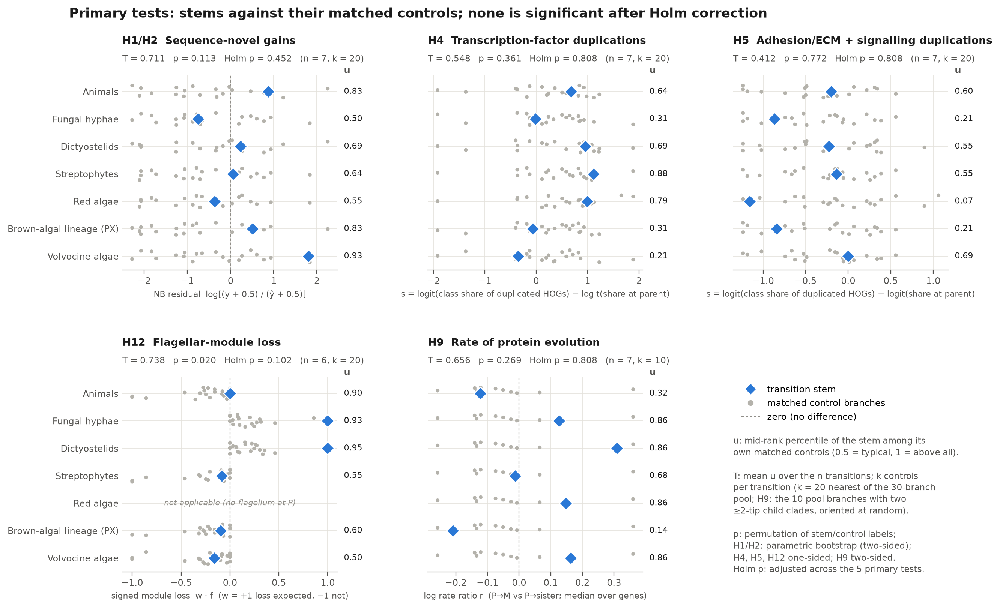
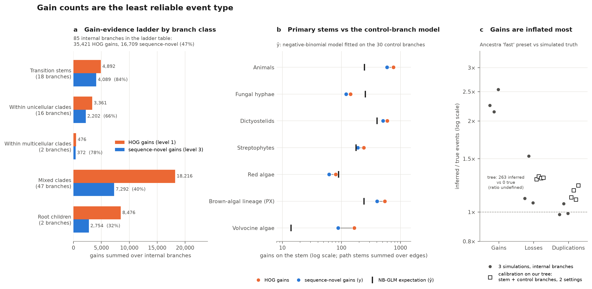
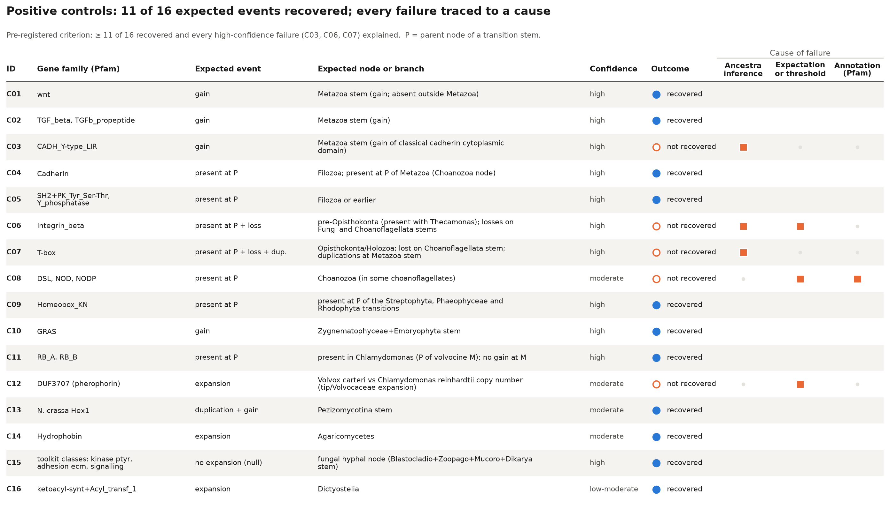
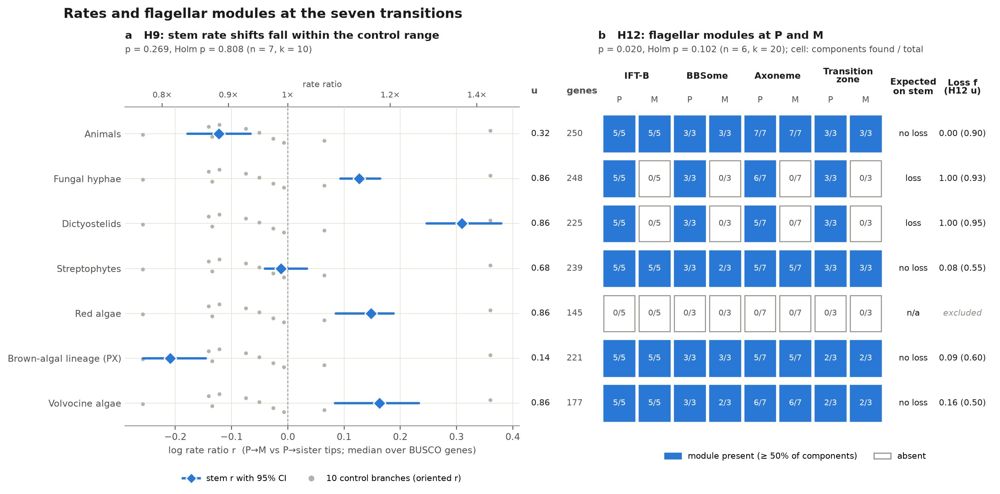
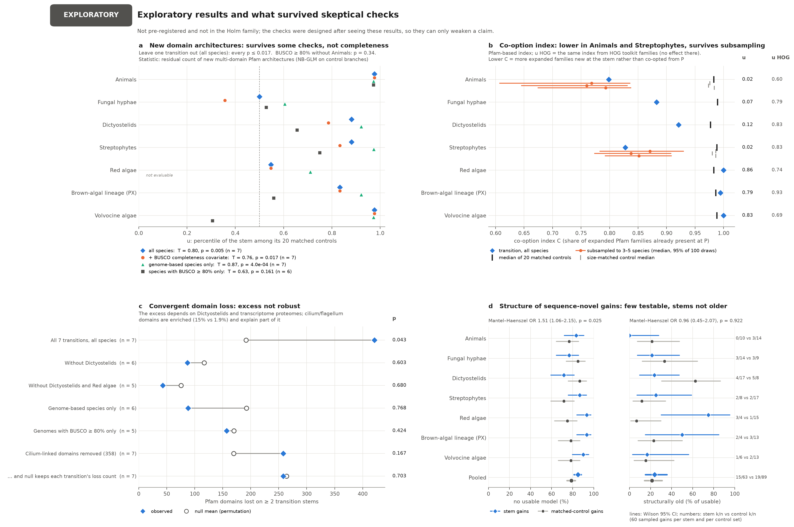
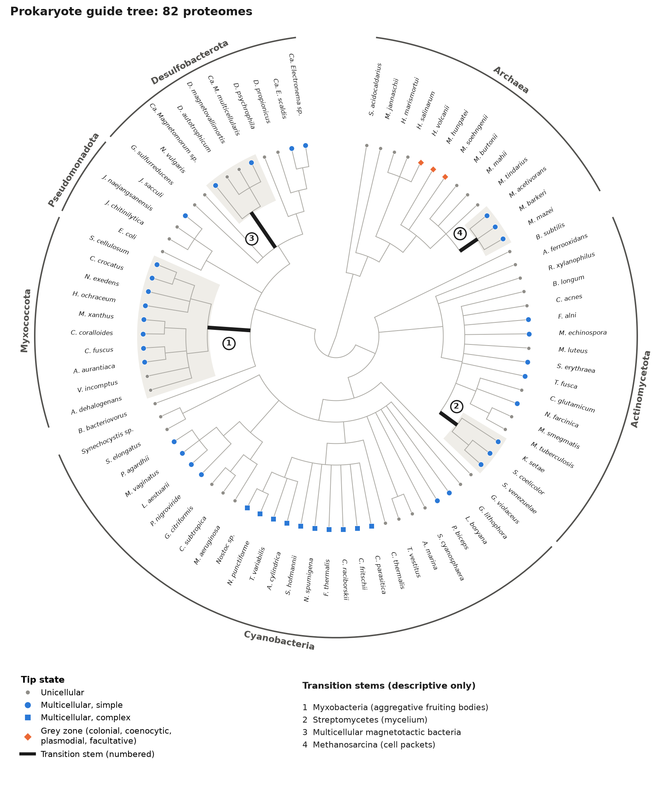

# Seven independent origins of multicellularity, one pipeline: a pre-registered, agent-run reconstruction of ancestral gene content

(Human-written text starts)
This is an exercise in assessing the bioinformatics capabilities of agentic AI. It is part of a hackathon run by the Beltrao lab at ETH Zurich, where we used Claude to run bioinformatics projects (LINK). All results in this project were generated entirely by AI with minimal human intervention. This is not intended to be viewed as a traditional publication.

[Project-specific text] The goal of this specific project was to investigate multicellularity across the tree of life. It was executed by Claude Opus 5.5 with delegation to Opus 5.5/Sonnet 5.5 subagents, and finished within 24 hours on a computational cluster with 24 cpus, 150GB RAM. if needed, the user will be able to switch the node to a node with a A100 GPU in the future, but at the moment do not rely on it.

Currently none of the results have been verified by a human. We plan to verify the agent’s methodology and benchmarking, and we will update this section accordingly.

The rest of this repository is entirely AI generated. It includes code for implementation of the predictive model and a AI-written report in the style of a journal article, detailing the final method, the path followed to reach it, and benchmarking against other methods.
(Human-written text ends)

---

## Abstract

Multicellularity evolved many times independently. Do the origins share genomic changes? AI agents ran a pre-registered comparison of seven eukaryotic origins: animals, fungal hyphae, dictyostelid slime moulds, streptophyte algae (the lineage that includes land plants), red algae, the brown-algal lineage and volvocine green algae. Ancestra, a new method for reconstructing the gene content of ancestral species, was applied to 2.97 million proteins from 187 species. <!-- src: DATA.md; data/transitions.tsv --> Each transition branch was compared with its 20 most similar branches from a pool of 30 branches inside unicellular lineages. Before any gene-content result, two problems with the method were found and accounted for. The planned null distribution was anti-conservative: it called 13.8% of no-effect datasets significant at a nominal 5%. And inferred gene gains were inflated 2.1–2.6-fold on simulated genomes; one simulation on our own tree suggested that transition branches may carry about twice as many spurious gains as control branches. <!-- src: results/validation_branchstats/null_calibration.tsv; results/validation_hogparser/metrics.tsv; results/calibration_tree/summary.md -->

None of the five primary tests (novel genes, transcription-factor duplications, adhesion/signalling duplications, flagellar loss, protein evolutionary rate) was significant after correction for multiple testing (smallest corrected p = 0.10). <!-- src: results/primary/euk/holm.tsv --> The gene-content tests could detect only large effects. They needed roughly a 2.2–2.8-fold change in the share of regulatory or adhesion genes among duplications, and a 2.4- to 6-fold excess of new genes, with our data near the less favourable end. The two duplication tests also depend on duplication timing, which the positive controls showed to be unreliable; orthology-free versions gave the same result. <!-- src: results/prereg/power_table.tsv; results/robustness/h4h5/summary.md --> The rate test had the most statistical power. Averaged over the seven transitions, conserved proteins did not evolve 1.5-fold faster or slower on the multicellular side (pooled rate ratio 1.10, 95% CI 0.96–1.26), although individual transitions ranged from 0.81 to 1.36. A within-protein measure of relaxed constraint showed no consistent shift. <!-- src: results/h9/summary.md; results/h9/h9_transitions.tsv; results/krkc/summary.md --> In every lineage, 80–100% of the protein-domain families that expanded in the multicellular clade were already present in its unicellular ancestor. The same measure is 98–99% on comparable unicellular branches, so a high value is expected for any branch and does not by itself favour co-option. <!-- src: results/exploratory/euk/summary.md §2 (pfam_expanded C and median_C_controls 0.977–0.990) --> The clearest convergent loss was the flagellum, in fungi and dictyostelids, where it was expected. A broader excess of convergently lost domains did not survive removal of dictyostelids or of transcriptome-based proteomes. <!-- src: results/primary/euk/per_transition_H12.tsv; results/robustness/exploratory/summary.md §1 -->

Ancestra recovered 11 of 16 expected events. Its failures show that gene origins and duplication timing are unreliable at deep nodes for large multi-domain families. <!-- src: results/positive_controls/euk/summary.md; results/positive_controls/euk/failure_diagnosis.md --> In this project, a shared genomic signature of multicellularity was not detected. Settling the "burst of novelty" debate will require better reconstruction of gene origins at deep nodes, not only more genomes.

---

## 1. Why this question

**Multicellularity evolved many times, independently, in very different organisms. Each origin is a natural experiment. If the same genomic changes recur at independent origins, they point to what a multicellular lifestyle requires; if they do not, the origins took different routes.** This project asks what changed in gene content, and in the rate of protein evolution, on the branches of the tree of life where multicellularity appeared, and whether those branches differ from comparable branches where it did not.

### What "multicellular" means

Multicellularity is not one trait but a set of separable properties (see the project's literature review, Supplementary File 1):

- **Clonal vs aggregative.** In *clonal* multicellularity, daughter cells stay attached after division, so all cells descend from one cell and share its genotype (animals, plants, *Volvox*). In *aggregative* multicellularity, free-living cells, which may differ in genotype, come together, as in the fruiting bodies of the social amoeba *Dictyostelium* (Grosberg & Strathmann 2007; Brunet & King 2017). Passing through a single cell limits conflict between cell lineages (Grosberg & Strathmann 2007), and species with clonal group formation were more likely to have become obligately multicellular (Fisher, Cornwallis & West 2013).
- **Facultative vs obligate.** A *facultative* multicellular organism forms groups only under some conditions (starvation in dictyostelids); an *obligate* one is multicellular throughout its life. Márquez-Zacarías et al. (2021) note that all known aggregative organisms are facultative.
- **Simple vs complex.** Knoll (2011) reserves *complex* multicellularity for organisms with differentiated tissues and cell-to-cell channels, and restricts it to six groups: animals, land plants, florideophyte red algae, laminarialean brown algae and two groups of fungi; Nagy, Kovács & Krizsán (2018) count 8–11 complex origins within fungi. Filaments, colonies and simple sheets are *simple*.
- **Grey zones.** Many organisms sit between categories: cells joined by cytoplasmic bridges after incomplete division (Chaigne & Brunet 2022), *coenocytes* (single cells with many nuclei) and facultative colonies such as choanoflagellate rosettes. Queller & Strassmann (2009) treat "organismality" as a continuum.

We coded these properties separately for each species and origin, and kept grey-zone cases out of the main tests (Section 3).

### How many origins?

Lamża (2023) counts 45 independent lineages of simple multicellular eukaryotes and estimates the true number is close to a hundred; complex multicellularity is much rarer. Several bacterial lineages are multicellular (Claessen et al. 2014); archaeal cases are rare (Rados et al. 2025). Only a few origins have genome data on both sides of the transition with enough relatives to test against: animals, fungi, dictyostelids, volvocine algae, streptophytes, red algae and brown algae.

### Competing ideas about the genomic basis

Four ideas from the literature frame our tests:

1. **Co-option.** Most genes later used for multicellular life already existed in the unicellular ancestor and were re-used. The choanoflagellate *Monosiga brevicollis* has cadherins and tyrosine kinases (King et al. 2008; Abedin & King 2008; Manning et al. 2008); the integrin adhesion machinery predates the split of animals and fungi and was later lost in fungi and choanoflagellates (Sebé-Pedrós et al. 2010); about 80% of the proteins essential for dictyostelid development are present in their unicellular relatives (Glöckner et al. 2016); *Volvox* and unicellular *Chlamydomonas* have similar protein-coding potential (Prochnik et al. 2010); and fungal hyphae arose mainly by co-opting ancient genes, together with some new gene families, and without expansions of kinases, receptors or adhesive proteins (Kiss et al. 2019).
2. **A burst of novelty.** Paps & Holland (2018) describe "an unprecedented increase in the extent of genomic novelty" at the origin of animals; Bowles et al. (2020) find two bursts of novelty in the plant lineage; Denoeud et al. (2024) find a marked gain of new gene families in brown algae. Such estimates depend on sampling: adding 19 choanoflagellate transcriptomes moved about 372 supposedly animal-specific families to before the animal–choanoflagellate split (Richter et al. 2018).
3. **Expansion of a "toolkit".** Transcription-factor families (de Mendoza et al. 2013; Lang et al. 2010), adhesion and extracellular-matrix families (Knoll 2011) and signalling families such as receptor kinases (Cock et al. 2010) are proposed to expand repeatedly at transitions; Pereira Lobo et al. (2025) found shared functional themes across 81 eukaryotes, for complex lineages. A related idea is that unicellular functions such as the flagellum are lost; for fungi, Merényi et al. (2023) describe early evolution as a "gradual shedding of protist genes" rather than an abrupt loss at one node.
4. **Relaxed selection through drift.** Larger organisms have smaller effective population sizes, so selection is weaker relative to chance (genetic drift) and slightly harmful genomic changes accumulate (Lynch & Conery 2003; Lynch 2007). Bingham & Ratcliff (2024) extend this to multicellularity: groups of cells that reproduce through genetic bottlenecks have reduced effective population sizes, and snowflake-yeast experiments show more drift in clonal than in aggregative groups (Pentz et al. 2023). We found no genome-wide test of this across independent origins.

What has been missing is one pipeline, run on many origins at once, that compares each origin with comparable non-origin branches. Ancestra, a new scalable method for reconstructing ancestral gene content, makes this feasible. The transitions were defined from the literature before any analysis; they are inputs, not findings.

---

## 2. How the work was organised

**AI agents ran the project. The design was reviewed three times and frozen before any eukaryote result existed. The reviews changed the design substantially, and two of the most consequential problems were found by the agents' own checks before the results, not after.**

### Agents, timeline and the research record

A principal-investigator (PI) agent (Claude Opus 5.5) planned the work, delegated to subagents (Opus 5.5 or Sonnet 5.5), reviewed their output and made the decisions. Subagents wrote the literature review, built the dataset, wrote and tested each analysis module, and acted as reviewers. The PI kept a *research tree*, a status list of every analysis with a dated decision log that also served as its memory (Supplementary File 5).

The project started at 12:21 CET on 28 October 2026. The eukaryote Ancestra run finished at 22:36 the same day, all primary tests were complete at 00:55 on 29 October (about 12.5 hours after the start), and this report was finalised at about 02:00 on 29 October, about 13.5 hours after the start. <!-- src: START.txt (2026-10-28T12:21:22+01:00); results/verification/verification_report.md check 6 (DONE 22:36:41); git log (00:55:22 primary family complete; 01:29 report draft; last commit before revision 01:38); revision written 01:39–02:00 -->

The literature review came first: about 9,000 words, 249 references each looked up by tool rather than recalled, and 16 testable hypotheses. <!-- src: RESEARCH_TREE.md M1 -->

### Three rounds of design review

<!-- src: reviews/round1-3/*.md; DESIGN.md §9; reviews/round3/prereg_audit.md F1/F2 -->
Three rounds of review by agent reviewers (an external PI, an evolutionary biologist, a statistician, a data/compute expert and an AI-failure-modes expert) reshaped the design. Gains had to pass a novelty filter, because simulations showed raw gains inflated about 2-fold. Transitions were recoded as changes between states, which turned budding yeasts and zygnematophyte algae into reversals and gave volvocines two origins (Lindsey et al. 2021). Branches were split into three classes (transition stems, inside multicellular clades, inside unicellular lineages). Each test received a power table before any data were seen. Two mis-specified transitions (volvocines, fungal hyphae) were redefined as two-branch "path stems" (Section 3). Horizontal gene transfer and site-level convergence were dropped for time.

### Pre-registration and deviations

Before any eukaryote Ancestra output existed, the design, transitions, guide trees, species sets, control definitions, gene lists and power table were frozen; the 15 files were hashed, and every analysis script refuses to run if a hash changes. <!-- src: PREREG.md; PREREG_HASHES.tsv (15 entries) --> Later changes are dated deviations, all made before any eukaryote gene-content result existed. The second to fourth were made after Ancestra's first (family-building) stage had finished but before its output was parsed. They were also made after the rate test, which does not use Ancestra, had been run. They concern only the novel-gene test and the gain-evidence ladder. <!-- src: PREREG.md Clarification (2026-10-28 20:09) and Correction (2026-10-29 01:18); git log -->
- **Deviation 1 (14:29):** the novel-gene test uses a parametric-bootstrap null, because permuting regression residuals was anti-conservative (Section 4.3).
- **Deviation 2 (18:19):** the novelty search used a faster DIAMOND setting (99.65% of the slowest setting's hits on 500 real proteins, at a third of the cost), run only on the branches the tests use, identically for stems and controls. <!-- src: PREREG.md Dev-2; results/gainladder/diamond_timing.json -->
- **Deviation 3 (18:19):** a planned "split-repair" step failed its pre-registered acceptance test on simulations and was dropped (Section 4.2). This was a test outcome, not a choice.
- **Deviation 4 (19:47):** an interpretation threshold for a "burst of novelty" (Section 6.1).

### Verification

Every module was tested on toy data with known answers before use, and independent agents reviewed code and inputs. <!-- src: docs/branchstats.md --> An agent that had not produced the results later re-derived the headline numbers from raw files (Section 7.3). Another audited 48 claim–citation pairs against abstracts and, where available, full texts: 39 were supported, and the other 9 are reworded in this version. <!-- src: report/citation_audit.txt Part 2 summary (39 S, 8 P, 1 C) --> All verifying agents were Claude subagents, not humans.

---

## 3. Data

**We assembled 187 eukaryotic and 82 prokaryotic proteomes (the full set of predicted proteins of a species) and placed them on literature-curated species trees. We coded 52 candidate transitions, of which 7 independent eukaryotic origins met a pre-registered rule for the primary tests (Figure 1).** <!-- src: DATA.md; data/transitions.tsv (52 rows) -->

*Figure 1. The eukaryote guide tree, its 187 proteomes and the seven primary transitions.* Branch order only; branch lengths are not drawn. Tip symbols give each species' state: unicellular (grey circle), simple multicellular (blue circle), complex multicellular (blue square), grey zone such as colonial, coenocytic, plasmodial or facultative forms (orange diamond), and reversal to unicellularity (green triangle). An asterisk marks the 36 proteomes derived from transcriptomes. Thick black segments are the stems (P → M) of the seven primary transitions, numbered as in Table 1; stems 2 (fungal hyphae) and 7 (volvocine algae) are two-branch path stems. Shading marks each multicellular crown clade M; outer arcs label major clades.

### Proteomes

| domain | source | species | proteins |
|---|---|---|---|
| eukaryotes | UniProt reference proteomes 2026_03 (UniProt Consortium 2025) | 112 | 1,629,372 |
| | EukProt v3 (Richter et al. 2022) | 59 | 1,060,055 |
| | NCBI annotations (incl. Phaeoexplorer brown algae) | 12 | 217,918 |
| | LukProt v1.5.1 (Sobala 2024) | 4 | 61,916 |
| | **total** | **187** | **2,969,261** |
| prokaryotes | UniProt 2026_03 | 75 | 366,790 |
| | NCBI annotations | 7 | 38,874 |
| | **total** | **82** | **405,664** |
<!-- src: DATA.md summary table; data/DATASET_DONE.json -->

Species were chosen to cover both sides of each documented origin. All sources are openly licensed; a script re-creates the dataset, and the data manifest (Supplementary File 4) lists every file's source, version, checksum and licence.

**Preparation.** Ancestra expects one protein per gene, so splice variants were collapsed. Thirty-six eukaryotic proteomes come from *transcriptomes* (sequenced messenger RNA), which miss unexpressed genes and contain fragments and near-duplicates; these were reduced to the longest open reading frame per gene and clustered at 95% identity with cd-hit (Fu et al. 2012). Proteins under 50 amino acids were removed. <!-- src: DATA.md "Processing"; DATASET_DONE.json n_transcriptome 36 -->

**Completeness.** BUSCO (Manni et al. 2021) measures the share of near-universal single-copy genes found in a proteome. Median completeness is 84.7% for eukaryotes and 97.6% for prokaryotes. <!-- src: results/qc/busco_medians.tsv (scripts/report/busco_medians.py) --> Five eukaryotic proteomes below 50% were kept but flagged as low quality: *Tetrabaena socialis* 32.2%, *Coleochaete scutata* 45.9%, *Porphyra umbilicalis* 43.9%, *Discosporangium mesarthrocarpum* 45.9% and *Guttulinopsis vulgaris* 11.8%. <!-- src: DATA.md "QC flags" -->

**Memory cap.** To fit 150 GB of memory, ten optional, non-essential species were dropped by a pre-written rule (e.g. *Trichomonas vaginalis*), capping the set at 2.97 million proteins. <!-- src: DATA.md cap section; data/species_cap_drops.tsv -->

### Guide trees

Ancestra and every test need a fixed rooted species tree. We edited the NCBI taxonomy to current phylogenomic consensus with 62 logged operations, each with rationale and reference. Contested relationships were left unresolved (25 nodes with more than two branches, including the order of sponges, comb jellies and other animals). The root lies between the group of animals, fungi, amoebozoans and their relatives and all other eukaryotes; alternative roots affect only backbone branches, not transition branches. <!-- src: data/guide_tree_edits.md -->

Branch lengths (substitutions per site) were estimated on this fixed topology from 250 BUSCO marker genes, each aligned with MAFFT (Katoh & Standley 2013) and trimmed with trimAl (Capella-Gutiérrez et al. 2009), and fitted with IQ-TREE 3.1.4 (Wong et al. 2026). Branch lengths serve as covariates and for the rate test; they never change which branch is a transition. <!-- src: results/phylo/summary.md; notes.md (64,727 columns, LG+G4) -->

### Transitions

Each transition is a **state change** between unicellular, simple and complex, with type labels (clonal/aggregative; obligate/facultative). **M** is the most recent common ancestor of the sampled species in the new state (the *crown*); **P** is the last sampled ancestor in the prior state. The branch from P to M is the **transition stem**: where the change must have happened. When P and M are two branches apart, both branches form a *path stem*. <!-- src: data/species_traits.tsv -->

A transition is primary only if M is an internal node; at least two sampled species are in the new state and at least two in the sister lineage, not counting low-quality proteomes; and the state is not grey-zone. <!-- src: DESIGN.md §2; scripts/prereg/apply_eligibility.py -->

Seven eukaryotic origins qualify (Table 1). Seven further transitions are secondary: three nested simple→complex ones (fruiting bodies of Pezizomycotina and Agaricomycetes fungi, and land plants) and four prokaryotic ones (myxobacteria, streptomycetes, multicellular magnetotactic bacteria, *Methanosarcina*; Figure S1). Six reversals serve as converse tests, 30 transitions are exploratory, and 2 lack data. <!-- src: data/transitions.tsv analysis_set: euk primary 7, secondary 3, reversal 6, exploratory 22, excluded 2; prok secondary 4, exploratory 8 -->

**Table 1. Primary transitions** (species: sampled in the multicellular clade / its sister lineage)

| # | transition | stem P → M | type | species | notes |
|---|---|---|---|---|---|
| 1 | Animals | choanozoans → animals (Metazoa) | clonal, complex, obligate | 15 / 8 | sisters partly transcriptomes |
| 2 | Fungal hyphae | true fungi → (blastoclads + non-flagellate fungi) → non-flagellate fungi (Amastigomycota) | hyphal, simple, obligate | 26 / 4 | path stem |
| 3 | Dictyostelids | Eumycetozoa → Dictyostelia | aggregative, simple, facultative | 6 / 2 | both sisters transcriptomes |
| 4 | Streptophytes | Streptophyta → Klebsormidiophyceae + Phragmoplastophyta | clonal, simple, obligate | 9 / 2 | contains 3 unicellular reversals |
| 5 | Red algae | Rhodophytina → Eurhodophytina (red algae excluding the unicellular Cyanidiophyceae and other early-branching unicellular lineages) | clonal, simple, obligate | 5 / 2 | the crown node rests on two incomplete Bangiales proteomes (e.g. *Porphyra*, 44% complete) |
| 6 | Brown-algal lineage | ochrophyte algae → PX clade (brown algae, yellow-green algae and relatives) | clonal, simple, obligate | 9 / 6 | P unresolved |
| 7 | Volvocine algae | *Chlamydomonas* + TGV → TGV clade (Tetrabaenaceae–Goniaceae–Volvocaceae) → *Gonium* + Volvocaceae | clonal, simple, obligate | 5 / 3 | path stem |
<!-- src: data/transitions.tsv (label, stem_path, type, n_mc_species, n_sister_species, flags); red-algae note: reviews/round3/prereg_audit.md §1; Porphyra BUSCO 43.9% DATA.md -->

---

## 4. Methods

**The core idea is simple: reconstruct which genes existed at every ancestor, count gene gains, losses and duplications on every branch, and ask whether transition stems stand out against comparable branches where multicellularity did not arise. Most of the effort went into making that comparison fair (Figure 2).**

*Figure 2. Workflow.* (1) Proteomes, guide trees and the transitions table were frozen and hashed, with the design, test specifications and power table, before any eukaryote output existed. (2) Ancestra reconstructs hierarchical orthologous groups (HOGs), which a parser turns into per-branch gains, losses and duplications. Gains are ranked on a gain-evidence ladder because raw HOG gains were inflated 2.1–2.6-fold on simulations. Pfam domains and predicted disorder annotate proteins; 250 BUSCO marker genes give branch lengths and gene trees. (3) Seven primary stems are compared with matched control branches in four gene-content tests and one rate test, with Holm correction across the five. Secondary and exploratory analyses (dashed box) are labelled as such.

### 4.1 Ancestral gene content with Ancestra

**Ancestra** is a recently developed method, itself built by AI, for *orthology inference*: deciding which genes in different species descend from the same ancestral gene. It groups all proteins into families of related sequences with DIAMOND (Buchfink et al. 2021), scores similarity within families, and walks the guide tree from tips to root, merging the genes of descendant lineages into ancestral genes.

Each ancestral gene at a node, with all its descendants, is a **hierarchical orthologous group (HOG)**: one inferred gene of that ancestor. The approach builds on earlier bottom-up methods for HOGs: SYNERGY (Wapinski et al. 2007), Hieranoid (Schreiber & Sonnhammer 2013), and OMA and FastOMA (Altenhoff et al. 2013; Majidian et al. 2025). Ancestra's benchmarks were dominated by animals and fungi; its behaviour on deep, protist-rich trees was untested. We ran it separately for eukaryotes and prokaryotes. <!-- src: DESIGN.md §3.2; RESEARCH_TREE.md D0, D3; scripts/run_ancestra.sh -->

**From HOGs to events.** A parser converts HOGs into per-branch **gains** (a HOG first appearing on the branch), **losses** (an ancestral gene present at the upper node and absent at the lower one) and **duplications** (one ancestral gene becoming two). On simulated data with known HOGs, it reproduced the true events exactly. <!-- src: results/validation_hogparser/summary.md (a) -->

### 4.2 Why raw gains are inflated, and the gain-evidence ladder

**Ancestra's gains cannot be taken at face value; losses and duplications can, with caveats.** On three simulations with Ancestra's own simulator, inferred losses were within 8–25% of the true totals and duplications within 2–14% (losses on internal branches were inflated 1.5-fold in one high-turnover simulation). Gains were inflated 2.1–2.6-fold in every simulation (2.1–2.5-fold on internal branches), because Ancestra sometimes splits one true family into several HOGs at deep nodes: for 6–11% of genes the inferred family origin was too young, and spurious gains concentrated on long branches near the root. <!-- src: results/validation_hogparser/metrics.tsv (fast preset; gene_level origin_too_young 0.065–0.114); summary.md (b) --> This bias favours exactly the misleading headline anticipated in review, because transition stems are long, deep branches.

Every gained HOG was therefore ranked on a pre-registered **gain-evidence ladder**:
1. **HOG gain**: the raw call; an upper bound, never a headline.
2. **Sequence-novel gain** (primary): no representative protein (up to three per HOG) has a DIAMOND hit (E ≤ 10⁻⁵, query coverage ≥30%) to a protein outside the clade among all 269 proteomes. <!-- src: DESIGN.md §3.2; PREREG.md Dev-2 -->
3. **Architecture-novel gain** (secondary): the HOG's ordered combination of Pfam domains is absent outside the clade.

A planned step that re-joined split HOGs to their older parent family left simulated inflation at 2.12–2.54-fold, against a required ≤1.3-fold, and was dropped (Deviation 3). <!-- src: results/gainladder/validation_sim/summary.md §1 -->

The novelty filter is not a cure. On simulations it kept 91–97% of true gains, but only 42–56% of its "novel" calls were real, because the simulator lets about a third of families diverge beyond detection (4.6–4.9 substitutions per site). This is probably pessimistic, but novel-gain counts remain upper bounds, reflecting the homology-detection failure that Weisman et al. (2020) showed explains many, but not all, lineage-specific genes. Conclusions rest on comparing stems and controls under the same filter, never on absolute counts. <!-- src: results/gainladder/validation_sim/summary.md §2–3 -->

### 4.3 Branch-level statistical design

**Unit and comparison.** The unit is a branch. Each primary stem is compared with a **control pool** of 30 branches that are unicellular at both ends and inside unicellular lineages, have at least two descendant species on each side, and are neither children of the root nor adjacent to any stem.  <!-- src: DESIGN.md §4.6; docs/branchstats.md -->

**Matching.** Longer branches accumulate more events, branches above many species collect more gains, and branches whose relatives are transcriptomes gain spuriously from genes missed there. For each stem, the 20 controls closest in depth, branch length, numbers of descendant and sister species, and transcriptome fractions are chosen (by Mahalanobis distance, which standardises each property and accounts for their correlations). Matching is poor: stems are deeper than controls by 1.77 control standard deviations. <!-- src: RESEARCH_TREE.md D6; results/primary/euk/smd.tsv -->

**One statistic per test.** Each stem's value is ranked among its 20 matched controls, giving a **percentile u** between 0 and 1 (0.5 = typical; 1 = above all controls). The test statistic **T** is the mean percentile over the seven stems, so every transition weighs equally. Codes such as H4 refer to the numbered hypotheses of the pre-registration; H1 (co-option) and H2 (burst of novelty) are the two directions of one two-sided test. In the text we use the names in the first column.

| test (code) | question | branch statistic | direction |
|---|---|---|---|
| novel-gene test (H1/H2) | co-option vs burst of novelty | sequence-novel gains, as residual from a negative-binomial regression fitted on controls | two-sided |
| TF-duplication test (H4) | transcription-factor expansion | share of stem-duplicated HOGs carrying a TF DNA-binding domain, vs the share among genes present at the branch start | one-sided |
| adhesion/signalling test (H5) | adhesion/extracellular-matrix and signalling expansion | as above, for adhesion/ECM + signalling domains | one-sided |
| rate test (H9) | rate shift | median over marker genes of log(distance P→M tips / P→sister tips) (Section 4.5) | two-sided |
| flagellum test (H12) | flagellar loss where expected | fraction of four flagellar modules lost, signed by a pre-set direction | one-sided |
<!-- src: PREREG.md primary family; DESIGN.md §4.6 -->

The domain list of the duplication tests (110 Pfam families, including plant, algal and other non-animal adhesion families so as not to favour animals) and the four flagellar modules (axoneme, intraflagellar transport, BBSome, transition zone) were frozen in advance. Flagellar loss is expected only on the fungal-hyphae and dictyostelid stems; red algae are excluded because their flagellum was lost before the stem. <!-- src: data/toolkit_pfam.tsv (110 rows); data/h12_sets.tsv; data/h12_expected_direction_frozen.tsv -->

**Gains as a regression residual.** Because matching is poor, raw gain counts would mostly measure depth. For the novel-gene test, a *negative-binomial regression* (a regression for over-dispersed counts) fitted on controls only predicts sequence-novel gains from branch length, species numbers and transcriptome fraction; a branch's statistic is log(observed/predicted). <!-- src: DESIGN.md §4.6 v3.1 -->

**Null distributions.** A p-value needs a *null distribution*: the statistic's values when nothing special happens on the stems. The planned null, relabelling random controls as transitions, rejected 13.8% of null datasets at a nominal 5% because the seven stems share controls; a test that rejects more often than its nominal level is *anti-conservative*. We therefore permute values over stems and controls jointly (5.1% at a nominal 5%). For the novel-gene test, permutation was itself anti-conservative because our stems lie outside the controls' range of branch properties (8.3–28.3%), so a *parametric bootstrap* is used: counts are simulated from the control fit, the model refitted and the statistic recomputed (4.0–5.3%; Deviation 1). <!-- src: results/validation_branchstats/null_calibration.tsv; docs/branchstats.md -->

**Multiple testing and effect sizes.** The five primary p-values are Holm-corrected (Holm 1979): the smallest p is multiplied by 5, the next by 4, and so on, which keeps the chance of any false positive among the five tests at 5%. Effects are pooled over transitions with a *random-effects* average (a weighted mean that allows the true effect to differ between transitions), with leave-one-out checks. Non-significant results are worded "not detected at this power"; "no ≥1.5-fold effect" is used only if the confidence interval lies within 0.67–1.5. All other analyses are exploratory, logged in an analysis registry and labelled. <!-- src: DESIGN.md §4.6, §7; power_table.tsv -->

**Power, stated before results.** With seven stems and 30 controls only large effects are detectable (80% power, α = 0.05; effects planted on the real tree):

| test | minimum detectable effect | power at 1.5-fold |
|---|---|---|
| novel-gene (H1/H2) | 2.4-fold (moderate over-dispersion) to 5.9-fold (high) | 0.35 / 0.13 |
| TF-duplication (H4) | odds ratio 2.8 | 0.28 |
| adhesion/signalling (H5) | odds ratio 2.2 | 0.35 |
| rate (H9) | rate ratio 1.26 (low gene noise) to 1.69 (high) | 1.00 / 0.66 |
| flagellum (H12) | not reached (power ≤0.33 even with complete loss) | — |
<!-- src: results/prereg/power_table.tsv; docs/branchstats.md -->

In plain words, only the rate test is sensitive; the gene-content tests cannot see the subtler differences the literature debates. The flagellum test cannot reach 80% power at all; it stayed primary because the pre-registered rule required two loss-expected stems, not adequate power.

### 4.4 Annotation

All proteins were annotated with Pfam-A 38.2 domains (Mistry et al. 2021; Paysan-Lafosse et al. 2025) using pyhmmer 0.12.3 (Larralde & Zeller 2023), a binding to HMMER3 (Eddy 2011), and with predicted *intrinsic disorder*, the fraction of residues lacking a stable fold, by metapredict 3.1 (Emenecker et al. 2021; Lotthammer et al. 2024, preprint). A HOG belongs to a domain class if at least half its members carry a class domain. The domain-class tests used a pre-registered subset of Pfam models; the domain-wide and architecture analyses used all of Pfam. <!-- src: DATA.md; data/annotations/*/*.DONE.json -->

### 4.5 Rate of protein evolution

If multicellular lineages experience more drift, their proteins should evolve faster on average. For each of 250 marker genes, IQ-TREE fitted a gene tree on the pruned guide tree, and we took the log ratio of the mean path length from P to multicellular tips over that from P to sister tips; comparing two lineages from the same ancestor cancels changes before P. The transition's value is the median over genes. Controls are the 10 control-pool nodes with two descendant clades of ≥2 species; a control has no "multicellular side", so which clade goes in the numerator is assigned at random. <!-- src: DESIGN.md §4.6 H9; results/h9/summary.md (methods) --> A difference is a **rate shift**, not proof of relaxed selection: generation time and mutation rate also change rates, and the measure covers all evolution after P. Relaxed constraint needs a within-protein contrast, such as radical vs conservative amino-acid changes, and a gene-by-gene analysis in the style of RERconverge (Chikina et al. 2016; Kowalczyk et al. 2019); both were exploratory.

### 4.6 Structure (exploratory)

Sequence searches miss distant relatives that share a fold. For sequence-novel gains with a confident AlphaFold model (Jumper et al. 2021; AlphaFold DB, Varadi et al. 2024, release v6; mean predicted confidence, pLDDT, ≥70), Foldseek (van Kempen et al. 2024) searched against models of the proteomes of the unicellular relatives and against 590,183 Swiss-Prot models outside the clade. A gain is "structurally old" with a hit at E ≤ 10⁻³ and TM-score ≥0.5, which generally indicates the same fold (Xu & Zhang 2010). Control-branch gains get the same treatment. <!-- src: docs/STRUCTURE_DATA.md -->

### 4.7 Controls and reproducibility

Sixteen eukaryotic and two prokaryotic **positive controls** were frozen with explicit pass rules: events the literature firmly expects, such as a Wnt-family gain on the animal stem. The pipeline passes if ≥11 of 16 eukaryotic controls are recovered and every high-confidence failure is explained. <!-- src: data/positive_controls.tsv; PREREG.md --> Every test is appended to an analysis registry, so the total number of tests is known. <!-- src: DESIGN.md §7 -->

---

## 5. Limitations known before the results

- **Few origins, low power.** Seven stems and 30 controls give 13–35% power for a 1.5-fold gene-content difference; flagellar-loss power never reaches 80%. Most negative results will be inconclusive. <!-- src: power_table.tsv -->
- **Stems are unlike controls** (deeper by 1.77 standard deviations), and gains are noisy; the regression, the bootstrap and the novelty filter correct this only as far as their models are right.
- **Uneven data quality.** Transcriptomes dominate some sister lineages (both dictyostelid sisters; part of the choanoflagellates). Two stems end in clades represented through low-quality proteomes (*Porphyra* for red algae; *Tetrabaena* on the volvocine path). Missed genes in sisters inflate stem gains; missed genes in the clade deflate them.
- **The tree is fixed.** One root and literature-based edits; polytomies remain; alternative trees were not run.
- **Ancestra is new**, AI-developed and benchmarked mainly on animals and fungi.
- **Rate-test controls are mixed.** Only 10 control nodes qualify, and in 9 of them one descendant clade contains multicellular species. <!-- src: results/h9/summary.md -->
- **Labels come from the literature.** Transitions, toolkit lists and positive controls come from the same literature the results are compared with, so some agreement is built in.
- **Proteins only.** Regulatory change, which much of the literature emphasises, is invisible here.

---

## 6. Results

**None of the five pre-registered tests found a feature shared by the seven origins once corrected for multiple comparisons (Figure 3). <!-- src: results/primary/euk/holm.tsv --> The design could only detect large effects, so most results mean "not detected at this power", not "absent". The genome-wide rate of protein evolution, the one quantity measured precisely, did not shift by 1.5-fold or more on average. <!-- src: results/prereg/power_table.tsv; results/h9/summary.md --> The most informative findings concern where Ancestra's reconstructions of deep ancestors can and cannot be trusted.**

*Figure 3. Primary tests: no test is significant after Holm correction.* Each panel is one pre-registered test; each row one primary transition. Grey dots: the transition's matched control branches (20 of the 30-branch pool; for the rate test, the 10 pool branches with two child clades of at least two species, oriented at random). Blue diamond: the stem. u: the stem's percentile among its own controls (0.5 = typical, 1 = above all). T: mean u; p from permutation (parametric bootstrap for the novel-gene test); Holm p adjusted across the five tests. Statistics: novel-gene test (H1/H2), regression residual of sequence-novel gains; TF (H4) and adhesion/signalling (H5) tests, log-odds (logit) of the class share among stem duplications minus that at the parent node; flagellum test (H12), signed fraction of four flagellar modules lost (red algae excluded, n = 6); rate test (H9), median per-gene log rate ratio.

### 6.1 What Ancestra produced on 187 eukaryotes, and how far it can be trusted

**Ancestra reconstructed ancestral gene content for 2.97 million eukaryotic proteins in about 9 hours and recovered 11 of 16 expected events, exactly the pre-registered threshold. The failures show that gene-family origins and duplication timing are unreliable at deep nodes for large multi-domain families.** <!-- src: RESEARCH_TREE.md item 5c; results/positive_controls/euk/summary.md -->

**Scale.** The eukaryote run took about 9 h (peak memory 84 GB) and placed 2.22 million of the 2.97 million proteins (75%) in HOGs; the other 750,000 remained *singletons* without an inferred relative in another species. <!-- src: RESEARCH_TREE.md item 5c; results/ancestra_runs/euk_fast (2,219,024 genes in groups, 750,237 singletons) --> An independent agent re-parsed the raw output with its own code and obtained identical event counts on six test branches (the animal stem has 760 gains, 11,593 losses and 5,677 duplications). <!-- src: results/verification/verification_report.md check 1 -->

**The giant component.** Linking proteins by sequence similarity joined 2.16 million eukaryotic proteins (73%) into one connected group, presumably because multi-domain proteins bridge unrelated families. Ancestra cut it with the Leiden community-detection algorithm (Traag et al. 2019) into families of at most about 7,500 proteins, so in large superfamilies (kinases, transcription factors, adhesion proteins) family boundaries are partly set by where the algorithm cuts, and each artificial boundary can make an old gene look new on a deep branch. <!-- src: RESEARCH_TREE.md D8 and D8 outcome -->

**Gains are the least certain quantity (Figure 4).** On the 85 internal branches searched, 47% of 35,421 HOG gains were *sequence-novel* (Figure 4a). The other 22 searched branches lead to single species, where most gains are species-specific groups that are almost all "novel" (96%); this raises the overall figure to 82% of 122,945. Relatives only in the other domain of life (candidates for horizontal gene transfer) were found for 1.3% of all gains (3.2% on internal branches). <!-- src: results/gainladder/euk/branch_gain_ladder.tsv (derived: child_is_leaf False 16,709/35,421; True 83,944/87,524; outside_other_domain_only 1,611/122,945 and 1,144/35,421) --> The share called sequence-novel was 84% on transition stems, 66% inside unicellular lineages, 40% on branches whose descendants include both unicellular and multicellular species, and 32% on the two branches next to the root. <!-- src: results/gainladder/euk/summary.md (by branch class) --> This is not evidence of biological novelty: long, deep branches like the stems are exactly where simulated relatives fell beyond DIAMOND's reach. <!-- src: results/gainladder/validation_sim/summary.md §3 -->

*Figure 4. Gain counts are the least reliable event type.* (a) Gain-evidence ladder summed by branch class over the 85 internal branches searched: HOG gains (orange) and sequence-novel gains (blue; share in brackets). "Mixed clades" have both unicellular and multicellular descendants. (b) Each primary stem (path stems summed): HOG gains, sequence-novel gains (y) and the expectation ŷ from the regression fitted on control branches, the comparison the novel-gene test uses. (c) Inferred/true event counts for Ancestra on simulated genomes (dots: three simulations, internal branches; squares: calibration on our pruned tree). On internal branches, gains are inflated 2.1–2.5-fold, losses 1.1–1.5-fold and duplications about 1-fold. The calibration simulator has no gene birth, so no gain ratio is defined there (263 inferred vs 0 true).

**Positive controls: 11 of 16 recovered, exactly at the pre-registered threshold (Figure 5).** Eleven controls were rated high-confidence, and 8 of those passed. The GRAS control could be scored only after the novelty search, so the count stood at 10 of 16 when the failures were first diagnosed. <!-- src: results/positive_controls/euk/summary.md; controls.tsv --> Recovered events include a Wnt gain on the animal stem (4 families, all sequence-novel), the GRAS transcription-factor gain on the stem of land plants plus Zygnematophyceae, and, as Kiss et al. (2019) report, no expansion of kinases, adhesion or signalling proteins on the fungal-hyphae stem. <!-- src: results/positive_controls/euk/controls.tsv (C01, C10, C15) --> The criterion that every high-confidence failure be explained is lenient, because explanations were written after the fact.

*Figure 5. Positive controls: 11 of 16 expected events recovered.* Rows: the 16 pre-registered eukaryotic positive controls (C01–C16), with the gene family (Pfam domains) used by the pass rule, the expected event and node (P = parent node of a transition stem) and the pre-registered confidence. Filled blue circle: recovered; open orange circle: not recovered. For each failure, orange squares mark the cause given by an independent diagnosis: Ancestra inference (over-merging, over-deep rooting or duplication placement; C03, C06, C07), an expectation or threshold contradicted by the literature or our sample (C06, C08, C12), or annotation sensitivity (C08). Pass criterion: at least 11 of 16 recovered and every high-confidence failure explained. The GRAS control (C10) could be scored only after the novelty search.

An independent agent diagnosed the five failures and found no code bug. Three involve Ancestra's inference (classical cadherin, integrin, T-box) and three involve our own expectations or thresholds (integrin, Notch ligands, pherophorin): <!-- src: results/positive_controls/euk/failure_diagnosis.md (Summary table) -->

1. **A domain gained inside an older gene lineage is invisible.** The cytoplasmic domain of classical cadherins is animal-specific in our data, but Ancestra correctly places these proteins in a cadherin lineage shared with choanoflagellates, so it records a *duplication* on the animal stem, not a *gain*. Many textbook "animal innovations" (classical cadherins, receptor tyrosine kinases, Notch/Delta) are new domain combinations, which HOG-level gains cannot date. <!-- src: failure_diagnosis.md §C03 -->
2. **Over-merging of large multi-domain families.** The integrin β of the apusomonad *Thecamonas* sits in the right deep lineage, but that lineage was merged with EGF-domain proteins into a 657-gene group of which only 19% are integrins, so the group misses the 50% rule that assigns a domain label. Adhesion and signalling families are the most affected. <!-- src: failure_diagnosis.md §C06 -->
3. **Duplications placed one branch too deep.** T-box transcription factors occur in animals and their unicellular relatives Filasterea and Ichthyosporea, but in none of 8 choanoflagellates. Ancestra places 9 T-box duplications on the branch *before* the animal–choanoflagellate split, followed by 9 compensating losses in choanoflagellates. This is systematic: of 5,728 gene copies from duplications on that branch, 2,994 (52%) occur only in animals. Whenever the sister lineage lacks a family, duplications move off the transition stem onto the branch above it. <!-- src: failure_diagnosis.md §C07 -->
4. **Expectations the literature contradicts.** Richter et al. (2018) had already reported integrin β in the choanoflagellate *Didymoeca costata*, and the Notch NOD/NODP domains we required are absent from every choanoflagellate and sponge in their data (they identified Notch by its domain architecture instead). The pherophorin threshold (2-fold) exceeded the published expansion (1.81-fold; Prochnik et al. 2010). <!-- src: failure_diagnosis.md §C06, §C08, §C12 -->

In short, **origins of compact, single-domain families are reliable** (Wnt, TGF-β, GRAS, Hex1), while origins and duplication timing of large multi-domain families at deep nodes are not. This matters because the two duplication tests count duplications on stems, and the animal stem is where the misplacement was found.

**Simulations and tree calibration.** A simulation on our own tree (pruned to 60 species) asked whether stems are affected more than controls. After adjusting for branch length and clade size, stems carried 1.7–2.2 times as many spurious gains as control branches. This is mostly because control branches carried fewer spurious gains than other internal branches (0.5–0.6 of the expected number), not because stems carried more (0.9–1.2). The estimate rests on one simulation draw per setting, 7 stems and 9 control branches, and a simulator without true gene birth. On the scale of the test statistic itself, the shift for sequence-novel gains was +0.06 and −0.04 in the two settings, within noise. Losses and duplications did not differ. <!-- src: results/calibration_tree/summary.md --> Because this possible bias favours a "burst of novelty", a rule was fixed before any eukaryote gene-content output (Deviation 4): a burst would be claimed only if the novel-gene test survived correction *and* the pooled effect exceeded 2.2-fold. <!-- src: PREREG.md Dev-4 -->

### 6.2 Primary tests (Figure 3)

**No primary test is significant after Holm correction. The smallest p-value, for flagellar loss (0.020), comes mostly from a known biological fact on the only two stems where loss was expected, and partly from animals retaining flagellar genes slightly more fully than their controls; it becomes 0.10 after correction.** <!-- src: results/primary/euk/holm.tsv; per_transition_H12.tsv (animals u 0.90) -->

In Table 2, T is the mean percentile of the stems among their matched controls (0.5 = typical), the pooled effect is a random-effects average over transitions, and the detectable effect is the one stated before the results.

**Table 2. Primary tests (eukaryotes).**

| test (code) | question | stems | T | p | Holm p | pooled effect [95% CI] | detectable at 80% power | pre-registered wording |
|---|---|---|---|---|---|---|---|---|
| novel-gene (H1/H2) | more sequence-novel gains on stems? | 7 | 0.711 | 0.113 | 0.452 | 1.67-fold [0.64, 4.34] | 2.4- to 5.9-fold | not detected at this power |
| TF-duplication (H4) | transcription-factor share of stem duplications | 7 | 0.548 | 0.361 | 0.808 | odds ratio 1.16 [0.62, 2.19] | odds ratio 2.8 | not detected at this power |
| adhesion/signalling (H5) | adhesion/ECM + signalling share of stem duplications | 7 | 0.412 | 0.772 | 0.808 | odds ratio 0.83 [0.55, 1.27] | odds ratio 2.2 | not detected at this power |
| rate (H9) | genome-wide rate shift | 7 | 0.656 | 0.269 | 0.808 | rate ratio 1.10 [0.96, 1.26] | rate ratio 1.26–1.69 | no ≥1.5-fold shift |
| flagellum (H12) | flagellar loss where expected | 6 | 0.738 | 0.020 | 0.102 | loss fraction +0.40 [0.13, 0.67] | not reachable (power ≤0.33) | not significant after correction |
<!-- src: results/primary/euk/holm.tsv; results/primary/euk/primary_tests.tsv (T_obs, pooled_est, pooled_ci_low/high); results/h9/h9_tests.tsv; results/prereg/power_table.tsv. Fold changes and odds ratios are exp(pooled log effect), derived. Novel-gene effect = observed/expected vs the mean of the 20 matched controls (mcell/branchstats.py, scale log_ratio). -->

For the novel-gene test, the pooled effect compares observed gains with the average of the matched controls. The test itself, and the per-stem ratios below (e.g. animals 2.4-fold), compare observed gains with a regression prediction that adjusts for branch length and clade size. The two quantities differ. <!-- src: per_transition_H1H2.tsv (est vs resid_s) -->

The pre-registered wording rule allows "no ≥1.5-fold effect" only when the whole confidence interval lies between 0.67 and 1.5; only the rate test meets it (for the adhesion/signalling test the interval excludes a 1.5-fold expansion but not a 1.5-fold depletion). An independent agent recomputed all p-values with its own code; they agreed within 1.5 Monte-Carlo standard errors. <!-- src: primary_tests.tsv (derived); results/verification/verification_report.md check 3 -->

**Novel-gene test: no burst of novelty detected.** The seven stems sit, on average, at the 71st percentile of their controls for sequence-novel gains (p = 0.113). <!-- src: primary_tests.tsv --> The animal stem has the most, 594 against 247 predicted by the regression (2.4-fold), yet 3 of its 20 matched controls rank higher. The volvocine stem ranks highest (percentile 0.93) with only 88 gains, because the model predicts just 14 for its very short two-branch path (about 6-fold). Fungal hyphae and red algae have fewer gains than predicted (Figure 4b). <!-- src: per_transition_H1H2.tsv (y, yhat, u; derived exp(resid_s)) --> Under the permutation scheme (whole-data p = 0.084), leaving out any one transition gives p = 0.052–0.181. This scheme is anti-conservative for this test (Section 4.3), so the true values are higher. <!-- src: results/primary/euk/loo.tsv; primary_tests.tsv (permute 0.0843) --> The originally planned null, shown before the results to be anti-conservative, would have given p = 0.024, still not significant after Holm correction. <!-- src: primary_tests.tsv (spec scheme 0.0237) --> Even a significant result would have failed the pre-set bias rule (1.67-fold is below 2.2-fold), and the fitted over-dispersion (0.77) is close to the pessimistic power scenario, in which only about 6-fold effects were detectable. <!-- src: primary_tests.tsv (notes: alpha=0.773); power_table.tsv -->

**TF-duplication and adhesion/signalling tests: no convergent toolkit expansion detected.** Neither transcription-factor families nor adhesion/extracellular-matrix and signalling families make up a larger share of stem duplications than expected from the genes present at the start of the branch. A pre-registered orthology-free version, counting domain-carrying proteins per species, agrees (p = 0.184 and 0.421), though the direction of the adhesion/signalling effect flips; a post-hoc version that moves each duplication down to the common ancestor of the species carrying its copies also agrees (p = 0.527 and 0.482). <!-- src: results/robustness/h4h5/summary.md §A, §B --> Animals stand out in both checks: the most extreme stem for both classes without orthology (percentile 0.976), and TF duplications rising from 21 to 30 after re-placement (percentile 0.64 → 0.98).

**Flagellum test: loss on the expected stems, not significant after correction.** Both stems where loss was expected, fungal hyphae and dictyostelids, lose all four flagellar modules (percentiles 0.93 and 0.95); the other four stems lose 0–16% of module genes (Figure 6b). <!-- src: results/primary/euk/per_transition_H12.tsv --> This is a sanity check, not a discovery: both lineages are known to lack flagella. That even this near-maximal effect yields Holm p = 0.10 shows the test's limits. <!-- src: results/prereg/power_curves.tsv (H12, effect 40: power 0.325) -->

*Figure 6. Rates and flagellar modules at the seven transitions.* (a) Rate test: per-transition log rate ratio r (median over marker genes of log[path length P→multicellular tips / P→sister tips]) with its 95% gene-bootstrap interval (blue), against the 10 randomly oriented control values (grey). Top axis: rate ratio. u: percentile among controls (maximum 0.95 with 10 controls). The dictyostelid value rests on a sister clade of two transcriptome-based proteomes. (b) Flagellum test: components of four flagellar modules (intraflagellar transport complex B, BBSome, axoneme, transition zone) found at the ancestor P and the crown node M; blue, module present (≥50% of components). Only the two transitions where loss was expected (fungal hyphae, dictyostelids) lose all modules. Red algae lacked a flagellum already in the ancestor and are excluded.

### 6.3 Evolutionary pressure: no shared genome-wide rate shift (Figure 6a)

**On average, proteins did not evolve 1.5-fold faster or slower after the transitions. The pooled rate ratio is 1.10 (95% CI 0.96–1.26). Individual transitions differ in both directions, by about as much as control pairs do. No within-protein signature of relaxed constraint was found.** <!-- src: results/h9/summary.md; results/krkc/summary.md -->

The rate test compares, over 250 single-copy marker genes, how far proteins have diverged since the last unicellular ancestor in the multicellular clade versus its sister lineage. Four transitions are faster on the multicellular side: dictyostelids (rate ratio 1.36), volvocines (1.18), red algae (1.16) and fungal hyphae (1.14); streptophytes (0.99), animals (0.88) and the brown-algal lineage (0.81) are equal or slower. <!-- src: results/h9/h9_transitions.tsv --> The 10 control pairs, randomly oriented, already span about 0.77- to 1.43-fold, so no stem stands out. Each pair splits at a unicellular ancestor, but in 9 of the 10 one side includes multicellular species. <!-- src: results/h9/summary.md; h9_controls.tsv; derived exp() of the control range −0.26 to +0.36 --> The largest value, dictyostelids, rests on a sister lineage represented only by two transcriptomes. Across the five pre-registered seeds for the random orientation of controls, p ranges from 0.19 to 0.61. <!-- src: results/h9/summary.md (seed stability) -->

Two sensitivity analyses give the same test result: p = 0.63 with genome-derived species only, and p = 0.146 with only unicellular tips in the controls. In the second, however, the pooled rate ratio (1.16, 1.01–1.34) excludes 1. This is a weak hint of faster evolution on the multicellular side, still well below 1.5-fold. <!-- src: results/h9/h9_tests.tsv --> The pooled interval of the main analysis treats the seven comparisons as independent, although they share the same ten controls, so it is somewhat too narrow; counting the shared-control uncertainty once widens it to about 0.94–1.29 (a post-hoc check), which still excludes a 1.5-fold shift. <!-- src: results/h9/pooled_ci_shared_controls.tsv (scripts/report/h9_shared_control_ci.py) -->

A rate shift is not, by itself, evidence of relaxed selection (Section 4.5). Three exploratory analyses looked for a more specific signature:
- **Gene-by-gene relative rates** (in the style of RERconverge; Chikina et al. 2016). No marker gene shifted after correction for 250 tests: none reached a false-discovery-rate q-value below 0.10 (q estimates the share of false positives among results called significant). There were 28 genes at p < 0.05 against 12.5 expected. <!-- src: results/rer/summary.md -->
- **Radical vs conservative amino-acid changes** (Kr/Kc, with classes after Zhang 2000, applied to amino-acid changes). Relaxed constraint predicts proportionally more radical changes (those altering charge or polarity) on the multicellular side; neither charge (p = 0.60) nor polarity (p = 0.16) differed from controls. Only fungal hyphae showed both a faster rate and more radical changes, with log Kr/Kc differences of 0.032 (charge) and 0.042 (polarity), within the control range (−0.20 to +0.35 for charge). Ancestral states were reconstructed by parsimony, which at these depths undercounts multiple substitutions. <!-- src: results/krkc/summary.md -->
- **Protein length and disorder** shifted within several transitions, but none was unusual relative to control pairs. <!-- src: results/exploratory/euk/summary.md §4 -->

This rules out a strong, shared acceleration of conserved proteins. It does not rule out shifts below about 1.26-fold, shifts in individual transitions or in other genes, changes in genome architecture, or confounding by generation time. <!-- src: results/prereg/power_table.tsv (H9 mde 1.264) -->

### 6.4 Exploratory analyses: what survived skeptical checks

**Of three exploratory signals that first looked positive, one did not survive checks designed to break it, one is suggestive but fragile, and one survives but rests on a single annotation source (Figure 7). The checks were designed after seeing the results and can only weaken a claim.** <!-- src: results/robustness/exploratory/summary.md --> In total the de-duplicated analysis registry holds 248 rows with a p-value: 10 for the five primary tests and their pre-registered sensitivity schemes, 13 secondary, 217 exploratory and 8 labelled post hoc; a further 66 of the exploratory rows are also post-hoc checks. Exploratory p-values should be read against that number. <!-- src: results/analysis_registry_dedup.tsv (tier counts; notes starting 'posthoc') -->

**Convergent expansion of Pfam domains: not above chance.** Pfam domain families expanded or gained in at least 2 of the 7 transitions numbered 370, against 643 expected when stems and controls are shuffled (p = 0.79). The most frequently flagged are transposon-derived (an integrase domain in 6 of 7; false-discovery-rate q = 0.56 for all). <!-- src: results/exploratory/euk/summary.md §1 -->

**Convergent domain loss: driven by one pair of lineages and by data quality; flagellar domains are enriched (Figure 7c).** 421 domains were lost in at least 2 transitions against 192 expected (p = 0.043). The excess vanishes when dictyostelids are left out (87 vs 117; p = 0.60) and when only genome-derived proteomes are used (88 vs 193; p = 0.77). Fungal hyphae and dictyostelids alone share 177 lost domains against 61 expected. Cilium and flagellum domains make up 15% of the convergently lost domains against 1.9% of all domains (odds ratio 17). Excluding them leaves a smaller excess (258 vs 170 expected; p = 0.17). That excess disappears under a null that preserves each transition's total number of losses (258 vs 264; p = 0.70), but this null was chosen after the results were seen. Flagellar domains therefore explain part of the excess. The rest tracks the dictyostelids and the number of species sampled per clade (fewer losses are called when more species are sampled; rank correlation ρ = −0.58). <!-- src: results/robustness/exploratory/summary.md §1 -->

**New domain architectures on stems: suggestive, not robust (Figure 7a).** A domain architecture is the ordered combination of Pfam domains in a protein. Stems create more new multi-domain architectures than their controls predict (T = 0.80, p = 0.005); the animal stem alone has 1,131, against a median of 34 among its controls. <!-- src: results/exploratory/euk/summary.md §3; results/robustness/exploratory/arch_per_transition.tsv --> The signal survives leaving out any one transition (all p ≤ 0.017) and restriction to genome-derived proteomes, but not restriction to proteomes at least 80% complete (p = 0.16), and the pooled effect relative to matched controls is close to 1 (1.02-fold, 95% CI 0.36–2.91). <!-- src: results/robustness/exploratory/summary.md §2; results/exploratory/euk/summary.md §3 (pooled_log_OE 0.024; derived exp) --> Incomplete control proteomes could produce part of it. This is consistent with the elevated domain rearrangement reported by Ekman et al. (2007) and Denoeud et al. (2024), but not established.

**Co-option index: high everywhere, including on controls (Figure 7b).** The co-option index is the fraction of the Pfam families expanded in a multicellular clade that were already present in its unicellular ancestor. It is 0.80–1.00 for all seven transitions (from 1.00 for volvocines and red algae to 0.83 for streptophytes and 0.80 for animals). On matched unicellular control branches the medians are 0.98–0.99, so high values are expected for any branch; on average the stems sit at percentile 0.39 among their controls. <!-- src: results/exploratory/euk/summary.md §2 (pfam_expanded; T_mean_u 0.388) --> Animals and streptophytes rank below all 20 of their controls, also after subsampling each clade to 3–5 species. <!-- src: results/robustness/exploratory/summary.md §3 --> But Pfam over-represents animal and plant families, and the HOG-based version of the index, computed from Ancestra's families of toolkit genes, points the other way (mean percentile 0.77). <!-- src: results/exploratory/euk/summary.md §2 (hog_toolkit) -->

**Reversals to unicellularity do not preferentially shed transition genes.** In cyanobacteria, Yang et al. (2026) found that reversions to unicellularity often lose genes for motility, regulatory complexity and cytoskeletal organization, many of them traceable to earlier ancestral innovations. In our six eukaryotic reversals (five yeast lineages and the zygnematophyte algae), genes gained or duplicated at the preceding transition were lost no more often than in multicellular sister lineages in 5 of 6 cases. <!-- src: results/exploratory/euk/summary.md §5 (ratio_of_or_vs_sisters 0.32–1.21) -->

**Structure: about four-fifths of novel gains cannot be tested, and the testable ones show no clear stem–control difference (Figure 7d).** Of 420 sampled sequence-novel gains on stems and 420 on controls, 85.0% and 78.8% had no usable AlphaFold model, mostly because of low confidence (odds ratio 1.51 [1.06, 2.15], p = 0.025). Among gains with a model, 23.8% (15/63) on stems and 21.3% (19/89) on controls had a fold present in Swiss-Prot outside the clade (odds ratio 0.96 [0.45, 2.07]). Against the proteomes of the unicellular relatives, completed for only four transitions, the shares were 10% (5/49) and 27% (6/22) (odds ratio 0.36 [0.09, 1.40], p = 0.26). <!-- src: results/structure/summary.md --> So roughly a tenth to a quarter of testable "novel" gains are probably old genes diverged beyond sequence recognition, as Weisman et al. (2020) showed for many lineage-specific genes in fungi and insects; no stem–control difference is significant.

*Figure 7. Exploratory results and post-hoc checks.* None of these analyses was pre-registered or Holm-corrected; the checks were designed after the results were seen and can only weaken a claim. (a) New multi-domain architectures: stem percentile among 20 matched controls under four variants; the signal (p = 0.005) weakens to p = 0.16 when only proteomes ≥80% complete are used. (b) Co-option index (share of expanded Pfam families present in the ancestor P) per transition, with the median of its matched controls (black tick); u and u HOG are percentiles for the Pfam-based and HOG-based versions; orange, animals and streptophytes subsampled to 3–5 species. (c) Domains lost on at least two stems, observed vs null mean, under successive checks. (d) AlphaFold-modelled sequence-novel gains: share with no usable model (left) and share with a known fold outside the clade (right), stems vs matched controls.

### 6.5 Secondary and prokaryotic transitions (descriptive)

**The three nested transitions from simple to complex multicellularity (fruiting bodies of Pezizomycotina and Agaricomycetes fungi, and land plants) show more sequence-novel gains than their controls (p = 0.016; with three stems, leaving one out gives p = 0.037–0.078). This test lies outside the Holm family, and its pooled effect, 1.87-fold, is below the pre-set 2.2-fold bias threshold.** <!-- src: results/primary/euk/primary_tests.tsv (secondary; T 0.897, p 0.0155; derived exp(0.623)); results/primary/euk/loo.tsv -->

Observed gains were 1.87–3.26 times the regression prediction (pooled 95% CI 0.45–7.71). <!-- src: per_transition_H1H2.tsv (derived); primary_tests.tsv --> By the bias rule this is "not distinguishable from method bias"; it is consistent with, but not evidence for, the convergent family expansions in complex fungi of Merényi et al. (2020) and the land-plant burst of Bowles et al. (2020). The secondary duplication tests found nothing (p = 0.69 and 0.51). Rates were slower on the two fungal stems (0.75 and 0.81), as expected because their sisters are fast-evolving yeasts. <!-- src: primary_tests.tsv; results/h9/summary.md (descriptive table) -->

The prokaryote tree has only 2 eligible control branches, so no test is possible; both prokaryotic positive controls were recovered (Figure S1). <!-- src: results/descriptive/prok/summary.md; results/positive_controls/prok/summary.md -->

---

## 7. Discussion

**Across seven independent origins, we found no shared genomic signature of becoming multicellular large enough for this design to detect. The results are compatible with the co-option view, but this design could not tell it apart from a modest burst of novelty. Settling the "burst of novelty" debate will require better reconstruction of gene origins at deep nodes, not only more genomes.**

### 7.1 What the data say about the competing ideas

**Co-option vs a burst of novelty.** The co-option view (King et al. 2008; Sebé-Pedrós et al. 2010; Glöckner et al. 2016; Prochnik et al. 2010; Kiss et al. 2019) predicts that most families used by multicellular lineages predate them. Our data are compatible with this but do not discriminate. 80–100% of expanded Pfam families were present in the unicellular ancestor of every transition, against 98–99% on matched unicellular control branches. Four of the seven transitions rank below most of their controls (percentiles 0.02–0.12). The presence controls (cadherin repeats, SH2–kinase pairs, TALE homeobox, RB pathway) show that the pipeline recovers families the co-option literature documents. Because they were chosen from that literature, they validate the method, not the hypothesis. <!-- src: results/exploratory/euk/summary.md §2; results/positive_controls/euk/controls.tsv (C04, C05, C09, C11) --> For fungal hyphae we reproduce Kiss et al.'s finding of no kinase, receptor or adhesion expansion, and the stem has fewer sequence-novel gains than predicted (120 vs 255). <!-- src: per_transition_H1H2.tsv -->

The burst view, proposed for animals (Paps & Holland 2018), streptophytes and land plants (Bowles et al. 2020) and brown algae (Denoeud et al. 2024), is not detected across the seven stems; our streptophyte and brown-algal stems are not the same nodes as theirs, so these are partial comparisons. Two per-stem excesses exceed the calibrated bias range: animals (2.4-fold over the regression prediction) and volvocines (about 6-fold, but from a predicted count of only 14). Method bias alone therefore may not explain every stem, although the test across all seven stems was not significant. <!-- src: per_transition_H1H2.tsv (derived exp(resid_s)) --> Richter et al. (2018) showed that denser sampling can move hundreds of "novel" animal families to earlier nodes; our simulations add a second reason for caution, that the reconstruction itself inflates gains and may inflate them more on stems than on comparable branches.

**Toolkit expansions.** Expansions of transcription-factor (de Mendoza et al. 2013; Lang et al. 2010), adhesion (Knoll 2011; Pereira Lobo et al. 2025) and signalling families (Cock et al. 2010) are not detected as features common to the seven origins, although only changes of roughly 2- to 3-fold were detectable. The animal stem is extreme in the robustness checks, which fits the animal-centred literature (Larroux et al. 2008; de Mendoza et al. 2013). Pereira Lobo et al. (2025) reported shared functional themes for *complex* lineages and did not analyse simple lineages separately, and our primary set is mostly simple.

**Shedding unicellular functions.** Merényi et al. (2023) describe early fungal evolution as a "gradual shedding of protist genes". The clearest convergent loss in our data is the flagellum, in fungi and dictyostelids, where it was expected. No excess of convergent loss remains once flagellar domains are removed and the null keeps each lineage's total number of losses (p = 0.70; a post-hoc null). Reversals to unicellularity did not preferentially lose transition genes, which contrasts with the losses Yang et al. (2026) describe at cyanobacterial reversions, but our analysis is exploratory and covers only six reversals.

**Relaxed selection through drift.** The drift hypothesis (Lynch & Conery 2003; Lynch 2007; Bingham & Ratcliff 2024) predicts faster, less constrained protein evolution after multicellularity. We found no earlier genome-wide test across independent origins with matched unicellular comparisons; ours finds no ≥1.5-fold average shift and no within-protein signature. The effect may be smaller than 1.26-fold, may act on genome architecture rather than conserved proteins, or the bottleneck may be weak in simple, often facultative multicellularity; Pentz et al. (2023) measured drift in experimental clonal groups, and our origins are mostly simple. The per-transition shifts (faster in four, slower in three) follow neither clonal vs aggregative nor simple vs complex. <!-- src: results/h9/h9_transitions.tsv; Table 1 -->

### 7.2 Why mostly null results are informative here, and what they cannot rule out

**The null results are informative where the design had power and the positive controls passed; elsewhere they are absences of evidence.** The rate test had 66–100% power for a 1.5-fold shift, so its null constrains the average shift across the seven transitions. <!-- src: results/prereg/power_table.tsv (H9 power at 1.5x: 0.655 / 1.00) --> The gene-content tests exclude only large, consistent effects: about 2.4-fold or more for novel gains under moderate over-dispersion, closer to 6-fold at the over-dispersion we observed; odds ratios of 2.2–2.8 for toolkit shares.

### 7.3 The project as an exercise in agentic science

**The decisions that most protected the results were made before the results: pre-registration, calibration on the real tree, and independent review. The failures were in planning compute, in bookkeeping, and in checking frozen expectations against their own sources.**

What worked:
- **Pre-registration and calibration caught three problems before any eukaryote gene-content result existed**: an anti-conservative null (13.8% false positives at a nominal 5%), 2.1–2.6-fold gain inflation, and a possible stem-specific inflation (one simulation draw). <!-- src: results/validation_branchstats/null_calibration.tsv; results/gainladder/validation_sim/summary.md; results/calibration_tree/summary.md --> Without them the novel-gene test would have given a nominal p = 0.024 for a "burst of novelty" (still not significant after Holm correction), and raw gain counts would have been read at face value. <!-- src: primary_tests.tsv (spec scheme) -->
- **Positive controls with explicit pass rules**, whose failures an independent agent turned into method knowledge (Section 6.1).
- **Independent verification.** A separate agent re-derived event counts, novelty calls, Holm values, permutation p-values and three positive controls from raw files with its own code, with no numerical discrepancy in 7 checks. <!-- src: results/verification/verification_report.md (OVERALL; check 4) -->
- **Post-hoc checks that can only weaken claims** showed that the convergent-loss excess depends on one pair of lineages and on transcriptome-based proteomes, and downgraded the architecture signal. <!-- src: results/robustness/exploratory/summary.md -->

What did not work:
- **Compute planning.** The eukaryote run was launched without a pilot, so the giant component was discovered mid-run. <!-- src: RESEARCH_TREE.md D8 outcome; LESSONS.md rule 2 --> Four agents together pushed the load to 73 on 24 CPUs and stalled the main run. <!-- src: LESSONS.md rule 8 --> The structure database's rate limit turned a 1–1.5 h download into 12–13 h, so the comparison with unicellular-relative structures covers only 4 of 7 transitions. <!-- src: LESSONS.md rule 2; results/structure/summary.md -->
- **Timestamps and bookkeeping.** Three deviation timestamps were first written without checking the clock and corrected afterwards, visibly in git; file times confirm that no eukaryote family, HOG or event output existed before the pre-registration was frozen. <!-- src: PREREG.md (Clarification; Correction 2026-10-29 01:18); results/verification/verification_report.md check 6; agents/retrospective_M3.md §1 -->
- **Frozen expectations not checked against their sources.** Two positive controls required what the cited literature itself contradicts, and one threshold exceeded the published effect. <!-- src: results/positive_controls/euk/failure_diagnosis.md --> An agent writing control rules should have to quote the sentence that justifies each one.

### 7.4 Next steps

1. **Date innovations at the domain level**, so that classical cadherins and Notch/Delta can be dated.
2. **Correct duplication placement** and validate it on simulations that misplace as often as the real data (2–6% of duplications moved in simulations vs 38% on real control branches). <!-- src: results/robustness/h4h5/summary.md §B -->
3. **Replace transcriptome-only sister lineages with genomes** (dictyostelid sisters; part of the choanoflagellates) and add aggregative lineages with genomes (*Acrasis*, *Fonticula*).
4. **Strengthen the novelty filter** with profile-based searches and structure for all transitions, and run more calibration replicates (about 12 min each). <!-- src: results/calibration_tree/summary.md -->
5. **Test drift where it can be measured**, with codon-level tests such as RELAX (Wertheim et al. 2015) on young transitions such as the volvocines, and gene-level rates on about 1,000 near-single-copy HOGs.
6. **Re-run on alternative trees** and with Ancestra's more accurate setting.

---

## 8. Conclusions

- **No shared gene-content signature was detected across seven eukaryotic origins.** None of five pre-registered tests survived Holm correction (smallest Holm p = 0.10). *Strength: moderate for effects of roughly 3- to 6-fold; uninformative for smaller ones (power 13–35% at 1.5-fold).* <!-- src: results/primary/euk/holm.tsv; results/prereg/power_table.tsv -->
- **On average, protein evolution did not shift by 1.5-fold or more after multicellularity**: pooled rate ratio 1.10 (95% CI 0.96–1.26; about 0.94–1.29 allowing for shared controls), with individual transitions from 0.81 to 1.36 and no within-protein sign of relaxed constraint. *Strength: strong for a ≥1.5-fold average shift in conserved proteins; silent on smaller, transition-specific or gene-specific shifts.* <!-- src: results/h9/summary.md; results/h9/pooled_ci_shared_controls.tsv; results/krkc/summary.md -->
- **Most families expanded in multicellular clades predate the transition, as they do on any branch** (80–100% present in the unicellular ancestor, against 98–99% on control branches), and the burst-of-novelty pattern is not detected (pooled 1.67-fold, below the 2.2-fold bias threshold). *Strength: weak. The index is equally high on unicellular control branches, so it does not distinguish co-option from novelty.* <!-- src: results/exploratory/euk/summary.md §2; results/primary/euk/primary_tests.tsv -->
- **The one clear convergent loss is the flagellum**, in fungi and dictyostelids (all four modules lost on both stems). *Strength: strong as a description; it confirms known biology rather than discovering it.* <!-- src: results/primary/euk/per_transition_H12.tsv; results/robustness/exploratory/summary.md -->
- **More new domain architectures on stems, and lower co-option in animals and streptophytes, are hypotheses for future work.** *Strength: weak; exploratory, and sensitive to proteome completeness (p 0.005 → 0.16) or to the annotation source.* <!-- src: results/robustness/exploratory/summary.md -->
- **Ancestra scales to 3 million eukaryotic proteins on one node and recovers 11/16 expected events. Its deep-node gene origins and duplication timing are biased for large multi-domain families**: gains are inflated 2.1–2.6-fold in simulations, possibly more on stems than on controls, and 52% of pre-animal duplication products are animal-only. *Strength: strong for gain inflation and duplication misplacement; preliminary (one simulation draw) for the stem-specific excess.* <!-- src: results/positive_controls/euk/summary.md; results/validation_hogparser/metrics.tsv; results/calibration_tree/summary.md; failure_diagnosis.md -->
- **For agent-run science, the safeguards that mattered acted before the results.** A calibrated null and a pre-set bias threshold removed a nominal "burst" (p = 0.024 under the original, anti-conservative null). Holm correction alone would also have kept it non-significant, and the safeguards make that conclusion robust to the choice of null. *Strength: shown for this project.* <!-- src: results/primary/euk/primary_tests.tsv; results/verification/verification_report.md -->

---

## Software and data availability

Ancestra: github.com/evocellnet/ancestra-mvp-ai, commit ffb0bbe (tag `freeze-v1`), run with the pre-registered `fast` preset; Ancestra calls DIAMOND, MMseqs2 (Steinegger & Söding 2017), FAMSA (Deorowicz et al. 2016) and FastTree (Price et al. 2010). Novelty search: DIAMOND `--very-sensitive -k 0 -e 1e-05 --query-cover 30` (pre-registered: `--ultra-sensitive`; Deviation 2). BUSCO 6.1.0 with the odb10 eukaryota, bacteria and archaea sets. Pre-registration tag: `prereg-v1`; seeds 11 (default), 23, 37, 41, 53. Environments: `envs/`. All numbers in this report carry an invisible source comment naming the committed file they come from.

Supplementary files (in the repository): S1 literature review (`LITERATURE.md`); S2 design and reviews (`DESIGN.md`, `reviews/`); S3 pre-registration and hashes (`PREREG.md`, `PREREG_HASHES.tsv`); S4 data manifest (`DATA.md`); S5 research tree and process lessons (`RESEARCH_TREE.md`, `LESSONS.md`); S6 independent verification (`results/verification/verification_report.md`); S7 citation audit (`report/citation_audit.txt`).

| figure | source tables | script |
|---|---|---|
| 1, S1 | `data/species_tree_bl_{euk,prok}.nwk`; `data/species_traits.tsv`; `data/transitions.tsv` | `scripts/report/fig_trees.py` |
| 2 | — | `scripts/report/fig_workflow.py` |
| 3 | `results/primary/euk/{holm,primary_tests,per_transition_*,branch_values,matched_sets}.tsv`; `results/h9/{h9_transitions,h9_controls,h9_tests}.tsv`; `results/report/h1h2_branch_residuals.tsv` | `scripts/report/fig_results.py` |
| 4 | `results/gainladder/euk/branch_gain_ladder.tsv`; `results/primary/euk/per_transition_H1H2.tsv`; `results/validation_hogparser/metrics.tsv`; `results/calibration_tree/class_summary.tsv` | `scripts/report/fig_results.py` |
| 5 | `results/positive_controls/euk/{controls.tsv,failure_diagnosis.md}`; `data/positive_controls.tsv` | `scripts/report/fig_results.py` |
| 6 | `results/h9/{h9_transitions,h9_controls}.tsv`; `results/primary/euk/{h12_module_coverage,per_transition_H12}.tsv` | `scripts/report/fig_results.py` |
| 7 | `results/exploratory/euk/`; `results/robustness/exploratory/`; `results/structure/` | `scripts/report/fig_exploratory.py` |

---

## References

Verified with PubMed (PMID given), Crossref (CR) or the web (WEB) by the citation audit (Supplementary File 7) on 2026-10-29.

- Abedin M, King N 2008. The premetazoan ancestry of cadherins. *Science* 319:946-8. doi:[10.1126/science.1151084](https://doi.org/10.1126/science.1151084). PMID:18276888
- Altenhoff AM, Gil M, Gonnet GH et al. 2013. Inferring hierarchical orthologous groups from orthologous gene pairs. *PLoS One* 8:e53786. doi:[10.1371/journal.pone.0053786](https://doi.org/10.1371/journal.pone.0053786). PMID:23342000
- Bingham EP, Ratcliff WC 2024. A nonadaptive explanation for macroevolutionary patterns in the evolution of complex multicellularity. *Proc Natl Acad Sci U S A* 121:e2319840121. doi:[10.1073/pnas.2319840121](https://doi.org/10.1073/pnas.2319840121). PMID:38315855
- Bowles AMC, Bechtold U, Paps J 2020. The Origin of Land Plants Is Rooted in Two Bursts of Genomic Novelty. *Curr Biol* 30:530-536.e2. doi:[10.1016/j.cub.2019.11.090](https://doi.org/10.1016/j.cub.2019.11.090). PMID:31956023
- Brunet T, King N 2017. The Origin of Animal Multicellularity and Cell Differentiation. *Dev Cell* 43:124-140. doi:[10.1016/j.devcel.2017.09.016](https://doi.org/10.1016/j.devcel.2017.09.016). PMID:29065305
- Chaigne A, Brunet T 2022. Incomplete abscission and cytoplasmic bridges in the evolution of eukaryotic multicellularity. *Curr Biol* 32:R385-R397. doi:[10.1016/j.cub.2022.03.021](https://doi.org/10.1016/j.cub.2022.03.021). PMID:35472432
- Chikina M, Robinson JD, Clark NL 2016. Hundreds of Genes Experienced Convergent Shifts in Selective Pressure in Marine Mammals. *Mol Biol Evol* 33:2182-92. doi:[10.1093/molbev/msw112](https://doi.org/10.1093/molbev/msw112). PMID:27329977
- Claessen D, Rozen DE, Kuipers OP et al. 2014. Bacterial solutions to multicellularity: a tale of biofilms, filaments and fruiting bodies. *Nat Rev Microbiol* 12:115-24. doi:[10.1038/nrmicro3178](https://doi.org/10.1038/nrmicro3178). PMID:24384602
- Cock JM, Sterck L, Rouzé P et al. 2010. The Ectocarpus genome and the independent evolution of multicellularity in brown algae. *Nature* 465:617-21. doi:[10.1038/nature09016](https://doi.org/10.1038/nature09016). PMID:20520714
- Denoeud F, Godfroy O, Cruaud C et al. 2024. Evolutionary genomics of the emergence of brown algae as key components of coastal ecosystems. *Cell* 187:6943-6965.e39. doi:[10.1016/j.cell.2024.10.049](https://doi.org/10.1016/j.cell.2024.10.049). PMID:39571576
- Ekman D, Björklund AK, Elofsson A 2007. Quantification of the elevated rate of domain rearrangements in metazoa. *J Mol Biol* 372:1337-48. doi:[10.1016/j.jmb.2007.06.022](https://doi.org/10.1016/j.jmb.2007.06.022). PMID:17689563
- Fisher RM, Cornwallis CK, West SA 2013. Group formation, relatedness, and the evolution of multicellularity. *Curr Biol* 23:1120-5. doi:[10.1016/j.cub.2013.05.004](https://doi.org/10.1016/j.cub.2013.05.004). PMID:23746639
- Glöckner G, Lawal HM, Felder M et al. 2016. The multicellularity genes of dictyostelid social amoebas. *Nat Commun* 7:12085. doi:[10.1038/ncomms12085](https://doi.org/10.1038/ncomms12085). PMID:27357338
- Grosberg RK, Strathmann RR 2007. The evolution of multicellularity: a minor major transition? *Annual Review of Ecology, Evolution, and Systematics* 38:621-654. doi:[10.1146/annurev.ecolsys.36.102403.114735](https://doi.org/10.1146/annurev.ecolsys.36.102403.114735). CR
- King N, Westbrook MJ, Young SL et al. 2008. The genome of the choanoflagellate Monosiga brevicollis and the origin of metazoans. *Nature* 451:783-8. doi:[10.1038/nature06617](https://doi.org/10.1038/nature06617). PMID:18273011
- Kiss E, Hegedüs B, Virágh M et al. 2019. Comparative genomics reveals the origin of fungal hyphae and multicellularity. *Nat Commun* 10:4080. doi:[10.1038/s41467-019-12085-w](https://doi.org/10.1038/s41467-019-12085-w). PMID:31501435
- Knoll AH 2011. The multiple origins of complex multicellularity. *Annual Review of Earth and Planetary Sciences* 39:217-239. doi:[10.1146/annurev.earth.031208.100209](https://doi.org/10.1146/annurev.earth.031208.100209). CR
- Kowalczyk A, Meyer WK, Partha R et al. 2019. RERconverge: an R package for associating evolutionary rates with convergent traits. *Bioinformatics* 35:4815-4817. doi:[10.1093/bioinformatics/btz468](https://doi.org/10.1093/bioinformatics/btz468). PMID:31192356
- Lamża Ł 2023. Diversity of 'simple' multicellular eukaryotes: 45 independent cases and six types of multicellularity. *Biol Rev Camb Philos Soc* 98:2188-2209. doi:[10.1111/brv.13001](https://doi.org/10.1111/brv.13001). PMID:37475165
- Lang D, Weiche B, Timmerhaus G et al. 2010. Genome-wide phylogenetic comparative analysis of plant transcriptional regulation: a timeline of loss, gain, expansion, and correlation with complexity. *Genome Biol Evol* 2:488-503. doi:[10.1093/gbe/evq032](https://doi.org/10.1093/gbe/evq032). PMID:20644220
- Larroux C, Luke GN, Koopman P et al. 2008. Genesis and expansion of metazoan transcription factor gene classes. *Mol Biol Evol* 25:980-96. doi:[10.1093/molbev/msn047](https://doi.org/10.1093/molbev/msn047). PMID:18296413
- Lindsey CR, Rosenzweig F, Herron MD 2021. Phylotranscriptomics points to multiple independent origins of multicellularity and cellular differentiation in the volvocine algae. *BMC Biol* 19:182. doi:[10.1186/s12915-021-01087-0](https://doi.org/10.1186/s12915-021-01087-0). PMID:34465312
- Lynch M 2007. The frailty of adaptive hypotheses for the origins of organismal complexity. *Proc Natl Acad Sci U S A* 104 Suppl 1:8597-604. doi:[10.1073/pnas.0702207104](https://doi.org/10.1073/pnas.0702207104). PMID:17494740
- Lynch M, Conery JS 2003. The origins of genome complexity. *Science* 302:1401-4. doi:[10.1126/science.1089370](https://doi.org/10.1126/science.1089370). PMID:14631042
- Majidian S, Nevers Y, Yazdizadeh Kharrazi A et al. 2025. Orthology inference at scale with FastOMA. *Nat Methods* 22:269-272. doi:[10.1038/s41592-024-02552-8](https://doi.org/10.1038/s41592-024-02552-8). PMID:39753922
- Manning G, Young SL, Miller WT et al. 2008. The protist, Monosiga brevicollis, has a tyrosine kinase signaling network more elaborate and diverse than found in any known metazoan. *Proc Natl Acad Sci U S A* 105:9674-9. doi:[10.1073/pnas.0801314105](https://doi.org/10.1073/pnas.0801314105). PMID:18621719
- de Mendoza A, Sebé-Pedrós A, Šestak MS et al. 2013. Transcription factor evolution in eukaryotes and the assembly of the regulatory toolkit in multicellular lineages. *Proc Natl Acad Sci U S A* 110:E4858-66. doi:[10.1073/pnas.1311818110](https://doi.org/10.1073/pnas.1311818110). PMID:24277850
- Merényi Z, Krizsán K, Sahu N et al. 2023. Genomes of fungi and relatives reveal delayed loss of ancestral gene families and evolution of key fungal traits. *Nat Ecol Evol* 7:1221-1231. doi:[10.1038/s41559-023-02095-9](https://doi.org/10.1038/s41559-023-02095-9). PMID:37349567
- Merényi Z, Prasanna AN, Wang Z et al. 2020. Unmatched Level of Molecular Convergence among Deeply Divergent Complex Multicellular Fungi. *Mol Biol Evol* 37:2228-2240. doi:[10.1093/molbev/msaa077](https://doi.org/10.1093/molbev/msaa077). PMID:32191325
- Márquez-Zacarías P, Conlin PL, Tong K et al. 2021. Why have aggregative multicellular organisms stayed simple?. *Curr Genet* 67:871-876. doi:[10.1007/s00294-021-01193-0](https://doi.org/10.1007/s00294-021-01193-0). PMID:34114051
- Nagy LG, Kovács GM, Krizsán K 2018. Complex multicellularity in fungi: evolutionary convergence, single origin, or both?. *Biol Rev Camb Philos Soc* 93:1778-1794. doi:[10.1111/brv.12418](https://doi.org/10.1111/brv.12418). PMID:29675836
- Paps J, Holland PWH 2018. Reconstruction of the ancestral metazoan genome reveals an increase in genomic novelty. *Nat Commun* 9:1730. doi:[10.1038/s41467-018-04136-5](https://doi.org/10.1038/s41467-018-04136-5). PMID:29712911
- Pentz JT, Márquez-Zacarías P, Bozdag GO et al. 2023. Evolutionary consequences of nascent multicellular life cycles. *Elife* 12:e84336. doi:[10.7554/eLife.84336](https://doi.org/10.7554/eLife.84336). PMID:37889142
- Pereira Lobo F, Benjamim DM, da Silva TTM et al. 2025. Molecular and Functional Convergences Associated with Complex Multicellularity in Eukarya. *Mol Biol Evol* 42. doi:[10.1093/molbev/msaf013](https://doi.org/10.1093/molbev/msaf013). PMID:39877976
- Prochnik SE, Umen J, Nedelcu AM et al. 2010. Genomic analysis of organismal complexity in the multicellular green alga Volvox carteri. *Science* 329:223-6. doi:[10.1126/science.1188800](https://doi.org/10.1126/science.1188800). PMID:20616280
- Queller DC, Strassmann JE 2009. Beyond society: the evolution of organismality. *Philos Trans R Soc Lond B Biol Sci* 364:3143-55. doi:[10.1098/rstb.2009.0095](https://doi.org/10.1098/rstb.2009.0095). PMID:19805423
- Rados T, Leland OS, Escudeiro P et al. 2025. Tissue-like multicellular development triggered by mechanical compression in archaea. *Science* 388:109-115. doi:[10.1126/science.adu0047](https://doi.org/10.1126/science.adu0047). PMID:40179183
- Richter DJ, Fozouni P, Eisen MB et al. 2018. Gene family innovation, conservation and loss on the animal stem lineage. *Elife* 7. doi:[10.7554/eLife.34226](https://doi.org/10.7554/eLife.34226). PMID:29848444
- Schreiber F, Sonnhammer ELL 2013. Hieranoid: hierarchical orthology inference. *J Mol Biol* 425:2072-2081. doi:[10.1016/j.jmb.2013.02.018](https://doi.org/10.1016/j.jmb.2013.02.018). PMID:23485417
- Sebé-Pedrós A, Ballaré C, Parra-Acero H et al. 2016. The Dynamic Regulatory Genome of Capsaspora and the Origin of Animal Multicellularity. *Cell* 165:1224-1237. doi:[10.1016/j.cell.2016.03.034](https://doi.org/10.1016/j.cell.2016.03.034). PMID:27114036
- Sebé-Pedrós A, Roger AJ, Lang FB et al. 2010. Ancient origin of the integrin-mediated adhesion and signaling machinery. *Proc Natl Acad Sci U S A* 107:10142-7. doi:[10.1073/pnas.1002257107](https://doi.org/10.1073/pnas.1002257107). PMID:20479219
- Wapinski I, Pfeffer A, Friedman N, Regev A 2007. Natural history and evolutionary principles of gene duplication in fungi. *Nature* 449:54-61. doi:[10.1038/nature06107](https://doi.org/10.1038/nature06107). PMID:17805289
- Weisman CM, Murray AW, Eddy SR 2020. Many, but not all, lineage-specific genes can be explained by homology detection failure. *PLoS Biol* 18:e3000862. doi:[10.1371/journal.pbio.3000862](https://doi.org/10.1371/journal.pbio.3000862). PMID:33137085
- Wertheim JO, Murrell B, Smith MD et al. 2015. RELAX: detecting relaxed selection in a phylogenetic framework. *Mol Biol Evol* 32:820-32. doi:[10.1093/molbev/msu400](https://doi.org/10.1093/molbev/msu400). PMID:25540451
- Xu J, Zhang Y 2010. How significant is a protein structure similarity with TM-score = 0.5? *Bioinformatics* 26:889-95. doi:[10.1093/bioinformatics/btq066](https://doi.org/10.1093/bioinformatics/btq066). PMID:20164152
- Yang L, Bianchini G, Paps J et al. 2026. The genomic origins of cyanobacterial morphological diversity. *Proc Natl Acad Sci U S A* 123:e2608186123. doi:[10.1073/pnas.2608186123](https://doi.org/10.1073/pnas.2608186123). PMID:42766750
- Zhang J 2000. Rates of conservative and radical nonsynonymous nucleotide substitutions in mammalian nuclear genes. *J Mol Evol* 50:56-68. doi:[10.1007/s002399910007](https://doi.org/10.1007/s002399910007). PMID:10654260

### Software and data

- Ancestra (evocellnet/ancestra-mvp-ai). https://github.com/evocellnet/ancestra-mvp-ai, commit ffb0bbef28bc31d05755264bbe0094e4c0d4a5fa, tag freeze-v1. Unpublished software (no paper). External programs it calls: DIAMOND 2.2.8, MMseqs2 18.8cc5c, FAMSA 2.4.1, FastTree 2.2.0.
- Buchfink B, Reuter K, Drost HG 2021. Sensitive protein alignments at tree-of-life scale using DIAMOND. *Nat Methods* 18:366-368. doi:[10.1038/s41592-021-01101-x](https://doi.org/10.1038/s41592-021-01101-x). PMID:33828273
- Capella-Gutiérrez S, Silla-Martínez JM, Gabaldón T 2009. trimAl: a tool for automated alignment trimming in large-scale phylogenetic analyses. *Bioinformatics* 25:1972-3. doi:[10.1093/bioinformatics/btp348](https://doi.org/10.1093/bioinformatics/btp348). PMID:19505945
- Deorowicz S, Debudaj-Grabysz A, Gudyś A 2016. FAMSA: Fast and accurate multiple sequence alignment of huge protein families. *Sci Rep* 6:33964. doi:[10.1038/srep33964](https://doi.org/10.1038/srep33964). PMID:27670777 (used inside Ancestra)
- Eddy SR 2011. Accelerated Profile HMM Searches. *PLoS Comput Biol* 7:e1002195. doi:[10.1371/journal.pcbi.1002195](https://doi.org/10.1371/journal.pcbi.1002195). PMID:22039361 (HMMER3, wrapped by pyhmmer)
- Emenecker RJ, Griffith D, Holehouse AS 2021. Metapredict: a fast, accurate, and easy-to-use predictor of consensus disorder and structure. *Biophys J* 120:4312-4319. doi:[10.1016/j.bpj.2021.08.039](https://doi.org/10.1016/j.bpj.2021.08.039). PMID:34480923 (metapredict 3.1 used)
- Fu L, Niu B, Zhu Z, Wu S, Li W 2012. CD-HIT: accelerated for clustering the next-generation sequencing data. *Bioinformatics* 28:3150-2. doi:[10.1093/bioinformatics/bts565](https://doi.org/10.1093/bioinformatics/bts565). PMID:23060610
- Holm S 1979. A simple sequentially rejective multiple test procedure. *Scandinavian Journal of Statistics* 6:65-70. No DOI (JSTOR stable 4615733). WEB (not in PubMed or Crossref).
- Jumper J, Evans R, Pritzel A et al. 2021. Highly accurate protein structure prediction with AlphaFold. *Nature* 596:583-589. doi:[10.1038/s41586-021-03819-2](https://doi.org/10.1038/s41586-021-03819-2). PMID:34265844
- Katoh K, Standley DM 2013. MAFFT multiple sequence alignment software version 7: improvements in performance and usability. *Mol Biol Evol* 30:772-80. doi:[10.1093/molbev/mst010](https://doi.org/10.1093/molbev/mst010). PMID:23329690
- van Kempen M, Kim SS, Tumescheit C et al. 2024. Fast and accurate protein structure search with Foldseek. *Nat Biotechnol* 42:243-246. doi:[10.1038/s41587-023-01773-0](https://doi.org/10.1038/s41587-023-01773-0). PMID:37156916
- Larralde M, Zeller G 2023. PyHMMER: a Python library binding to HMMER for efficient sequence analysis. *Bioinformatics* 39:btad214. doi:[10.1093/bioinformatics/btad214](https://doi.org/10.1093/bioinformatics/btad214). PMID:37074928
- Lotthammer JM, Hernández-García J, Griffith D, Weijers D, Holehouse AS, Emenecker RJ 2024. Metapredict enables accurate disorder prediction across the Tree of Life. *bioRxiv*. doi:[10.1101/2024.11.05.622168](https://doi.org/10.1101/2024.11.05.622168). CR. **Preprint, not peer reviewed** (describes metapredict V3; no journal version found in PubMed or Crossref on 2026-10-29).
- Manni M, Berkeley MR, Seppey M et al. 2021. BUSCO Update: Novel and Streamlined Workflows along with Broader and Deeper Phylogenetic Coverage for Scoring of Eukaryotic, Prokaryotic, and Viral Genomes. *Mol Biol Evol* 38:4647-4654. doi:[10.1093/molbev/msab199](https://doi.org/10.1093/molbev/msab199). PMID:34320186 (BUSCO 6.1.0 with odb10 sets used)
- Mistry J, Chuguransky S, Williams L et al. 2021. Pfam: The protein families database in 2021. *Nucleic Acids Res* 49:D412-D419. doi:[10.1093/nar/gkaa913](https://doi.org/10.1093/nar/gkaa913). PMID:33125078
- Paysan-Lafosse T, Andreeva A, Blum M et al. 2025. The Pfam protein families database: embracing AI/ML. *Nucleic Acids Res* 53:D523-D534. doi:[10.1093/nar/gkae997](https://doi.org/10.1093/nar/gkae997). PMID:39540428 (Pfam-A 38.2 used)
- Price MN, Dehal PS, Arkin AP 2010. FastTree 2--approximately maximum-likelihood trees for large alignments. *PLoS One* 5:e9490. doi:[10.1371/journal.pone.0009490](https://doi.org/10.1371/journal.pone.0009490). PMID:20224823 (used inside Ancestra)
- Richter DJ, Berney C, Strassert JFH et al. 2022. EukProt: a database of genome-scale predicted proteins across the diversity of eukaryotes. *Peer Community Journal* 2:e56. doi:[10.24072/pcjournal.173](https://doi.org/10.24072/pcjournal.173). CR (article number e56 confirmed in Crossref). Data: EukProt v3, figshare article 12417881 (files dated 2021-11-22).
- Sobala ŁF 2024. LukProt: A Database of Eukaryotic Predicted Proteins Designed for Investigations of Animal Origins. *Genome Biol Evol* 16. doi:[10.1093/gbe/evae231](https://doi.org/10.1093/gbe/evae231). PMID:39431411 (data: LukProt v1.5.1)
- Steinegger M, Söding J 2017. MMseqs2 enables sensitive protein sequence searching for the analysis of massive data sets. *Nat Biotechnol* 35:1026-1028. doi:[10.1038/nbt.3988](https://doi.org/10.1038/nbt.3988). PMID:29035372 (used inside Ancestra)
- Traag VA, Waltman L, van Eck NJ 2019. From Louvain to Leiden: guaranteeing well-connected communities. *Sci Rep* 9:5233. doi:[10.1038/s41598-019-41695-z](https://doi.org/10.1038/s41598-019-41695-z). PMID:30914743
- UniProt Consortium 2025. UniProt: the Universal Protein Knowledgebase in 2025. *Nucleic Acids Res* 53:D609-D617. doi:[10.1093/nar/gkae1010](https://doi.org/10.1093/nar/gkae1010). PMID:39552041 (data: UniProt reference proteomes 2026_03)
- Varadi M, Bertoni D, Magana P et al. 2024. AlphaFold Protein Structure Database in 2024: providing structure coverage for over 214 million protein sequences. *Nucleic Acids Res* 52:D368-D375. doi:[10.1093/nar/gkad1011](https://doi.org/10.1093/nar/gkad1011). PMID:37933859 (AlphaFold DB release v6 used)
- Wong TKF, Ly-Trong N, Ren H et al. 2026. IQ-TREE 3: phylogenomic inference software using complex evolutionary models. *Mol Biol Evol* 43(5):msag117. doi:[10.1093/molbev/msag117](https://doi.org/10.1093/molbev/msag117). PMID:42085559 (IQ-TREE 3.1.4 used)

---

## Supplementary figure

*Figure S1. The prokaryote guide tree (82 genome-based proteomes).* Symbols as in Figure 1. The four numbered stems are the secondary prokaryotic transitions (myxobacteria, streptomycetes, multicellular magnetotactic bacteria, *Methanosarcina*), analysed descriptively because the tree yields only 2 eligible control branches.
