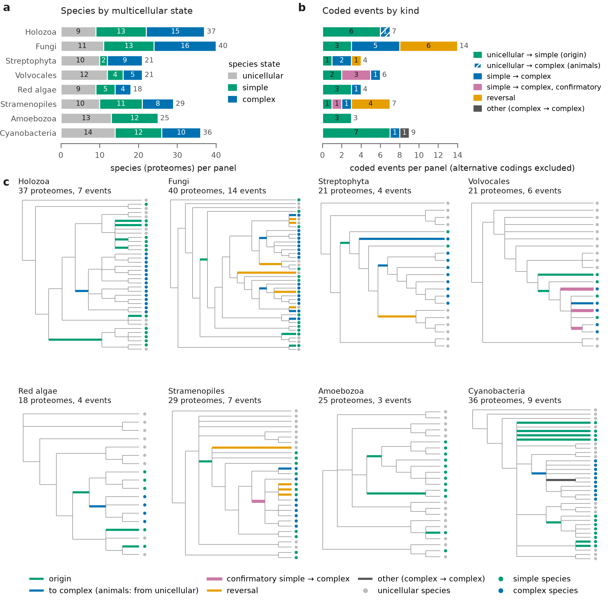
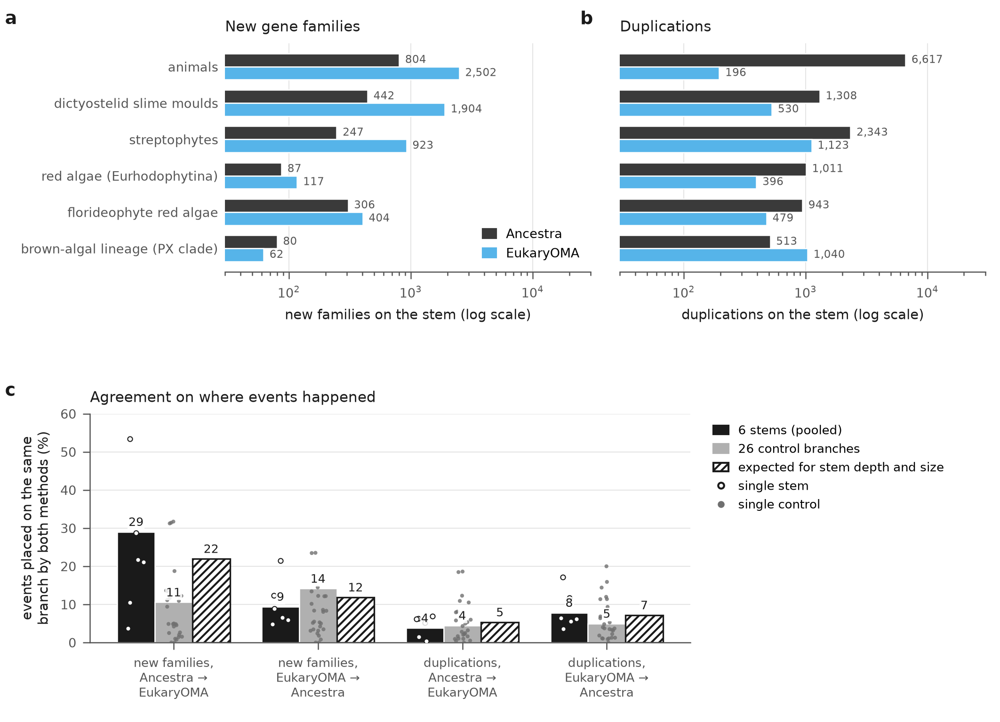
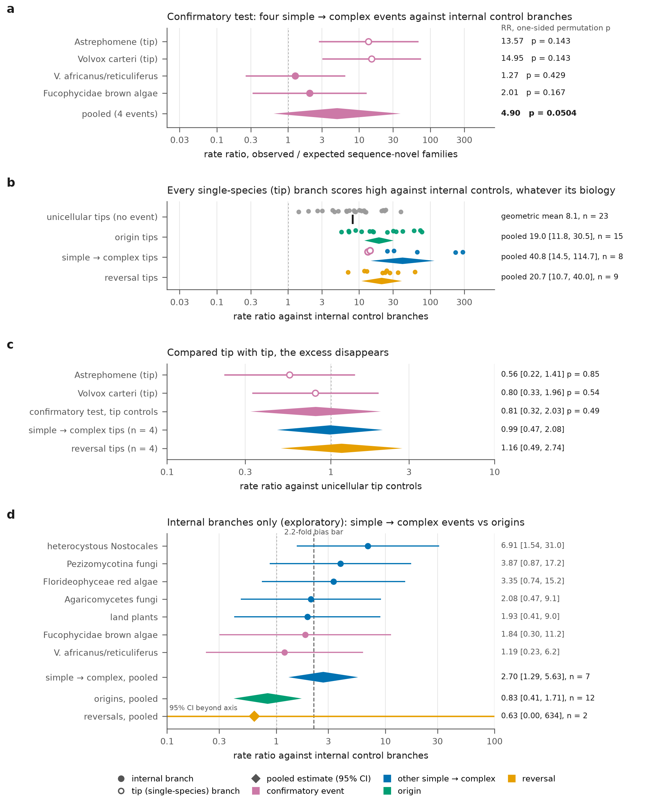
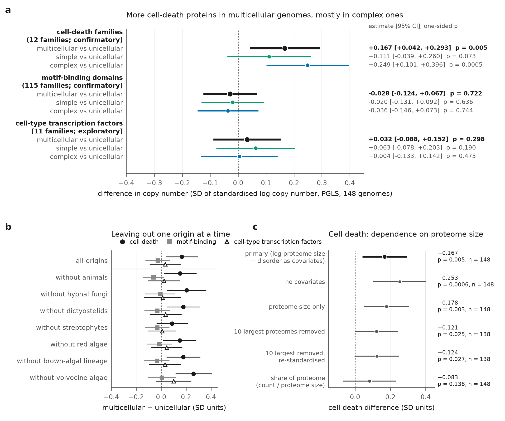
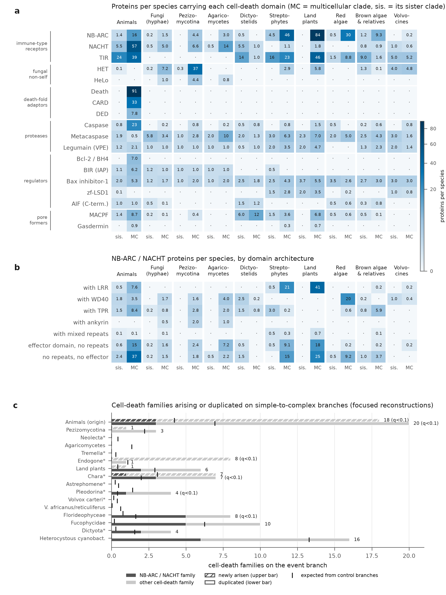
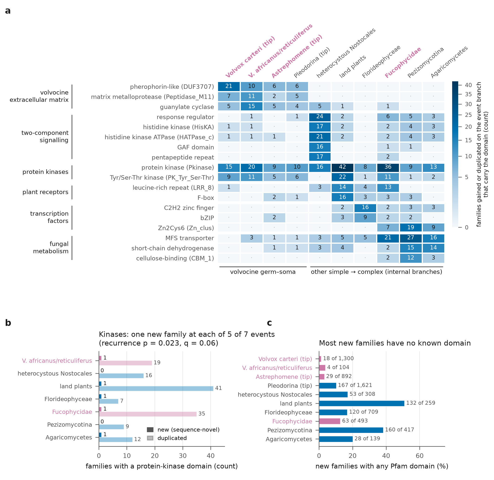
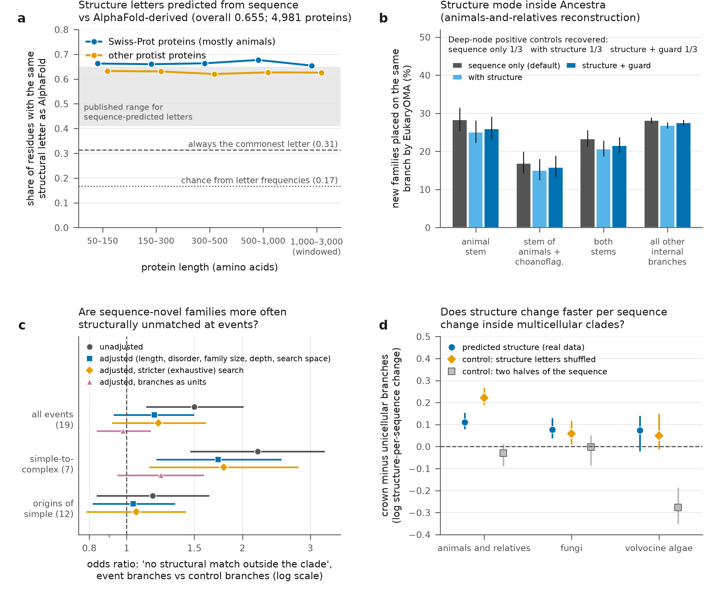
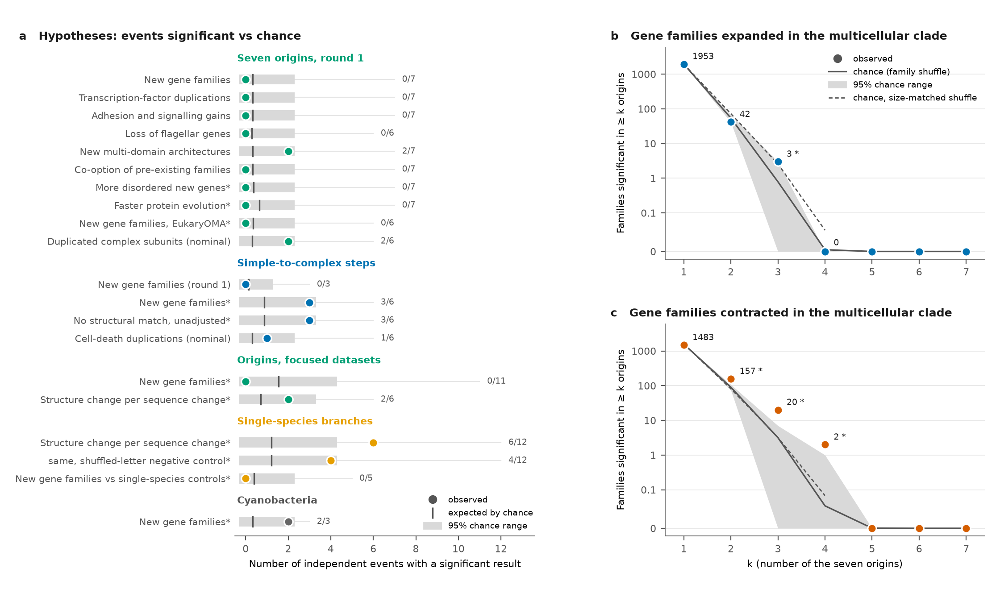

# From many origins to single events: a two-round, agent-run study of the genomic transitions to multicellularity

(Human-written text starts)
This is an exercise in assessing the bioinformatics capabilities of agentic AI. It is part of a hackathon run by the Beltrao lab at ETH Zurich, where we used Claude to run bioinformatics projects (LINK). All results in this project were generated entirely by AI with minimal human intervention. This is not intended to be viewed as a traditional publication.

[Project-specific text] The goal of this specific project was to investigate multicellularity across the tree of life. It was executed by Claude Opus 5.5 with delegation to Opus 5.5/Sonnet 5.5 subagents, and finished within 24 hours on a computational cluster with 24 cpus, 150GB RAM. if needed, the user will be able to switch the node to a node with a A100 GPU in the future, but at the moment do not rely on it.

Currently none of the results have been verified by a human. We plan to verify the agent’s methodology and benchmarking, and we will update this section accordingly.

The rest of this repository is entirely AI generated. It includes code for implementation of the predictive model and a AI-written report in the style of a journal article, detailing the final method, the path followed to reach it, and benchmarking against other methods.
(Human-written text ends)

---

AI-written note on this version. The paragraph above describes the first round of the project. After that round, an independent senior reviewer (an AI agent acting as a department head) assessed the report and research record, and a second round of analysis was run on a larger allocation: 48 CPUs, 500 GB of memory and one NVIDIA A100 GPU (40 GB). The second round started at 15:07 CET on 29 October 2026; when this report was finalised (08:29 CET on 30 October 2026) it had run for about 17.4 hours (soft deadline about 30 hours). Round 1 had taken about 13.6 hours, so the two rounds together took about 31 hours of active wall time. This report replaces the round-1 report (report/REPORT.md), which is kept unchanged for the record. Detail that a reader can skip is in a separate supplement (report/REPORT_v2_SUPPLEMENT.txt, sections S1–S10), cited in the text.

---

## Abstract

Multicellularity evolved many times independently. We asked what changed in gene content at these origins, using Ancestra, a new AI-developed method for reconstructing ancestral gene content. A first round compared seven eukaryotic origins at once (187 species) and found no shared signature, but an independent review showed that it had only 13–35% power for plausible effects. A second round studied single, densely sampled events, including the step from simple to complex multicellularity, in eight focused reconstructions (18–40 proteomes, 15–45 minutes each), with three pre-registered tests.

One test was positive: multicellular genomes carry more cell-death proteins than expected for their proteome size (1.21-fold, 95% CI 1.04–1.42; Holm-adjusted p = 0.014; 148 genomes), almost entirely in complex lineages. Domain architectures show that the excess is mostly lineage-specific immune and self/non-self receptor machinery, not a shared cell-death program. Two tests were null: motif-binding domains are not expanded (0.98-fold), and four new simple-to-complex events did not carry significantly more sequence-novel gene families (combined p = 0.050; Holm-adjusted 0.10). Three of those four events share one panel and its controls; treated as one effect per panel, the test becomes a two-panel comparison that could not have reached significance. Their large per-event ratios were an artefact of comparing single-species branches with internal branches. On the same proteins, Ancestra and the independent orthology database EukaryOMA place only 29% of new families on the same branch, so counts of gains and duplications on a branch depend on the method. Protein structure predicted from sequence on a GPU matched AlphaFold-derived structure letters at 65.5% of residues but did not improve Ancestra, and apparent structural signals did not survive adjustment or a negative control. Independent verification overturned two of our own claims; we report the AI team's process candidly.

---

## 1. Introduction

**Main point: multicellularity arose many times, in very different ways. This project asks whether the genomes of the lineages that made the step changed in recognisable, repeated ways: first across all origins at once, then, after an independent review, event by event and for the step from simple to complex multicellularity.**

### 1.1 Kinds of multicellularity

"Multicellular" covers several separable properties. In *clonal* multicellularity, daughter cells stay attached after division, so all cells share one genotype (animals, land plants, *Volvox*). In *aggregative* multicellularity, free-living cells come together, as in the fruiting bodies of the social amoeba *Dictyostelium* (Grosberg & Strathmann 2007). Multicellularity can be *facultative* (formed only under some conditions) or *obligate*. *Simple* multicellularity covers filaments, colonies and sheets with little cell differentiation; *complex* multicellularity, following Knoll (2011), has three-dimensional tissues, cell-to-cell connections and differentiated cell types. Knoll counts about six complex groups (animals, land plants, florideophyte red algae, laminarialean brown algae and two groups of fungi), whereas Nagy, Kovács & Krizsán (2018) count 8–11 complex origins within fungi alone. Many organisms sit in grey zones, such as cells joined by cytoplasmic bridges (Chaigne & Brunet 2022) and facultative colonies such as choanoflagellate rosettes. Lamża (2023) counts 45 independent multicellular lineages in eukaryotes.

In round 2 we coded complexity on two axes per species, each with a literature reference: D (a germ–soma split or at least three cell types) and T (a three-dimensional tissue with cell–cell connections). A species is "complex" if it has D or T. *Volvox* and heterocyst-forming cyanobacteria are D-only; parenchymatous brown algae, florideophyte red algae, land plants and fungal fruiting bodies are T.

### 1.2 The question and the competing ideas

Each independent origin is a natural experiment: changes that recur at independent origins point to what multicellular life requires. Four ideas from the literature frame the analysis. *Co-option*: most genes later used in multicellular life already existed in unicellular ancestors and were re-used (King et al. 2008; Sebé-Pedrós et al. 2010; Prochnik et al. 2010; Hanschen et al. 2016; Kiss et al. 2019). *A burst of novelty*: many new gene families appear at the origin (Paps & Holland 2018 for animals; Bowles et al. 2020 for plants; Denoeud et al. 2024 for brown algae). *Toolkit expansion*: particular families (transcription factors, adhesion, signalling) expand repeatedly (de Mendoza et al. 2013; Cock et al. 2010; Pereira Lobo et al. 2025). *Relaxed selection*: multicellular lineages have smaller effective population sizes, so selection is weaker (Lynch & Conery 2003; Bingham & Ratcliff 2024); whether this shows in protein evolution is tested in Section 8.

### 1.3 Ancestra and ancestral gene content

The central tool is Ancestra (github.com/evocellnet/ancestra-mvp-ai), a recently developed, AI-built method for *orthology inference*: deciding which genes in different species descend from one ancestral gene. Given the predicted proteins of many species (their *proteomes*) and a fixed species tree, Ancestra groups proteins into families by sequence similarity and then walks the tree from the tips to the root, merging the genes of sister lineages into ancestral genes. Each inferred ancestral gene, with all its descendants, is a *hierarchical orthologous group* (HOG), an idea developed in earlier methods such as OMA and FastOMA (Altenhoff et al. 2013; Majidian et al. 2025). Reading HOGs branch by branch gives *gains* (a family first appears), *losses* and *duplications* (one ancestral gene becomes two).

---

## 2. Round 1 in brief, and what the review found wrong

**Main point: round 1 found no genomic feature shared by seven origins, but most of its tests could only have detected very large effects. An independent review found three overstated statements; they are corrected here, and none changes a round-1 conclusion.**

Round 1 (about 13.6 hours on 24 CPUs) assembled 187 eukaryotic and 82 prokaryotic proteomes (2.97 million eukaryotic proteins; 36 derived from transcriptomes, i.e. from sequenced messenger RNA, which miss unexpressed genes), placed them on a literature-curated species tree, and compared the *transition stems* of seven independent eukaryotic origins (animals, fungal hyphae, dictyostelid slime moulds, streptophyte algae, red algae, brown algae, volvocine algae) with control branches inside unicellular lineages. A transition stem is the branch on which the transition must have happened. Five pre-registered primary tests were corrected together by the Holm method (Holm 1979: the smallest p-value is multiplied by the number of tests, the next by one fewer, and so on). None was significant (smallest adjusted p = 0.10).

Two calibrations shaped everything that followed. On simulated genomes, Ancestra inflated gene gains 2.1–2.6-fold, because it sometimes splits one old family into several HOGs, which makes old genes look new. Gains were therefore filtered: a gain counts as *sequence-novel* only if none of up to three representative proteins has a DIAMOND hit (E ≤ 10⁻⁵, ≥ 30% query coverage) to any protein outside the clade. And a rule fixed before the results stated that a "burst of novelty" would be claimed only if a pooled excess exceeded 2.2-fold, the stem-specific inflation seen in one simulation on the real tree. Two exploratory leads were flagged: more sequence-novel families at three nested simple-to-complex transitions (1.9–3.3-fold, p = 0.016, outside the Holm family) and many new multi-domain architectures on the animal stem.

The reviewer judged round 1 honest but aimed at a question it could not answer: averaging over seven very different events gives a nearly uninformative mean, and with seven stems the gene-content tests had 13–35% power at a 1.5-fold effect. A separate agent checked the specific errors with new scripts (Supplement S1, Table S1). The depth imbalance between stems and controls was understated (2.06, not 1.77, control standard deviations). The power table had used placeholder branch lengths (re-running it changed no value by more than 0.025). The positive controls (events the literature firmly expects, such as Wnt-family gains on the animal stem) were overstated as a validation of Ancestra: of the 10 controls that need Ancestra to place an event on a specific branch, 7 passed, but one of these is a null control (no excess of stem duplications) that a method missing duplications would also pass; excluding it, 6 of 9 passed, including all recent-stem gains, and all three deep-node placement controls failed. And the rate test depended on a random seed; the exact, orientation-averaged version gives p = 0.31. The round-1 record had also wrongly declared the EukaryOMA database not found.

---

## 3. How the review changed the plan

**Main point: round 2 replaced one question about all origins with many questions about single, densely sampled events, and narrowed the confirmatory claims to three pre-registered tests whose power was stated in advance.**

1. **Single events instead of one average.** Round 2 ran eight focused reconstructions (*panels*), each containing one or a few origins with as many related genomes as were available. Small runs avoid the giant similarity network that, in round 1, joined 73% of all eukaryotic proteins into one connected group, and they put more species near each event. They sharpen each event; they do not add independent origins.
2. **Simple to complex.** Complex multicellularity usually arises inside lineages that are already simply multicellular. Round 2 coded these *nested* events (for example, *Volvox* germ–soma differentiation inside colonial volvocines) and added three complex transitions round 1 had excluded (florideophyte red algae, complex brown algae, heterocystous cyanobacteria).
3. **Specific families instead of class aggregates.** Family lists were fixed before looking at data: 115 Pfam families that bind short linear motifs (from the ELM resource; Kumar et al. 2024), 22 cell-death families including non-animal forms, 26 cell-type transcription-factor families, and a mask of 223 transposon-related families.
4. **An independent orthology resource.** EukaryOMA was used to check Ancestra's round-1 events.
5. **Three confirmatory tests, with power stated.** The pre-registration (frozen in the repository about 40 minutes into round 2, before any round-2 Ancestra output existed) defined three one-sided tests with Holm correction: (i) simple-to-complex events carry more sequence-novel families than matched control branches; (ii) motif-binding domains are more abundant in multicellular than unicellular species; (iii) cell-death machinery is more abundant in multicellular species. For (i), only events without any round-1 novelty value were eligible. The four events were frozen before their reconstructions existed: *Astrephomene* (independent germ–soma), *Volvox carteri*, *Volvox africanus/reticuliferus* (*Volvox* is polyphyletic; Herron & Michod 2008) and the stem of parenchymatous Fucophycidae brown algae. The design stated that power with three events was 18% at a 2-fold effect and 41% at 3-fold: "we expect an estimate, not a decision." Everything else is exploratory.

A design review by three agent reviewers (statistics, evolutionary biology, compute and AI failure modes) cut the confirmatory family from five tests to three. In retrospect, the simple-to-complex test should also have been labelled estimation (Section 11).

---

## 4. Dense per-event datasets

**Main point: eight focused panels of 18–40 proteomes were built in about two and a half hours and reconstructed in 15–45 minutes each (round 1's single reconstruction took about 9–10 hours). They cover 59 coded events, but most panels have few control branches.**

Each panel is a set of proteomes, a fixed rooted species tree edited to current phylogenomic consensus, and a table of coded events (Table 1, Figure 1). An *event* is a state change on a branch: unicellular to simple (an *origin*), unicellular to complex (animals, where no simple intermediate is sampled), simple to complex (*nested*), or back to unicellular (a *reversal*). Alternative codings (for example, a single colonial origin in volvocines instead of two; Lindsey et al. 2021) are kept as sensitivity analyses.

**Figure 1. Eight focused reconstructions, each built around one or a few origins of multicellularity.** (a) Proteomes per panel by multicellular state (227 in all). (b) Coded events per panel by kind (54 drawn; five alternative codings used only in sensitivity analyses are not shown). Hatched: the origin of animals, from unicellular directly to complex. (c) Cladogram of each panel (branch lengths not to scale). Tips are labelled with species names and internal event branches with clade names; dots give each species' state; coloured branches are events, coloured by the state they lead to; thick pink branches are the four confirmatory simple-to-complex events. Most of each tree lies inside multicellular clades, which leaves 5–9 control branches per panel. Full caption and sources: Supplement S10.

Table 1. The eight dense panels (sources: data/dense/STATUS.txt and each panel's transitions.tsv).

| clade | proteomes | proteins | species uni / simple / complex | coded events | non-genome proteomes |
|---|---|---|---|---|---|
| Holozoa (animals and unicellular relatives) | 37 | 628,756 | 9 / 13 / 15 | 7 (6 origins incl. colonial choanoflagellates, 1 origin of complex animals) | 10 transcriptomes |
| Fungi and relatives | 40 | 401,122 | 11 / 13 / 16 | 14 (3 origins, 5 nested fruiting bodies, 6 yeast reversals) | 1 |
| Streptophyta | 21 | 471,379 | 10 / 2 / 9 | 4 (1 origin, 2 nested incl. land plants, 1 reversal) | 2 |
| Volvocales | 21 | 302,934 | 12 / 4 / 5 | 7 (2 origins, 4 nested germ–soma, 1 alternative coding) | 0 (2 de novo annotated) |
| Rhodophyta | 18 | 189,824 | 9 / 5 / 4 | 5 (3 origins, 1 nested Florideophyceae, 1 alternative) | 3 |
| Stramenopiles / brown algae | 29 | 521,323 | 10 / 11 / 8 | 8 (1 origin, 2 nested, 4 reversals, 1 alternative) | 0 |
| Amoebozoa | 25 | 355,932 | 13 / 12 / 0 | 4 (3 origins, 1 alternative) | 9 |
| Cyanobacteria | 36 | 187,809 | 14 / 12 / 10 | 10 (7 origins, 1 nested heterocyst, 1 branching, 1 alternative) | 0 |
| total | 227 | 3,059,079 | | 59 | |

Fifty-three proteomes were new relative to round 1, from UniProt, NCBI, EukProt and LukProt. Gaps remain (no annotated genomes for *Physarum*, *Zygnema*, *Coleochaete* or *Nuclearia*, among others), and two volvocine genomes had to be annotated *de novo* without RNA or protein evidence; a sensitivity panel without them was agreed before either reconstruction ran (Supplement S2). All panels used Ancestra's fast preset, on which round 1's inflation calibration was done, so that the 2.2-fold bias rule still applies. Across panels, 41–80% of Ancestra's HOG gains were sequence-novel.

The panels repaired one known failure: the deep-node T-box control, which failed in round 1, passed in the Holozoa panel. But each panel has only 5–9 *control branches*: internal branches that are not events and do not lie inside a multicellular clade (a *crown*). This limits every per-event test.

---

## 5. Do two orthology methods agree on when gene families arose?

**Main point: no. Ancestra and EukaryOMA place the origin of only a minority of the same gene families on the same branch, and duplications almost never agree. Stems do not agree better than control branches once branch depth is taken into account. A count of "new families" or "duplications" on a stem therefore says as much about the method as about the biology.**

EukaryOMA (eukaryoma.unil.ch, release All.Oct2026) is a precomputed orthology database for 1,328 eukaryotic genomes built with the OMA and FastOMA methods (Altenhoff et al. 2024; Majidian et al. 2025). It shares many input genomes with our data, so the comparison is a cross-method check on largely the same proteins, not independent data. 125 of our 187 species have a EukaryOMA genome. Proteins were matched by identical sequence and, for species with different assemblies, by reciprocal best hits at ≥ 95% identity against EukaryOMA sequences downloaded in bulk; 87.1% of our proteins were mapped. Both sets of HOGs were restricted to the 125 shared species, stripped of their own branch labels, and placed on the same pruned tree by the same parser: a family's origin is the common ancestor of its members (Supplement S3).

Pooled over the six internal stems that map exactly onto the pruned tree, 29% of Ancestra's stem gains were placed on the same stem by EukaryOMA (540 of 1,859 mapped). In the other direction, only 9% of EukaryOMA's stem gains were confirmed by Ancestra. Duplications agreed in 4–8% of cases on these six stems and on controls alike. When the methods disagreed, the median offset was 8 nodes, close to the root of the eukaryotes, which points to over-merged or stray family members rather than a one-branch shift (Figure 2).

**Figure 2. Ancestra and EukaryOMA often disagree on when gene families arose, and almost never on duplications.** Both sets of hierarchical orthologous groups were restricted to the 125 shared species and placed on one pruned tree by one parser. (a) New families and (b) duplications on six transition stems (log scale); on the animal stem the methods differ 3.1-fold and 34-fold, in opposite directions. (c) Share of events that the other method places on the same branch: stems pooled (dark), 26 unicellular control branches (grey), and the share expected for branches of the stems' depth and clade size (hatched; the producer's binomial GLM on 86 non-stem branches gives 22%, the independent verifier's equivalent fit on 97 branches 24.7%). Ancestra's stem gains are confirmed in 29% of cases (540 of 1,859), controls in 11%. Agreement measures consistency between methods, not accuracy. Full caption and sources: Supplement S10.

The two methods split gene families differently. On the animal stem, Ancestra reports about 6,600 duplications and 804 new families; EukaryOMA reports 196 duplications and 2,502 new families. EukaryOMA keeps 53% of genes outside any multi-gene group (Ancestra 27%) and treats paralogues as separate families where Ancestra links them. Neither method is ground truth.

*Stems do not agree better than controls.* The raw contrast looks striking: 29% on stems against 11% on 26 control branches. But stems lie deeper in the tree than controls (mean 7.5 against 4.3 nodes from the root), and agreement rises with depth on ordinary branches. A binomial regression of agreement on depth and log number of descendant species, fitted by the independent verifier on 97 non-stem internal branches, predicts 24.7% for the stems and 13.1% for the controls, so about 62% of the gap is expected without any stem effect. (The producer's version of the same model, fitted on 86 branches, predicts 22.0% for the stems; the difference is the choice of baseline branches.) The small remainder rests mostly on one stem: dictyostelids agree at 53%, and the other five stems agree at 21.3%, below their expected 24.7%. We therefore make no claim that the methods agree better at transitions.

An independent agent re-implemented the comparison and reproduced the protein mapping, all 20 per-branch agreement values within 2 percentage points, and gains exactly; 3 of 10 duplication counts differed by 12–15%, so duplication counts here are approximate (Supplement S3). Two results are reassuring. The round-1 direction for new gene families was reproduced (stems' mean percentile among controls 0.63 with EukaryOMA, 0.72 with Ancestra; 0.5 = typical). And with branch labels stripped, Ancestra places the expected T-box duplications on the animal stem, so the round-1 T-box failure came from Ancestra's labelling of where families arose, not from its families. The cadherin and integrin controls fail in both methods: dating a domain gained inside an older family is a limitation of family-based dating in general.

---

## 6. Are complex multicellular lineages marked by new genes?

**Main point: the confirmatory test was not significant (combined one-sided p = 0.050, Holm-adjusted 0.10). Its large per-event ratios came from an artefact: two of the four events are single species, and any single species looks rich in new genes when compared with internal branches. Restricted to internal branches, simple-to-complex events carry about 2.8 times more sequence-novel families than expected, an exploratory estimate whose lower bound does not clear round 1's 2.2-fold bias threshold.**

### 6.1 The statistic

A *negative-binomial regression* (a regression for over-dispersed counts) was fitted on the 55 control branches of all eight panels together, with a separate intercept per panel and shared effects of branch length, number of descendant species, fraction of transcriptome-derived descendants, mean BUSCO completeness, and distance to the nearest outgroup (a proxy for how hard homologues are to detect; Weisman et al. 2020). For an event, the *rate ratio* (RR) is observed sequence-novel gains divided by the model's prediction. Each confirmatory event received a one-sided permutation p-value against its depth-matched controls, and the four p-values were combined with Stouffer's method (summing their normal scores). Effect sizes were pooled with a random-effects meta-analysis with a modified Hartung–Knapp confidence interval (Röver et al. 2015).

Two versions of every number exist. The analysis code applied a small numerical floor to branch lengths before taking logarithms, which the written specification did not contain; it changes one amoebozoan control branch (length 2.8 × 10⁻⁵) and, through the shared regression, all estimates slightly. An independent verifier found the discrepancy. We call the values computed without the floor **as specified** and treat them as the confirmatory result; the values with the floor are **as implemented** and are reported as a variant. Both are labelled wherever they differ.

### 6.2 The confirmatory result

Per event, against the six or five controls of its panel (as specified; as implemented in brackets):

- *Astrephomene* (a single species, i.e. a *tip* branch): p = 0.143, RR 13.6 [13.2].
- *Volvox carteri* (tip): p = 0.143, RR 14.9 [14.2].
- *Volvox africanus/reticuliferus* (internal node): p = 0.429 [0.571], RR 1.27 [1.19].
- Fucophycidae stem (internal): p = 0.167, RR 2.01 [1.84].

Combined, p = 0.0504 as specified (0.072 as implemented); pooled RR 4.90 (95% CI 0.63–38.4). Holm's procedure requires p < 0.025 at this step (adjusted p 0.10), so the test is not significant (Figure 3a). That one control's rank moves the second decimal shows how coarse the test is: with five or six controls, no single event can reach p below 1/6 or 1/7. Depth matching was also impossible: the confirmatory events lie 7–10 edges below the panel root, every control in their panels 2–6 edges, so every matched set had to be widened to all controls of the panel.

*Dependence among the events.* Three of the four events sit in the volvocine panel and are compared with the same six controls, so Stouffer's method and the random-effects pool, which treat the four as independent, overstate the information. As a dependence-aware sensitivity analysis (added after the review; it does not replace the confirmatory result), each panel contributed one effect. The volvocine effect is the mean log rate ratio of its three events (RR 6.4), tested against all 20 ways of drawing three of the panel's six controls; no triple of controls reaches it, so p = 1/21 = 0.048, the smallest value attainable. With Fucophycidae (p = 0.167, also its floor), the two-panel Stouffer p is 0.031 (Holm-adjusted 0.062), identical as specified and as implemented. This is the smallest p the two-panel design can produce, so, read with its dependence, the confirmatory test could not have reached significance whatever the data. The pooled rate ratio with one effect per panel is 3.9–4.8, depending on how the within-panel dependence is treated, with a 95% CI from about 0.01 to over 1,000. The volvocine panel effect is carried by its two tip events, so this analysis inherits the tip artefact below and adds no evidence for a burst (Supplement S4; results/r2/panels_sensitivity_onepanel/).

**Figure 3. Simple-to-complex events do not carry significantly more sequence-novel gene families; their large per-event ratios come from comparing single-species (tip) branches with internal branches.** Rate ratio (RR): observed sequence-novel families on a branch divided by the prediction of a negative-binomial regression fitted on 55 internal control branches. Bars: 95% CI; diamonds: pooled estimates; open circles: tips. (a) Confirmatory test as specified: combined p = 0.0504, pooled RR 4.90 (0.63–38.4); not significant after Holm correction. (b) Every kind of tip scores high against internal controls, including 23 unicellular non-event tips (geometric mean 8.1) and 9 reversal tips (20.7). (c) Against unicellular tip controls, *Astrephomene* scores 0.56 and *V. carteri* 0.80. (d) Internal branches only (exploratory): seven simple-to-complex events pool to 2.70 (as implemented; 2.81 as specified), with a lower bound below the 2.2-fold bias line. Panels (b)–(d) use the as-implemented model. Full caption: Supplement S10.

### 6.3 The tip artefact

The two volvocine tip events have ratios of about 14–15. They should not be read as evidence. A gain on an internal branch is a family shared by at least two descendant species and absent elsewhere; a gain on a tip branch is any gene of that one species with no detectable relative outside it, including orphan genes, mis-predicted gene models and fast-evolving genes. The regression was fitted on internal branches, so a tip's prediction is an extrapolation. If tips are inflated by this, every tip should score high whatever its biology, and they do: reversal tips (species that returned to unicellularity) score about 21-fold (RR 20.7, 95% CI 10.7–40.0), ordinary unicellular tips that are not events about 8-fold, tip origins about 19-fold. The fair comparison is tip against tip: against 23 unicellular tips of the volvocine and brown-algal panels, *Astrephomene* scores RR 0.56 (p = 0.85) and *V. carteri* 0.80 (p = 0.54), and the confirmatory test recomputed this way gives combined p = 0.49 (Figure 3b, c). The problem was found by the analysis agent itself while inspecting interim output, and was handled by a dated, labelled sensitivity analysis rather than by changing the frozen test (Supplement S4).

### 6.4 The internal-only estimate

Restricted to internal branches, the seven simple-to-complex events (as specified: Pezizomycotina 4.0, Agaricomycetes 2.1, land plants 2.1, *V. africanus* 1.27, Florideophyceae 3.4, Fucophycidae 2.01, heterocystous Nostocales 7.4) pool to RR 2.81 (95% CI 1.34–5.89) with no detectable heterogeneity; as implemented, the value plotted in Figure 3d, 2.70 (1.29–5.63). Twelve internal origins from unicellular ancestors pool to 0.82 (0.38–1.77) as specified.

This is the one gene-content lead that survives round 2, but it is weak evidence. Three of the seven events were already seen in round 1; the analysis was not pre-registered; events lie deeper than controls in every panel (standardised mean difference of depth 1.15); and the lower bound (1.3) does not clear the 2.2-fold stem inflation that round 1 measured in a single simulation (Section 10.4). It is consistent with convergent gene-family expansion in complex fungi (Merényi et al. 2020) and the land-plant burst of Bowles et al. (2020), but it does not establish a burst of novelty at complex multicellularity. Fourteen of 18 positive-control scorings were recovered on the panels; the T-box control now passes, but the GRAS gain on the land-plant stem, which passed in round 1, failed (Supplement S4).

---

## 7. Specific protein families

**Main point: among three pre-defined family sets, only cell-death machinery is more abundant in multicellular genomes, after correcting for shared ancestry and proteome size. The effect is robust to leaving out any origin and was re-derived independently, but it is modest, concentrated in complex lineages, partly entangled with proteome size, and consists mostly of lineage-specific immune and self/non-self receptors rather than a shared cell-death program. Motif-binding domains and cell-type transcription factors show nothing.**

### 7.1 The test

For each species and family, the copy number is the number of proteins carrying at least one domain of that Pfam family (Pfam 38.2, gathering thresholds). The response for a family set is the equal-weight mean, over families, of the standardised log copy number, so that very large families do not dominate. Because related species share ancestry, the test is a *phylogenetic generalised least squares* (PGLS) regression, whose residuals are correlated according to the species tree, with the strength of that correlation estimated as Pagel's λ (Pagel 1999; phylolm, Ho & Ané 2014). Covariates were log proteome size and the fraction of the proteome predicted to be disordered. The data were the 148 genome-based proteomes with BUSCO completeness ≥ 50% among the round-1 eukaryotes (68 multicellular, 80 unicellular or grey-zone). A rule fixed before testing kept families present in the multicellular clades of at least three of the seven origins, or in at least half of all species, so that animal-only families would not decide a test about all origins. This rule is asymmetric, because it conditions on presence in multicellular clades, which could favour a positive result; the check that addresses this is a symmetric version of the rule (presence in multicellular or in unicellular clades), which gave p = 0.0068.

### 7.2 Cell death: supported, with caveats

The 22 cell-death families include caspases, metacaspases, NB-ARC and NACHT domains (central to plant and animal immune receptors), fungal HET and HeLo domains, gasdermins and Bcl-2 family members; the pre-set rule kept 12. Multicellular species carry more cell-death proteins than unicellular species for a given proteome size: +0.167 standard deviations (95% CI 0.042–0.293), one-sided p = 0.0047, λ = 0.91, a geometric-mean 1.21-fold excess (1.04–1.42); Holm-adjusted p = 0.014 (Figure 4a).

**Figure 4. Among three pre-defined family sets, only cell-death families are more abundant in multicellular genomes, mostly in complex ones, and the effect depends partly on proteome size.** PGLS coefficients on 148 genome-based proteomes (covariates: log proteome size, disorder fraction); unit: one standard deviation (SD) of a family's log copy number (+0.167 SD = 1.21-fold). Bars: 95% CI. (a) Multicellular vs unicellular (black), and simple (green) and complex (blue) vs unicellular, for 12 cell-death families (confirmatory; Holm-adjusted p = 0.014), 115 motif-binding families (confirmatory; p = 0.72) and 11 cell-type transcription-factor families (exploratory; p = 0.30). (b) Leaving out each of the seven origins: cell death stays positive in all seven; motif-binding estimates are negative in six. (c) Proteome-size sensitivities: without the ten largest proteomes the cell-death estimate falls by about 28%; as a share of the proteome it is +0.083 (p = 0.14). Full caption: Supplement S10.

*Support.* Leaving out any one origin keeps the sign positive (p 0.0002–0.078; weakest without streptophytes), as does leaving out any single family (largest p = 0.020). An independent agent rebuilt the count matrix from raw annotation files and reproduced the coefficient and p-value within 0.001; with all 22 families, p = 0.0078; and 200 random prevalence-matched sets of other families gave p < 0.05 in 2.5% of cases, none reaching the observed effect. The excess is concentrated in complex multicellularity (complex vs unicellular +0.249, p = 0.0005; simple vs unicellular +0.111, p = 0.073).

*Caveats.* Proteome size is by far the strongest predictor: without the ten largest proteomes (six of them multicellular) the effect shrinks by about 28% and p rises to 0.025, which would not pass Holm; measured as a share of the proteome, the effect is +0.083, p = 0.14. The correct reading is "more cell-death proteins than expected for a proteome of that size", not "a larger share of the proteome". With seven origins one lineage can carry a phylogenetic regression (Uyeda et al. 2018); sister-clade contrasts were positive in five of six origins (volvocines negative). Pfam models are built mostly from animal, plant and fungal sequences, which may favour detection in better-studied multicellular lineages.

### 7.3 What the extra cell-death proteins are

A descriptive follow-up, fixed after the test, took all 9,031 proteins carrying any of the 22 cell-death domains in the 187 round-1 eukaryotes, recorded their domain order (*architecture*), and compared each multicellular clade with its sister clade (Figure 5). Complex species carry on average 138 cell-death proteins (66 per 10,000 proteins), simple multicellular species 18 (14 per 10,000) and unicellular species 22 (15 per 10,000). Which proteins carry the excess differs by lineage:

- *Land plants*: NB-ARC proteins with C-terminal leucine-rich repeats (LRR), with or without an N-terminal TIR or coiled-coil domain (+84 per species against the Zygnematophyceae, which have none). These are plant NLRs (nucleotide-binding, leucine-rich-repeat receptors), the intracellular immune receptors that detect pathogen effectors and trigger a localised cell death at the infection site (Jones & Dangl 2006).
- *Red algae*: NB-ARC proteins again (+29 per species), but with WD40 repeats instead of LRR. *Brown algae*: a small excess of NB-ARC–TPR proteins.
- *Filamentous fungi*: HET domains (+37 per species) and NACHT proteins with WD40 or ankyrin repeats, which mediate non-self recognition and the death of fused cells of genetically different individuals (Dyrka et al. 2014).
- *Animals*: death-fold adaptors (Death, CARD and DED domains, absent from all eight choanoflagellate sisters), NACHT proteins, caspases, Bcl-2 and BIR proteins.
- *Dictyostelids and volvocines*: no excess in any family.

So the excess is not one shared cell-death program. It is mostly lineage-specific receptor machinery for immunity and self/non-self recognition, plus an animal-specific expansion of apoptosis adaptors. These receptors do trigger cell death, but they are best known for killing infected or incompatible cells, not for developmental cell death; with domain counts alone the two cannot be separated. Without NB-ARC and NACHT the confirmatory test stays positive (p = 0.018), carried mainly by animal death-fold families and TIR, which are themselves partly immune. At simple-to-complex events, cell-death families are rarely new; where they change, they are duplicated, notably NB-ARC–WD40 families at the origin of florideophyte red algae (Supplement S5).

**Figure 5. The extra cell-death proteins of multicellular lineages are mostly immune-type receptors, and the receptor type differs between lineages.** (a) Mean number of proteins per species carrying each cell-death domain, in the multicellular clade (MC) of each lineage and its closest unicellular or simpler sister clade. (b) NB-ARC and NACHT proteins by architecture: C-terminal LRR, WD40, TPR or ankyrin repeats (NLR-like receptors), an N-terminal effector domain only, or neither. Land plants use LRR, red algae WD40, brown algae TPR, fungi WD40 or ankyrin with NACHT; animals are mixed. (c) Cell-death gene families gained (hatched) or duplicated (plain) on simple-to-complex branches and the animal origin, against the number expected from control branches (ticks); only the animal origin, Florideophyceae, *Pleodorina* and two tip branches exceed expectation (exploratory). Full caption: Supplement S10.

### 7.4 Motif-binding domains and transcription factors: null

Many signalling proteins recognise short linear motifs, stretches of a few amino acids in disordered regions; the domains that bind them (SH2, SH3, PDZ, WW, 14-3-3 and others) have been proposed to expand with regulatory complexity. Across 115 such families, multicellular species show no excess: −0.028 SD (95% CI −0.124 to 0.067), one-sided p = 0.72, a geometric-mean ratio of 0.98. Six of seven leave-one-origin-out estimates are negative (Figure 4b). A Bayesian phylogenetic count model, run as a sensitivity analysis, gave a small positive estimate; we consider it anti-conservative for many-family sets and read the result as a null with an unresolved model dependence (Supplement S5). Expansion is visible within the animal origin and contraction in hyphal fungi, so the pattern is lineage-specific.

Eleven widely distributed cell-type transcription-factor families (homeodomain, TALE, bHLH, forkhead, MADS, Myb and others; exploratory) show no excess either (+0.032 SD, 95% CI −0.088 to 0.152, p = 0.30). Known expansions reappear within origins (T-box and Runt in animals, TEA in hyphal fungi, SBP in land plants), consistent with much of the toolkit predating multicellular lineages (de Mendoza et al. 2013).

### 7.5 What is gained and duplicated at transitions

Two scans asked whether the same families change at several events. Across the seven round-1 origins and three nested events, Pfam families *expanded* in the multicellular clade relative to its sister do not recur beyond chance (42 families at two or more origins against 54 expected, p = 0.98), whereas *contractions* do (157 against 90, p = 0.001). At the seven internal simple-to-complex events in the panels, domains appear at several events more often than expected, but this is a size effect that disappears after rarefying (p = 0.77). The only candidate is the protein kinase domain: one new kinase-domain family at each of five of seven events (p = 0.023, q = 0.06), suggestive only.

Event by event, the annotatable families fit known biology (Figure 6; full lists in Supplement S5). All four volvocine germ–soma events duplicate pherophorin-like extracellular-matrix families (DUF3707), volvocine matrix metalloproteases (Peptidase_M11) and guanylate cyclases, known to be expanded in *Volvox* (Prochnik et al. 2010); these are duplications of existing families, not new ones. Heterocystous cyanobacteria duplicate two-component signalling families, which fit the signalling that regulates heterocyst differentiation (Herrero et al. 2016); land plants, receptor kinases and F-box families; complex fungi, transporters, Zn2Cys6 transcription factors and metabolic enzymes. But these statements describe a minority: the share of sequence-novel families with any Pfam domain ranges from 1.4% (*V. carteri*, 18 of 1,300) to 51% (land plants, 132 of 259), and at every other event most sequence-novel families carry no Pfam domain.

**Figure 6. Families gained or duplicated at simple-to-complex events fit known biology, but only an annotatable minority can be described.** (a) Number of gene families gained (sequence-novel) or duplicated on each event branch that carry selected Pfam domains (transposon families excluded; dots = 0); four volvocine germ–soma events (three single-species branches) and six internal events; pink labels: confirmatory events. In all four volvocine events the extracellular-matrix and guanylate-cyclase families are duplications, not new families. (b) Protein-kinase families at the seven internal events: one sequence-novel kinase family at each of five (recurrence p = 0.023, q = 0.06), against 7–41 duplicated kinase families per event. (c) Share of sequence-novel families with any Pfam domain, from 1.4% (*V. carteri*, 18 of 1,300) to 51% (land plants, 132 of 259). Full caption: Supplement S10.

---

## 8. Protein structure from sequence on a GPU

**Main point: protein structure, encoded as a string of structural letters, can now be predicted from sequence fast enough to cover whole proteomes on one GPU, and our implementation matched structure-derived letters at 65.5% of residues. But structure did not help Ancestra, and the two evolutionary signals it seemed to reveal did not survive verification and controls. Its clearest use is descriptive: about half of "sequence-novel" families have a structural match outside their clade.**

### 8.1 Structural letters, and making them

Protein folds change more slowly than sequences, so two proteins whose sequences have diverged beyond recognition may still share a fold, and some "sequence-novel" families are probably old genes that have diverged (Weisman et al. 2020). Foldseek (van Kempen et al. 2024) describes each residue of a structure by one of 20 *3Di* letters, which encode the local geometry of its contact with its nearest neighbour in space, so a structure becomes a string that can be searched like a sequence. ProstT5 (Heinzinger et al. 2024) is a protein language model that predicts 3Di letters directly from amino-acid sequence. Predicting full 3D structures for three million proteins was not feasible in the time available; predicting 3Di letters was.

A pilot showed that Foldseek's own GPU build silently ran the model on the CPU; only a direct check of device usage revealed it. Our own implementation of ProstT5's encoder and prediction head ran at 48 proteins per second, agreed with Foldseek's ProstT5 output at 97.1% of residues, and covered 263 of 322 panel proteomes by the end of the round (Supplement S6). For 4,981 proteins with an AlphaFold database model, our predicted letters matched those computed from the model at 65.5% of residues (chance 16.7%; always predicting the commonest letter 31.4%). Heinzinger et al. (2024) report 41–65% for the same kind of predictor, so our implementation loses no accuracy (Figure 7a). The reference letters themselves come from predicted structures, not experiments.

**Figure 7. Structure predicted from sequence is accurate enough to search with, but it did not improve Ancestra and gave no robust evolutionary signal.** (a) Agreement of predicted 3Di letters with letters from AlphaFold models, by protein length (overall 65.5%; chance 17%; published range 41–65%, grey band). (b) Ancestra's structure mode on the Holozoa panel: agreement with EukaryOMA on new families at the animal and animal-plus-choanoflagellate stems fell slightly, and deep-node controls were 1 of 3 in every run, so the default was kept. (c) Odds that a sequence-novel family has no structural match outside its clade, event versus control branches, unadjusted and adjusted for length, disorder and other covariates (verifier's mixed models); the general effect disappears after adjustment. (d) Structural change per unit of sequence change inside multicellular clades (blue) against a shuffled-letter negative control (orange) and an amino-acid split-half control (grey). Full caption: Supplement S10.

### 8.2 Does structure help Ancestra? No

Ancestra has an optional mode in which small families are searched by structure against representatives of large families and attached to them if they match (a *family rescue*), with an optional *guard* that re-checks each attachment. A rule fixed before any structure-mode output existed said: replace the default only if the deep-node positive controls improve and agreement with EukaryOMA does not fall. On the Holozoa panel, the rescue attached 25,035 small families to 2,400 large ones; the guard confirmed only 17% of these attachments. Deep-node controls were recovered 1 of 3 in all three runs (default, structure mode, structure mode with guard). Agreement with EukaryOMA on new families at the two animal stems was 23.3% (default) against 20.7% (structure mode) and 21.5% (with guard); no difference is individually significant, but every comparison points down. Structure mode therefore failed the rule and the default was kept (Figure 7b; Supplement S6). The negative result rests on one panel and one preset.

### 8.3 Are "sequence-novel" families structurally old? About half are; the event-specific signal did not survive

For every event and control branch, up to 200 sequence-novel families were searched with Foldseek (combined 3Di and amino-acid mode) against all proteins of the panel's species outside the clade. A family with no hit covering at least half of the query is *structurally unmatched*. Controls behaved as intended: families that are not sequence-novel were found again in 77–96% of cases, and shuffled queries found nothing. Depending on the panel, 32–65% of sequence-novel families have a structural homologue outside the clade (median about 49%), so sequence-based novelty substantially overstates true novelty.

The first analysis found more structurally unmatched families on the 19 internal event branches than on the 55 controls (43.7% against 33.3%; odds ratio 1.44; p = 0.004). An adversarial verifier reproduced every number and then tested confounders. Unmatched families are much shorter (median 211 against 519 amino acids) and more disordered, so "unmatched" mostly means "no detectable fold", not "new fold", and event branches carry more such proteins. Adjusting for length, disorder, low complexity, family size, depth and search space in a mixed model lowered the event odds ratio from 1.50 (95% CI 1.13–2.00) to 1.18 (0.93–1.49) (Figure 7c), and an exhaustive search without Foldseek's fast pre-filter found homologues for 21% of the "unmatched" families, more often on events. At the seven simple-to-complex events an excess persists in family-level models (adjusted odds ratio 1.73, 1.20–2.51) but not with branches as the units (1.23, 0.95–1.58). We drop the general claim; the simple-to-complex excess is an exploratory lead, and none of these families has been shown to have a new fold (Supplement S6).

### 8.4 Does structure change faster per sequence change in multicellular lineages? Inconclusive

The relaxed-selection idea predicts that multicellular lineages tolerate more structural change for a given amount of sequence change. For 300 conserved single-copy genes in each of three panels (animals and relatives, fungi, and the volvocines without the two de novo genomes), branch lengths were estimated from amino-acid and from 3Di alignments, and their ratio was compared between branches inside multicellular crowns and unicellular branches. Inside crowns, 3Di change per amino-acid change was 7–12% higher in all three panels when genes are the units (log ratios 0.110, 0.076, 0.074), but with branches as units, which is the honest test because all genes share one tree, only fungi reached p < 0.05 (p = 0.020). The decisive problem is the negative control: shuffling 3Di letters among species within each alignment column, which destroys any real structural signal, produced a crown "effect" comparable to the real data, and twice as large in animals (0.222 against 0.110 in animals and relatives; 0.058 against 0.076 in fungi; 0.049 against 0.074 in volvocines; Figure 7d). A second control, comparing two random halves of the amino-acid alignment, should give zero; it was near zero in animals and fungi but strongly negative in volvocines (−0.28), a further sign that the volvocine panel's five crown branches cannot support this test. The result is inconclusive, in line with round 1's rate test, which found no 1.5-fold or larger change in protein evolution at the transitions.

---

## 9. Protein complexes

**Main point: published protein-complex data add nothing detectable. Duplications on multicellular stems are not consistently enriched in subunits of ancient protein complexes, and complexes are not more often kept intact in multicellular lineages.**

Cox et al. (2026) used co-fractionation mass spectrometry (separating native protein extracts into many fractions and finding proteins that consistently travel together) from 31 species to reconstruct the protein complexes of the last eukaryotic common ancestor (LECA). We used only this published LECA complex map; the raw co-fractionation elution profiles were not reanalysed. Because the map contains only complexes conserved across eukaryotes, it cannot reveal lineage-specific complexes; we asked only whether genes duplicated on round-1 stems belong to these ancient complexes. Among testable duplications (13 species mappable through UniProt), 66.6% on the animal stem and 72.1% on the fungal-hyphae stem involved a complex subunit, against 63.6% on control branches; the brown-algal and volvocine stems were depleted, and no complex was enriched across stems after correction. Co-retention of subunits was, if anything, slightly lower in multicellular species. With duplication counts that are method-dependent (Section 5), we treat this analysis as a null (Supplement S7).

---

## 10. Discussion

**Main point: across two rounds, the genomes of multicellular lineages do not show a large, shared change in gene content. The one confirmatory positive is a modest, size-dependent excess of cell-death machinery in complex lineages, mostly lineage-specific immune and self/non-self receptors. Gene-content changes at the transitions are real but lineage-specific, and our ability to measure them is limited more by the reconstruction method than by the number of genomes.**

### 10.1 What was shown, and what is believed

> **WHAT WAS SHOWN** (with the stated caveats)
>
> - No shared signature across seven origins was detected in round 1, and the genome-wide rate of protein evolution did not shift 1.5-fold on average.
> - Multicellular genomes carry about 1.2-fold more cell-death proteins than expected for their proteome size (confirmatory, Holm-adjusted p = 0.014), robust to leaving out any origin or family, weaker without the largest proteomes, and almost entirely in complex lineages.
> - That excess consists mostly of lineage-specific receptor architectures: NB-ARC–LRR in land plants, NB-ARC–WD40 in red algae, HET and NACHT proteins in filamentous fungi, death-fold adaptors and NACHT in animals; none in dictyostelids or volvocines.
> - Motif-binding domains are not expanded (0.98-fold); cell-type transcription-factor families are not expanded across origins (exploratory).
> - Four unseen simple-to-complex events did not show significantly more sequence-novel families; their large per-event ratios are a tip-versus-internal-branch artefact.
> - Two orthology methods place only 29% of stem gene-family origins on the same branch, almost never agree on duplications, and do not agree better on stems than on controls of similar depth.
> - About half of sequence-novel families have a structural match outside their clade among the panel species.
> - Ancestra's structure mode did not improve deep-node controls and slightly lowered cross-method agreement.
>
> **WHAT IS BELIEVED, BUT NOT ESTABLISHED**
>
> - Simple-to-complex steps may add more new gene families than origins of simple multicellularity do (internal branches only: 2.8-fold against 0.82-fold, as specified). Exploratory, partly seen before, within the range of method bias.
> - Families gained at simple-to-complex events may lack structural matches more often than those on control branches. Not significant with branches as units; confounded with protein length and disorder.
> - Protein kinases may be repeatedly recruited into new families at complex events (q = 0.06).
> - Larger multicellular bodies may need more immune and self/non-self surveillance; our counts are compatible with this but cannot separate it from developmental cell death or from the growth of large families in large genomes.
>
> **NOT SUPPORTED, AFTER INITIALLY LOOKING POSITIVE**
>
> - A general excess of structurally new families at transitions (overturned by verification).
> - Better cross-method agreement at transition stems (mostly branch depth plus one stem).
> - Faster structural change per sequence change inside multicellular clades (fails a shuffled-letter negative control).

### 10.2 Comparison with the literature

*Programmed cell death and immunity.* A link between programmed cell death and multicellularity is an old idea: cell death in microbes can benefit relatives and may have contributed to the origin of multicellularity (Durand et al. 2016), and one model ties the joint origin of both to arms races with viruses (Iranzo et al. 2014). Our result is compatible with this, with two qualifications. First, the core apoptosis machinery was already present in the last eukaryotic common ancestor (Klim et al. 2018), so what we see is a larger repertoire, built by duplication of existing families. Second, the families that grew are mostly receptors: plant NLRs that trigger a localised cell death when they detect a pathogen (Jones & Dangl 2006), and fungal NLR-like and HET proteins involved in non-self recognition (Dyrka et al. 2014). Each lineage built its excess from a different receptor architecture, which reads as convergence on a function rather than inheritance of a toolkit. The proteome-size dependence means part of the pattern could also reflect the general growth of large, fast-evolving families in large genomes.

*Co-option and the Volvox case.* The volvocine algae show the clearest case of little gene-content change: the volvocine stem had no significantly expanded Pfam family, and the germ–soma events' annotatable changes are duplications of lineage-specific extracellular-matrix families. This matches Prochnik et al. (2010), who found *Volvox* and *Chlamydomonas* similar in coding potential and concluded that complexity can come from "modifications of lineage-specific proteins rather than large-scale invention", and Hanschen et al. (2016), who showed that colony formation in *Gonium* co-opted the retinoblastoma cell-cycle pathway. Our recurrence results fit the co-option view more broadly: expansions do not recur across origins beyond chance, whereas contractions do.

*Complex fungi and signalling.* The families gained at fruiting-body events (transporters, Zn2Cys6 transcription factors, metabolic enzymes) fit Kiss et al. (2019) and Merényi et al. (2020). Receptor kinases in land plants and a new kinase family at five of seven complex events fit reports of receptor kinase families in brown algae and plants (Cock et al. 2010; Shiu & Bleecker 2001) and the convergent expansions in complex lineages described by Pereira Lobo et al. (2025).

*Bursts of novelty.* Claims of novelty bursts at the origins of animals, plants and brown algae (Paps & Holland 2018; Bowles et al. 2020; Denoeud et al. 2024) depend on how families are split. On the animal stem, two state-of-the-art methods differ three-fold in new families and more than 30-fold in duplications on the same proteins. Richter et al. (2018) showed that denser sampling of choanoflagellates moved hundreds of supposedly animal-specific families earlier; our cross-method comparison shows a second, independent source of uncertainty in the inference itself, and the structural search a third: about half of the families that look new by sequence have a structural relative outside their clade (cf. Weisman et al. 2020).

*Relaxed selection.* Neither the round-1 rate test nor the structure-per-sequence comparison found a clear signature of weaker selection on proteins at the transitions. Smaller effective population sizes (Lynch & Conery 2003; Bingham & Ratcliff 2024) may act mainly on genome architecture, or on genes other than the conserved single-copy genes we could measure.

### 10.3 What we learned about the method

- *Gains, not losses, are the weak point.* Inflated gains in simulation, the tip artefact, cross-method disagreement and structural matches among "novel" families all affect the "new gene" counts that most hypotheses rely on.
- *Dense, small reconstructions are cheap and help some deep-node placements,* but they leave each event with few controls, so per-event statistics are coarse.
- *Branch type matters.* Tip and internal branches measure different things and must not be pooled in one comparison.
- *Domain-level dating needs domain-level methods.* Innovations such as classical cadherins are new domain combinations inside old families, invisible to any method that dates whole families.
- *Predicted structure is a good search tool and a weak measuring tool.* At 65% per-residue accuracy, its noise can create apparent rate differences, and "no structural match" is dominated by short and disordered proteins.

### 10.4 Limitations

- Few independent origins (seven primary eukaryotic origins; four confirmatory and seven internal simple-to-complex events), so most nulls are absence of evidence. Three of the four confirmatory events share one panel and its controls; treated as one effect per panel, the confirmatory test is a two-panel comparison whose smallest attainable p (0.031) cannot pass Holm correction.
- The 2.1–2.6-fold gain inflation and the 2.2-fold "burst" threshold used in Sections 6.4 and 10.3 and Figure 3d rest on a single round-1 simulation. The reviewer recommended calibrating with a gene-birth simulator; this was not done in round 2, so the threshold is itself uncertain.
- The design promised the cross-method comparison split by species present in both resources and species present in only one. This was not possible: the comparison is restricted to the 125 shared species by construction, so it says nothing about how either method behaves on species the other lacks.
- Events are deeper than controls in every comparison (standardised depth difference 2.06 in round 1, 1.15 in the panels), and depth is entangled with several measured quantities.
- Gene-family gains and duplications on a branch are method-dependent (Section 5); duplication counts in the cross-method comparison are approximate (about ±15%).
- Transcriptome-derived proteomes remain in two panels and among the sisters of animals and dictyostelids; two volvocine proteomes are de novo gene predictions.
- Pfam annotation favours well-studied lineages; at most events most novel families have no annotation; NLR-type receptors are often fragmented in gene models.
- The cell-death result depends partly on proteome size and cannot distinguish developmental cell death from immunity.
- Structural letters are predicted from sequence, the structural search covered only the panel species, and no 3D models were examined; "structurally unmatched" never means "new fold". The structure-mode test used one panel and one preset; the divergence test used three panels and conserved single-copy genes only.
- The species trees are fixed; alternative topologies and roots were not run.
- Multicellular states come from the literature, which also supplied the positive controls and family lists, so some agreement with the literature is built in.
- Only protein-coding content was studied; regulatory change, which much of the literature emphasises (Sebé-Pedrós et al. 2016), is invisible here.
- Nothing here has been checked by a human expert.

---

## 11. Agentic science: what the AI team did well and badly

**Main point: the safeguards that matter most worked. Pre-registration, adversarial verification by agents that did not produce a result, and plain reporting of nulls caught or contained every serious problem we know of, including two of our own positive claims overturned in this round. The weaknesses were in specifying tests, in finding design problems only after seeing results, in bookkeeping and in tool handling.**

The project was run by a principal-investigator agent (Claude Opus 5.5) that planned, delegated to subagents (Opus 5.5 or Sonnet 5.5), reviewed their output and kept a dated research record. Separate agents wrote the literature review, built data, ran analyses, reviewed designs, verified results, audited citations and drew figures.

What worked:
- *External review steered the science.* The department-head review was the most consequential input of round 2: it redirected the project from one under-powered question to single events and the simple-to-complex step, restricted the confirmatory novelty test to unseen events, and found the overstated statements of round 1. A second review of this report found a dependence among the confirmatory events that the team had not addressed (Section 6.2).
- *Adversarial verification changed conclusions, not just decimals.* In this round it overturned two claims that had already been written into summaries. (i) The excess of structurally new families at transitions (odds ratio 1.44, p = 0.004) disappeared once the verifier adjusted for protein length, disorder and depth (1.18, 0.93–1.49) and re-ran the search without its fast pre-filter. (ii) The statement that the two orthology methods agree better on transition stems than on controls (29% against 11%) turned out to be mostly an effect of branch depth plus a single stem. Verification also found the cell-death result's proteome-size dependence and an undocumented branch-length floor in the confirmatory novelty test, and it confirmed the protein mapping and agreement values of the cross-method comparison while showing that some duplication counts were off by up to 15%. Producers did not find these problems in their own work.
- *Pre-registration with "what had been seen" notes.* Every post-freeze change to the panel analysis is a dated deviation stating which results were visible at the time (12 such entries in about 5.5 hours, including the branch-length-floor entry). This kept the frozen confirmatory test separate from later sensitivity analyses. The rule for Ancestra's structure mode was fixed before any structure-mode output existed, and it was applied as written even though the result was negative.
- *Analysis agents caught some of their own design problems.* The tip-versus-internal artefact was noticed by the analysis agent while inspecting interim output from five panels, and handled as a labelled sensitivity analysis rather than by changing the frozen test.
- *Negative controls were built in.* The shuffled-letter control in the structural divergence analysis is what showed that result to be uninterpretable; without it, a 7–12% "effect" with gene-level p-values as low as 10⁻¹¹ would have looked convincing.
- *Cross-checking with a second method* (EukaryOMA) gave the most sobering and most useful result of round 2.
- *Early piloting of new hardware* caught the silent CPU fallback of Foldseek's GPU build within the first hour.
- *Null results were reported as nulls*, with power, rather than reframed.

What did not work:
- *Confirmatory tests with known low power.* The simple-to-complex test had 18–41% power by the design's own estimate, two events outside the range of its controls, and three events sharing one set of controls. It should have been framed as estimation from the start.
- *Design problems found after seeing data.* The tip artefact, the size effect in domain recurrence, an over-permissive recurrence null, and the length and disorder confounding of "structural novelty" were all discovered from interim or final outputs. They were handled honestly, but piloting each statistic on control-only data, and checking covariate balance, before freezing it would have found them earlier.
- *Undocumented analysis choices.* The confirmatory novelty analysis applied a numerical floor to branch lengths that was not in the written specification. It was a defensible guard against taking the logarithm of a near-zero length, but it changed the confirmatory p from 0.050 to 0.072; only the independent verifier noticed. Similarly, the structural-novelty producer described a search-space-only adjustment as "adjusted", which a reader would take to mean confounders had been handled.
- *Stale numbers.* Round 1's depth imbalance (1.77 instead of 2.06) and the "real tree" power claim were copied forward from early drafts and never recomputed; a final numbers audit of this report found eight further mismatches (for example a run-time range, an early estimate of proteome size, and a denominator), all corrected here.
- *Tool handling.* Twice, a pattern-based kill command (one that terminates every process whose command line matches a text pattern) matched the shell that issued it and killed its own caller; once, in round 2, this also left a GPU job running without supervision. A waiting loop launched an analysis on four of eight panels prematurely; a name-matching bug briefly dropped one panel from a sensitivity analysis; a broken R package build forced a different sensitivity model; and IQ-TREE could not estimate a substitution model for structural letters, which required a documented workaround.
- *Lagging records.* The research tree trailed the results by hours at two milestones, and scripts and logs were left uncommitted for a while after the runs that used them.

The project's process rules (LESSONS.md, 14 rules) condense these: pilot before long runs; calibrate statistics before freezing them, including covariate ranges and tip/internal comparability; label under-powered tests as estimation; have someone other than the author verify, adversarially; log every deviation with what had been seen; kill processes only by explicit process ID; never let wait loops launch analyses.

---

## 12. Addendum: counting independent events instead of averaging them

*Added on 30 October 2026, after publication, at the project lead's request. It is exploratory and post hoc; no pre-registered result changes.*

**Main point: counting in how many independent origins a result is significant does not rescue any of the null hypotheses, because each origin is null on its own.** The lead asked whether demanding one signature shared by all origins asked too much, and whether findings significant in at least two, three or more independent events should be reported. Everything needed was already computed, so we built a "recurrence ladder": for every hypothesis, and for every protein family in the domain scans, we counted the independent origins with a significant result in the same direction and compared each tier (at least 1, 2, 3 … origins) with its chance expectation. The counting rules were fixed before the counts were made.

This view cannot raise the power of any single event: the data for each origin are unchanged. What it can do is avoid diluting a signal present in a subset of origins, as an average over all seven would. That makes it informative only when each tier is compared with chance and corrected for the number of hypotheses and families tested.

**Hypotheses.** The core round-1 tests (new gene families, transcription-factor duplications, adhesion and signalling gains, flagellar loss, co-option) are significant in none of the seven origins, so averaging hid nothing. The best rows before correction are new multi-domain architectures in 2 of 7 origins (animals and volvocines; chance P = 0.04, Holm 0.65). The volvocine hit reflects a low model expectation, not a high count. In the focused panels, 3 of 6 internal simple-to-complex steps rank above all their controls for new gene families (Pezizomycotina, land plants, parenchymatous brown algae; P = 0.04, Holm 0.17). Many per-event tests cannot reach p < 0.05 at all, because the smallest attainable p is one over the number of controls plus one.

**Protein families (Figure 8).** Families expanded in two or more origins are no more frequent than chance (42 observed vs 54 expected). Contracted families do recur (157 vs 90 at ≥2 origins; 20 vs 3 at ≥3), but most of the recurrence involves dictyostelids and animals, whose sister clades are largely transcriptomes. The list is rich in bacterial-type enzymes and inteins, which suggests contamination rather than loss. With genome-based sisters only, the excess shrinks to 29 vs 18. Two families pass correction across all 12,813 tested (q = 0.07), both contracted in four origins: cyclic-nucleotide phosphodiesterase (PDEase_I) and the intein-like Vint domain.

Within the cell-death set, the immune-receptor domain NB-ARC is expanded in animals and red algae, and also at the land-plant step nested within the streptophyte origin. TIR and NACHT are expanded in two origins each. Counting only the seven primary origins, this recurrence is not beyond chance (P = 0.09; independent verification). It is consistent with, but does not add evidence for, the receptor reading of the cell-death result in section 7.

*Figure 8. Counting independent origins rather than averaging them. (a) For each hypothesis, the number of origins with a significant per-event result (dots) against the number expected by chance (grey). (b) Observed and expected numbers of protein families significantly expanded or contracted in at least k origins, k = 1–7. Expansions follow chance; contractions exceed it, largely in origins whose sister clades are transcriptome-based. Sources: results/r2/recurrence_ladder/, verification in results/r2/verification/recurrence_ladder/.*

## Methods

Full methods, with software versions and file paths, are in Supplement S9; the main choices are summarised here.

**Data.** Round-1 data: 187 eukaryotic and 82 prokaryotic proteomes (UniProt reference proteomes 2026_03; EukProt v3, Richter et al. 2022; LukProt v1.5.1, Sobala 2024; NCBI), one protein per gene. Panel data: data/dense/<panel>/; two volvocine proteomes predicted with AUGUSTUS ab initio (Stanke et al. 2006). Completeness: BUSCO 6.1.0 (Manni et al. 2021). EukaryOMA release All.Oct2026. Cox et al. LECA complex map (Zenodo 10.5281/zenodo.17716736). Sources, versions, checksums and licences: DATA.md.

**Orthology and novelty.** Ancestra (commit ffb0bbe), preset `fast`, with an output-identical parallel community-detection wrapper (Traag et al. 2019); DIAMOND 2.2.8 (Buchfink et al. 2021). Branch lengths: IQ-TREE 3 (Wong et al. 2026) LG+G4 on the fixed topology from MAFFT (Katoh & Standley 2013) and trimAl (Capella-Gutiérrez et al. 2009) alignments of near-single-copy families. Sequence novelty: DIAMOND --very-sensitive, E ≤ 10⁻⁵, ≥ 30% query coverage, ≤ 3 representatives per family, against panel proteomes plus round-1 proteomes outside the panel.

**Panel statistics.** Pooled negative-binomial GLM on 55 internal non-crown controls; leave-one-out control residuals; depth-class matching with widening to ≥ 5 controls; one-sided permutation p; Stouffer combination; REML random effects with modified Hartung–Knapp CI. One-effect-per-panel sensitivity: scripts/r2/panels_sensitivity_onepanel.py.

**Family tests.** Pfam-A 38.2 (Paysan-Lafosse et al. 2025) with pyhmmer (Larralde & Zeller 2023); disorder with metapredict (Emenecker et al. 2021); motif-binding list from ELM (Kumar et al. 2024); PGLS with phylolm (Ho & Ané 2014; Pagel 1999); sensitivity with MCMCglmm (Hadfield 2010); per-family scans with ashr shrinkage (Stephens 2017); Pfam-to-GO mapping (Mitchell et al. 2015; Ashburner et al. 2000; Gene Ontology Consortium 2026).

**Structure.** ProstT5 (Heinzinger et al. 2024) encoder plus convolutional head, own implementation on one A100; validation against Foldseek (van Kempen et al. 2024) 3Di letters of AlphaFold DB models (Varadi et al. 2024).

**Pre-registration and verification.** Round 1: tag prereg-v1. Round 2: tags prereg-r2 (design and family lists) and prereg-r2-p1 (confirmatory events). Seeds 11 (default), 23, 37, 41, 53. Every confirmatory number was re-derived by an agent that did not produce it (results/r2/verification/).

## Data and code availability

All scripts (scripts/), result tables (results/), research record (RESEARCH_TREE.md, LESSONS.md, agents/), reviews (reviews/) and this report are in the project's git repository; restricted data are not committed. The department-head review of round 1 is public at https://claude.ai/artifact/NfrexbqRBFmS3A97VvTqcR. Each numeric claim in this report is listed with its source file in report/REPORT_v2_claims.tsv. Repository map (internal names used in file paths only): errata = W0; EukaryOMA comparison = W1; focused panels = W2 and W3, panels R1–R8 in the order of Table 1 (R4_curated = volvocine panel without de novo proteomes); family sets = W4 (cell-death follow-up: w4_celldeath); structure = W5 and W6; complexes = W7. Confirmatory tests: simple-to-complex novelty = R2-P1, motif-binding = R2-P2, cell death = R2-P3; the branch-length floor deviation = D-PI-1. Figures: report/figures_v2/ (scripts/r2/figures/make_all.sh); full captions in Supplement S10 and report/figures_v2/CAPTIONS.txt.

## References

All entries were checked against Crossref or PubMed; claims attributed to them were checked at abstract level (full text for the ProstT5 accuracy range).

- Altenhoff AM, Gil M, Gonnet GH et al. 2013. Inferring hierarchical orthologous groups from orthologous gene pairs. PLoS One 8:e53786. doi:10.1371/journal.pone.0053786
- Altenhoff AM, Warwick Vesztrocy A, Bernard C et al. 2024. OMA orthology in 2024: improved prokaryote coverage, ancestral and extant GO enrichment, a revamped synteny viewer and more in the OMA Ecosystem. Nucleic Acids Res 52:D513-D521. doi:10.1093/nar/gkad1020
- Ashburner M, Ball CA, Blake JA et al. 2000. Gene Ontology: tool for the unification of biology. Nat Genet 25:25-29. doi:10.1038/75556
- Bingham EP, Ratcliff WC 2024. A nonadaptive explanation for macroevolutionary patterns in the evolution of complex multicellularity. PNAS 121:e2319840121. doi:10.1073/pnas.2319840121
- Bowles AMC, Bechtold U, Paps J 2020. The origin of land plants is rooted in two bursts of genomic novelty. Curr Biol 30:530-536.e2. doi:10.1016/j.cub.2019.11.090
- Brunet T, King N 2017. The origin of animal multicellularity and cell differentiation. Dev Cell 43:124-140. doi:10.1016/j.devcel.2017.09.016
- Buchfink B, Reuter K, Drost H-G 2021. Sensitive protein alignments at tree-of-life scale using DIAMOND. Nat Methods 18:366-368. doi:10.1038/s41592-021-01101-x
- Capella-Gutiérrez S, Silla-Martínez JM, Gabaldón T 2009. trimAl: a tool for automated alignment trimming in large-scale phylogenetic analyses. Bioinformatics 25:1972-1973. doi:10.1093/bioinformatics/btp348
- Chaigne A, Brunet T 2022. Incomplete abscission and cytoplasmic bridges in the evolution of eukaryotic multicellularity. Curr Biol 32:R385-R397. doi:10.1016/j.cub.2022.03.021
- Cock JM, Sterck L, Rouzé P et al. 2010. The Ectocarpus genome and the independent evolution of multicellularity in brown algae. Nature 465:617-21. doi:10.1038/nature09016
- Cox RM, Papoulas O, Shril S et al. 2026. A protein interactome for the last eukaryotic common ancestor illuminates the biochemical basis of modern genetic diseases. Cell Genomics 6:101254. doi:10.1016/j.xgen.2026.101254 (preprint: Cox RM et al. 2024. Ancient eukaryotic protein interactions illuminate modern genetic traits and disorders. bioRxiv. doi:10.1101/2024.05.26.595818)
- de Mendoza A, Sebé-Pedrós A, Šestak MS et al. 2013. Transcription factor evolution in eukaryotes and the assembly of the regulatory toolkit in multicellular lineages. PNAS 110:E4858-66. doi:10.1073/pnas.1311818110
- Denoeud F, Godfroy O, Cruaud C et al. 2024. Evolutionary genomics of the emergence of brown algae as key components of coastal ecosystems. Cell 187:6943-6965.e39. doi:10.1016/j.cell.2024.10.049
- Durand PM, Sym S, Michod RE 2016. Programmed cell death and complexity in microbial systems. Curr Biol 26:R587-R593. doi:10.1016/j.cub.2016.05.057
- Dyrka W, Lamacchia M, Durrens P et al. 2014. Diversity and variability of NOD-like receptors in fungi. Genome Biol Evol 6:3137-3158. doi:10.1093/gbe/evu251
- Emenecker RJ, Griffith D, Holehouse AS 2021. Metapredict: a fast, accurate, and easy-to-use predictor of consensus disorder and structure. Biophys J 120:4312-4319. doi:10.1016/j.bpj.2021.08.039
- Fu L, Niu B, Zhu Z, Wu S, Li W 2012. CD-HIT. Bioinformatics 28:3150-2. doi:10.1093/bioinformatics/bts565
- Gene Ontology Consortium 2026. The Gene Ontology knowledgebase in 2026. Nucleic Acids Res 54:D1779-D1792. doi:10.1093/nar/gkaf1292
- Grosberg RK, Strathmann RR 2007. The evolution of multicellularity: a minor major transition? Annu Rev Ecol Evol Syst 38:621-654. doi:10.1146/annurev.ecolsys.36.102403.114735
- Hadfield JD 2010. MCMC methods for multi-response generalized linear mixed models: the MCMCglmm R package. J Stat Softw 33(2):1-22. doi:10.18637/jss.v033.i02
- Hanschen ER, Marriage TN, Ferris PJ et al. 2016. The Gonium pectorale genome demonstrates co-option of cell cycle regulation during the evolution of multicellularity. Nat Commun 7:11370. doi:10.1038/ncomms11370
- Heinzinger M, Weissenow K, Sanchez JG et al. 2024. Bilingual language model for protein sequence and structure. NAR Genom Bioinform 6:lqae150. doi:10.1093/nargab/lqae150
- Herrero A, Stavans J, Flores E 2016. The multicellular nature of filamentous heterocyst-forming cyanobacteria. FEMS Microbiol Rev 40:831-854. doi:10.1093/femsre/fuw029
- Herron MD, Michod RE 2008. Evolution of complexity in the volvocine algae: transitions in individuality through Darwin's eye. Evolution 62:436-51. doi:10.1111/j.1558-5646.2007.00304.x
- Ho LST, Ané C 2014. A linear-time algorithm for Gaussian and non-Gaussian trait evolution models. Syst Biol 63:397-408. doi:10.1093/sysbio/syu005
- Holm S 1979. A simple sequentially rejective multiple test procedure. Scand J Stat 6:65-70.
- Iranzo J, Lobkovsky AE, Wolf YI et al. 2014. Virus-host arms race at the joint origin of multicellularity and programmed cell death. Cell Cycle 13:3083-8. doi:10.4161/15384101.2014.949496
- Jones JDG, Dangl JL 2006. The plant immune system. Nature 444:323-329. doi:10.1038/nature05286
- Katoh K, Standley DM 2013. MAFFT multiple sequence alignment software version 7: improvements in performance and usability. Mol Biol Evol 30:772-780. doi:10.1093/molbev/mst010
- King N, Westbrook MJ, Young SL et al. 2008. The genome of the choanoflagellate Monosiga brevicollis and the origin of metazoans. Nature 451:783-8. doi:10.1038/nature06617
- Kiss E, Hegedüs B, Virágh M et al. 2019. Comparative genomics reveals the origin of fungal hyphae and multicellularity. Nat Commun 10:4080. doi:10.1038/s41467-019-12085-w
- Klim J, Gładki A, Kucharczyk R et al. 2018. Ancestral state reconstruction of the apoptosis machinery in the common ancestor of eukaryotes. G3 8:2121-2134. doi:10.1534/g3.118.200295
- Knoll AH 2011. The multiple origins of complex multicellularity. Annu Rev Earth Planet Sci 39:217-239. doi:10.1146/annurev.earth.031208.100209
- Kumar M, Michael S, Alvarado-Valverde J et al. 2024. ELM - the Eukaryotic Linear Motif resource - 2024 update. Nucleic Acids Res 52:D442-D455. doi:10.1093/nar/gkad1058
- Lamża Ł 2023. Diversity of 'simple' multicellular eukaryotes: 45 independent cases and six types of multicellularity. Biol Rev 98:2188-2209. doi:10.1111/brv.13001
- Larralde M, Zeller G 2023. PyHMMER: a Python library binding to HMMER for efficient sequence analysis. Bioinformatics 39:btad214. doi:10.1093/bioinformatics/btad214
- Lindsey CR, Rosenzweig F, Herron MD 2021. Phylotranscriptomics points to multiple independent origins of multicellularity and cellular differentiation in the volvocine algae. BMC Biol 19:182. doi:10.1186/s12915-021-01087-0
- Lynch M, Conery JS 2003. The origins of genome complexity. Science 302:1401-4. doi:10.1126/science.1089370
- Majidian S, Nevers Y, Yazdizadeh Kharrazi A et al. 2025. Orthology inference at scale with FastOMA. Nat Methods 22:269-272. doi:10.1038/s41592-024-02552-8
- Manni M, Berkeley MR, Seppey M et al. 2021. BUSCO update. Mol Biol Evol 38:4647-4654. doi:10.1093/molbev/msab199
- Merényi Z, Prasanna AN, Wang Z et al. 2020. Unmatched level of molecular convergence among deeply divergent complex multicellular fungi. Mol Biol Evol 37:2228-2240. doi:10.1093/molbev/msaa077
- Mitchell A, Chang H-Y, Daugherty L et al. 2015. The InterPro protein families database: the classification resource after 15 years. Nucleic Acids Res 43:D213-D221. doi:10.1093/nar/gku1243
- Nagy LG, Kovács GM, Krizsán K 2018. Complex multicellularity in fungi: evolutionary convergence, single origin, or both? Biol Rev 93:1778-1794. doi:10.1111/brv.12418
- Pagel M 1999. Inferring the historical patterns of biological evolution. Nature 401:877-884. doi:10.1038/44766
- Paps J, Holland PWH 2018. Reconstruction of the ancestral metazoan genome reveals an increase in genomic novelty. Nat Commun 9:1730. doi:10.1038/s41467-018-04136-5
- Paysan-Lafosse T, Andreeva A, Blum M et al. 2025. The Pfam protein families database: embracing AI/ML. Nucleic Acids Res 53:D523-D534. doi:10.1093/nar/gkae997
- Pereira Lobo F, Benjamim DM, da Silva TTM et al. 2025. Molecular and functional convergences associated with complex multicellularity in Eukarya. Mol Biol Evol 42. doi:10.1093/molbev/msaf013
- Prochnik SE, Umen J, Nedelcu AM et al. 2010. Genomic analysis of organismal complexity in the multicellular green alga Volvox carteri. Science 329:223-6. doi:10.1126/science.1188800
- Richter DJ, Berney C, Strassert JFH et al. 2022. EukProt. Peer Community Journal 2:e56. doi:10.24072/pcjournal.173
- Richter DJ, Fozouni P, Eisen MB et al. 2018. Gene family innovation, conservation and loss on the animal stem lineage. eLife 7:e34226. doi:10.7554/eLife.34226
- Röver C, Knapp G, Friede T 2015. Hartung-Knapp-Sidik-Jonkman approach and its modification for random-effects meta-analysis with few studies. BMC Med Res Methodol 15:99. doi:10.1186/s12874-015-0091-1
- Sebé-Pedrós A, Ballaré C, Parra-Acero H et al. 2016. The dynamic regulatory genome of Capsaspora and the origin of animal multicellularity. Cell 165:1224-1237. doi:10.1016/j.cell.2016.03.034
- Sebé-Pedrós A, Roger AJ, Lang FB et al. 2010. Ancient origin of the integrin-mediated adhesion and signaling machinery. PNAS 107:10142-7. doi:10.1073/pnas.1002257107
- Shiu SH, Bleecker AB 2001. Receptor-like kinases from Arabidopsis form a monophyletic gene family related to animal receptor kinases. PNAS 98:10763-8. doi:10.1073/pnas.181141598
- Sobala ŁF 2024. LukProt. Genome Biol Evol 16. doi:10.1093/gbe/evae231
- Stanke M, Keller O, Gunduz I et al. 2006. AUGUSTUS: ab initio prediction of alternative transcripts. Nucleic Acids Res 34:W435-W439. doi:10.1093/nar/gkl200
- Stephens M 2017. False discovery rates: a new deal. Biostatistics 18:275-294. doi:10.1093/biostatistics/kxw041
- Traag VA, Waltman L, van Eck NJ 2019. From Louvain to Leiden: guaranteeing well-connected communities. Sci Rep 9:5233. doi:10.1038/s41598-019-41695-z
- Uyeda JC, Zenil-Ferguson R, Pennell MW 2018. Rethinking phylogenetic comparative methods. Syst Biol 67:1091-1109. doi:10.1093/sysbio/syy031
- van Kempen M, Kim SS, Tumescheit C et al. 2024. Fast and accurate protein structure search with Foldseek. Nat Biotechnol 42:243-246. doi:10.1038/s41587-023-01773-0
- Varadi M, Bertoni D, Magana P et al. 2024. AlphaFold Protein Structure Database in 2024: providing structure coverage for over 214 million protein sequences. Nucleic Acids Res 52:D368-D375. doi:10.1093/nar/gkad1011
- Weisman CM, Murray AW, Eddy SR 2020. Many, but not all, lineage-specific genes can be explained by homology detection failure. PLoS Biol 18:e3000862. doi:10.1371/journal.pbio.3000862
- Wong T, Ly-Trong N, Ren H et al. 2026. IQ-TREE 3: phylogenomic inference software using complex evolutionary models. Mol Biol Evol 43:msag117. doi:10.1093/molbev/msag117
