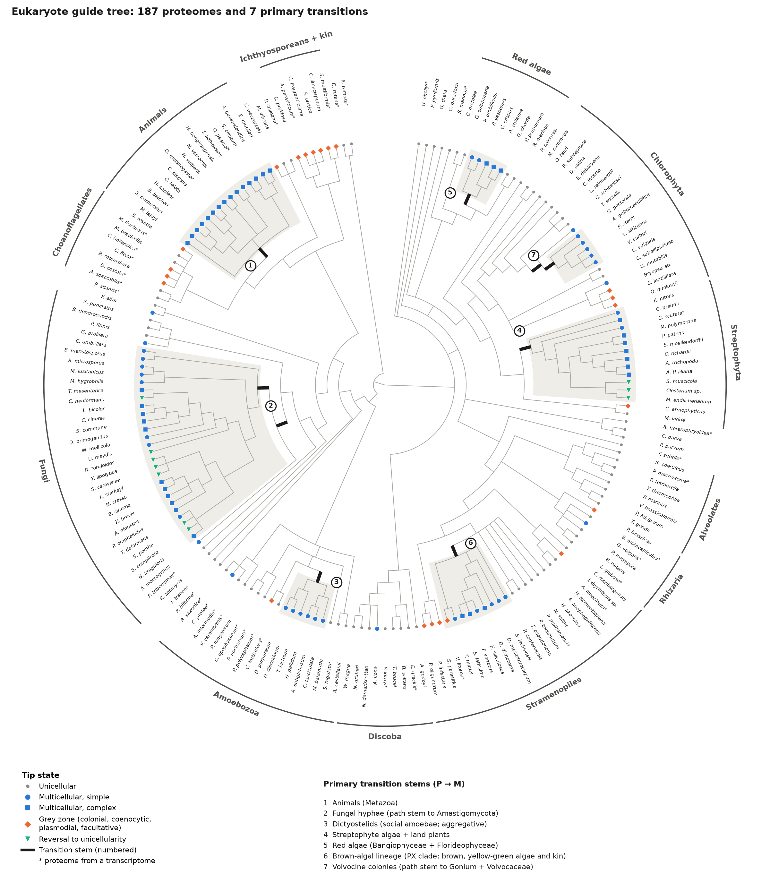
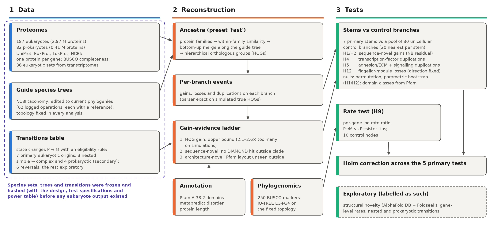

# Seven independent origins of multicellularity, one pipeline: a pre-registered, agent-run reconstruction of ancestral gene content

(Human-written text starts)
This is an exercise in assessing the bioinformatics capabilities of agentic AI. It is part of a hackathon run by the Beltrao lab at ETH Zurich, where we used Claude to run bioinformatics projects (LINK). All results in this project were generated entirely by AI with minimal human intervention. This is not intended to be viewed as a traditional publication.

[Project-specific text] The goal of this specific project was to investigate multicellularity across the tree of life. It was executed by Claude Opus 5.5 with delegation to Opus 5.5/Sonnet 5.5 subagents, and finished within [TIME] on a computational cluster with 24 cpus, 150GB RAM. if needed, the user will be able to switch the node to a node with a A100 GPU in the future, but at the moment do not rely on it.

Currently none of the results have been verified by a human. We plan to verify the agent’s methodology and benchmarking, and we will update this section accordingly.

The rest of this repository is entirely AI generated. It includes code for implementation of the predictive model and a AI-written report in the style of a journal article, detailing the final method, the path followed to reach it, and benchmarking against other methods.
(Human-written text ends)

<!-- PI-NOTE: the human text said "finished within 24 hours". START.txt: 2026-10-28T12:21:22+01:00, 48 h allocation. Replace [TIME] with the actual elapsed wall time; if it exceeds 24 h, tell the user (their text, their edit). Otherwise copied verbatim from PROMPT.md, including the last paragraph, which mentions a "predictive model" and "benchmarking against other methods" that this project does not have. -->

---

## Abstract

Multicellularity evolved many times independently. Do the independent origins share genomic changes? AI agents ran a pre-registered comparison of seven eukaryotic origins: animals, fungal hyphae, dictyostelid slime moulds, streptophyte algae, red algae, brown-algal filaments and volvocine algae. Ancestra, a new method for reconstructing ancestral gene content, was applied to 2.97 million proteins from 187 species. <!-- src: DATA.md; data/transitions.tsv --> Each transition branch was compared with 30 unicellular control branches. Before any result, two problems with the method were found and corrected for: the planned null distribution was anti-conservative, and inferred gene gains were inflated, more so on transition branches (1.7–2.2-fold) than on controls. <!-- src: results/validation_branchstats/null_calibration.tsv; results/calibration_tree/summary.md -->

None of the five primary tests was significant after correction for multiple testing. These tests covered novel genes, transcription-factor duplications, adhesion/signalling duplications, flagellar loss and protein evolutionary rate (smallest corrected p = 0.10). <!-- src: results/primary/euk/holm.tsv --> The gene-content tests could detect only effects of about 2-fold or more. The rate test was sensitive: it excluded a 1.5-fold genome-wide rate shift (pooled ratio 1.10, 95% CI 0.96–1.26), and we found no within-protein sign of relaxed selection. <!-- src: results/h9/summary.md; results/krkc/summary.md --> In every lineage, 80–100% of the domain families expanded in the multicellular clade were already present in its unicellular ancestor. This agrees with the co-option view, but the measure is descriptive: families shared with the sister lineage count as ancestral by construction. <!-- src: results/exploratory/euk/summary.md §2 --> The only convergent loss was the flagellum, in fungi and dictyostelids.

Ancestra recovered 11 of 16 expected events. Its failures show that gene origins and duplication timing are unreliable at deep nodes for large multi-domain families. <!-- src: results/positive_controls/euk/summary.md; results/positive_controls/euk/failure_diagnosis.md --> In this project, a shared genomic signature of multicellularity was not detected. Settling the "burst of novelty" debate will require better reconstruction at deep nodes more than additional genomes.

---

## 1. Why this question

**Multicellularity evolved many times, independently, in very different organisms. Each origin is a natural experiment. If the same genomic changes recur at independent origins, they point to what a multicellular lifestyle requires; if they do not, the origins took different routes.** This project asks what changed in gene content, and in the rate of protein evolution, on the branches of the tree of life where multicellularity appeared, and whether those branches differ from comparable branches where it did not.

### What "multicellular" means

Multicellularity is not one trait but a set of separable properties (LITERATURE.md §1):

- **Clonal vs aggregative.** In *clonal* multicellularity, daughter cells stay attached after division, so all cells descend from one cell and share its genotype (animals, plants, *Volvox*). In *aggregative* multicellularity, free-living cells, which may differ in genotype, come together, as in the fruiting bodies of the social amoeba *Dictyostelium* (Grosberg & Strathmann 2007; Brunet & King 2017). Grosberg & Strathmann (2007) argued that passing through a single cell is the main defence against conflict between cell lineages; Fisher, Cornwallis & West (2013) found that clonal groups were more likely to have become obligately multicellular and to have more cell types.
- **Facultative vs obligate.** A *facultative* multicellular organism can live as single cells and forms groups only under some conditions (starvation in dictyostelids; a bacterial signal in the choanoflagellate *Salpingoeca rosetta*). An *obligate* one is multicellular throughout its life. Márquez-Zacarías et al. (2021) note that all known aggregative organisms are facultative.
- **Simple vs complex.** Knoll (2011) reserves *complex* multicellularity for organisms with differentiated tissues and cell-to-cell channels for nutrients and signals, and restricts it to animals, land plants, florideophyte red algae, laminarialean brown algae and two groups of fungi; Nagy, Kovács & Krizsán (2018) instead count 8–11 origins of complex fruiting bodies within fungi. Multicellular but not complex (filaments, colonies, simple sheets) is *simple*.
- **Grey zones.** Many organisms sit between categories: cells joined by cytoplasmic bridges after incomplete division (Chaigne & Brunet 2022); *coenocytes*, single cells with many nuclei (ichthyosporeans, the plasmodium of the slime mould *Physarum*); facultative colonies such as choanoflagellate rosettes; culture-induced aggregates such as those of *Capsaspora*. Queller & Strassmann (2009) frame the question as a continuum of "organismality" rather than a yes/no trait.

We coded these properties separately for each species and origin, and kept grey-zone cases out of the main tests (Section 3).

### How many origins?

Lamża (2023) counts 45 independent lineages of "simple" multicellular eukaryotes of six types and estimates the true number is likely close to a hundred. Complex multicellularity is much rarer: five or six eukaryotic clades (Knoll 2011), plus the additional fungal origins of Nagy et al. (2018). Several bacterial lineages are multicellular (Claessen et al. 2014); archaeal cases are rare (Rados et al. 2025). Only a few origins have genome data on both sides of the transition with enough relatives to test against: animals, fungi, dictyostelids, volvocine algae, streptophytes (the green-algal lineage that includes land plants), red algae and brown algae (LITERATURE.md §2).

### Competing ideas about the genomic basis

Four ideas from the literature frame our tests (LITERATURE.md §3–4, §7):

1. **Co-option.** Most genes later used for multicellular life already existed in the unicellular ancestor and were re-used. The choanoflagellate *Monosiga brevicollis* has cadherins and tyrosine kinases (King et al. 2008); *Capsaspora* has integrin adhesion machinery (Sebé-Pedrós et al. 2010); about 80% of the proteins essential for dictyostelid development are present in their unicellular relatives (Glöckner et al. 2016); the *Volvox* proteome differs little in coding potential from that of unicellular *Chlamydomonas* (Prochnik et al. 2010); fungal hyphae arose by co-opting ancient genes, without expansions of kinases, receptors or adhesive proteins (Kiss et al. 2019).
2. **A burst of novelty.** Paps & Holland (2018) describe "an unprecedented increase in the extent of genomic novelty" at the origin of animals; Bowles et al. (2020) find two bursts of genomic novelty in the plant lineage; Denoeud et al. (2024) find a marked gain of new gene families at the emergence of brown algae. Such estimates depend on how densely relatives are sampled: adding 19 choanoflagellate transcriptomes moved about 372 supposedly animal-specific families to before the animal–choanoflagellate split (Richter et al. 2018).
3. **Expansion of a "toolkit".** Transcription-factor families (de Mendoza et al. 2013; Lang et al. 2010) and adhesion, extracellular-matrix and signalling families (Knoll 2011; Cock et al. 2010) are proposed to expand repeatedly at transitions; Pereira Lobo et al. (2025) found shared functional themes across 81 eukaryotes, but for complex lineages only. A related idea is that transitions shed unicellular functions such as the flagellum (Merényi et al. 2023: early fungal evolution as a "gradual shedding of protist genes").
4. **Relaxed selection through drift.** Groups of cells that reproduce through bottlenecks have smaller effective population sizes, so selection is weaker relative to chance (genetic drift) and slightly harmful changes accumulate (Lynch & Conery 2003; Lynch 2007). Bingham & Ratcliff (2024) extend this to multicellularity, and snowflake-yeast experiments show more drift in clonal than in aggregative groups (Pentz et al. 2023). The literature review found no genome-wide test of this across independent origins with matched unicellular comparisons (LITERATURE.md §4.3; an absence in our searches, not proof of absence).

What has been missing is one pipeline, run on many origins at once, that compares each origin with comparable non-origin branches (LITERATURE.md, main point 2). Ancestra, a new scalable method for reconstructing ancestral gene content, makes this feasible. The transitions were defined from the literature before any data were analysed; they are inputs, not findings.

---

## 2. How the work was organised

**AI agents ran the project. The design was reviewed three times and frozen before any eukaryote result existed. The reviews changed the design substantially, and two of the most consequential problems were found by the agents' own checks before the results, not after.**

### Agents and the research record

A principal-investigator (PI) agent (Claude Opus 5.5) planned the work, delegated to subagents (Opus 5.5 or Sonnet 5.5), reviewed their output and made the decisions. Subagents wrote the literature review, scouted data, built the dataset, wrote and tested each analysis module, and acted as reviewers. The PI kept a *research tree* (RESEARCH_TREE.md), a status list of every analysis plus a dated decision log (D0–D8) that also served as its memory across context resets. A lessons file recorded process rules learned the hard way, for example capping each agent's CPU use after four agents together pushed the load to 73 on 24 CPUs and stalled the main computation. <!-- src: LESSONS.md rule 6 -->

The literature review came first: about 9,000 words, 249 references each looked up by tool rather than recalled, and 16 testable hypotheses (H1–H16). <!-- src: RESEARCH_TREE.md M1 -->

### Three rounds of design review

<!-- src: reviews/round1-3/*.md; DESIGN.md §9 -->
- **Round 1** (five reviewers: an external PI, an evolutionary biologist, a statistician, a data/algorithms/compute reviewer, and an AI-agent-failure-modes reviewer). The external PI named the most likely misleading headline in advance: "transitions are marked by a burst of new gene families". The data reviewer showed why the pipeline leaned towards it. On simulated genomes with a known history, Ancestra's gene *gains* were 2.1–2.6 times the true number, because it sometimes splits one old family and the younger pieces look like new genes; losses and duplications were accurate (Section 4.2). This led to the gain-evidence ladder: a gain counts as new only if it has no detectable relative outside the clade. The biologist recoded transitions as changes between states. Dictyostelids became simple aggregative, budding yeasts and unicellular zygnematophyte algae became *reversals* to unicellularity, filamentous relatives showed that filaments predate brown algae, and volvocines got two origins (Lindsey et al. 2021). The statistician separated three branch classes (transition stems, inside multicellular clades, inside unicellular lineages). They also showed that RERconverge-style relative rates remove genome-wide shifts by construction, so the drift hypothesis needed a different test. The AI-failure-modes reviewer required tamper-evident pre-registration, one source of truth for report numbers, and toy-data tests for every module. Horizontal gene transfer and site-level convergence were cut for time.
- **Round 2** (three reviewers). The design had promised ≥200 matched controls per transition; only about 40–60 suitable branches exist, so controls were rebuilt around one shared pool (Section 4.3). With about seven transitions, a rank test could never pass the multiple-testing threshold, so each test was given a table of its smallest attainable p-value and detectable effect before results. The expected direction of flagellum loss was wrong in two of three cases (the flagellate *Allomyces* sits inside the hyphal clade; mosses and *Chara* have flagellate sperm). A technical pitfall was caught: DIAMOND reports only 25 hits by default, which close in-clade relatives can fill, so a gene would look falsely new.
- **Round 3** (pre-registration audit). Two transitions were mis-specified on the tree. The node chosen as the start of volvocine multicellularity is inferred to be unicellular in the very study we cited (Lindsey et al. 2021). The fungal-hyphae node rested on one species whose hyphal status Kiss et al. (2019) consider uncertain. Both were fixed with *path stems*, chains of two consecutive branches from the last ancestor in the old state to the first in the new one (D7). <!-- src: reviews/round3/prereg_audit.md F1/F2 -->

Still before any eukaryote output, the PI calibrated the statistics on the real tree. The planned null distribution turned out to be *anti-conservative*: under no true effect it declared significance in 13.8% of simulated datasets at a nominal 5%, because the control sets of different transitions overlap. It was replaced by a calibrated scheme (Section 4.3; D6, Dev-1). <!-- src: results/validation_branchstats/null_calibration.tsv (spec, two-sided, α 0.05: 0.138) -->

### Pre-registration and deviations

Before any eukaryote Ancestra output existed, the following were frozen: the design, transitions, guide trees, species sets, control definitions, toolkit and flagellar gene lists, literature scorecard and power table. The 15 files were hashed with SHA-256 and the repository tagged `prereg-v1`; every analysis script re-checks the hashes and refuses to run on a mismatch. <!-- src: PREREG.md; PREREG_HASHES.tsv (15 entries) --> Later changes are dated deviations, all made before eukaryote results existed:
- **Dev-1:** the gene-gain test (H1/H2) uses a parametric-bootstrap null, because permuting residuals was anti-conservative when transition branches lie outside the controls' covariate range (Section 4.3).
- **Dev-2:** DIAMOND ran at `--very-sensitive` instead of `--ultra-sensitive`. On 500 real proteins it recovered 99.65% of the ultra-sensitive hits at about a third of the cost; the ultra-sensitive setting was estimated at 150–700 CPU-hours. The search covered only the branches the tests use, identically for stems and controls. <!-- src: PREREG.md Dev-2; results/gainladder/diamond_timing.json -->
- **Dev-3:** the planned "split-repair" step failed its pre-registered acceptance test on simulations and was dropped (Section 4.2). This was a test outcome, not a choice.
<!-- PI-NOTE: PREREG.md stamps Dev-2/Dev-3 "~19:00", but the git commit introducing them is 18:19 on 2026-10-28; fix one or the other. -->

### Verification by agents that did not produce the work

Every analysis module was tested on toy data with known answers, planted effects and null simulations (e.g. 38 tests for the statistics engine) before use. <!-- src: docs/branchstats.md --> Independent agents reviewed code and inputs. One found, before any eukaryote result, that an exploratory volvocine transition sharing the same end node silently replaced the primary one in the statistics code; this was fixed. <!-- src: RESEARCH_TREE.md bug entry t≈7h --> Planned: re-derivation of headline numbers by an agent that did not produce them, and an audit of ≥20 claim–citation pairs. <!-- PI-NOTE: update with what verification actually did (RESEARCH_TREE item 7). -->

---

## 3. Data

**We assembled 187 eukaryotic and 82 prokaryotic proteomes (the full set of predicted proteins of a species) and placed them on literature-curated species trees. We coded 52 candidate transitions, of which 7 independent eukaryotic origins met a pre-registered rule for the primary tests (Figure 1).** <!-- src: DATA.md; data/transitions.tsv (52 rows) -->

### Proteomes

| domain | source | species | proteins |
|---|---|---|---|
| eukaryotes | UniProt reference proteomes 2026_03 | 112 | 1,629,372 |
| | EukProt v3 (Richter et al. 2022) | 59 | 1,060,055 |
| | NCBI annotations (incl. Phaeoexplorer brown algae) | 12 | 217,918 |
| | LukProt v1.5.1 (Sobala 2024) | 4 | 61,916 |
| | **total** | **187** | **2,969,261** |
| prokaryotes | UniProt 2026_03 | 75 | 366,790 |
| | NCBI annotations | 7 | 38,874 |
| | **total** | **82** | **405,664** |
<!-- src: DATA.md summary table; data/DATASET_DONE.json -->

Species were chosen to cover both sides of each documented origin. The starting pools were 151 core and 104 optional eukaryotic candidates and 79 core prokaryotic ones. <!-- src: RESEARCH_TREE.md M1 --> All sources are open (UniProt, EukProt, LukProt CC BY 4.0; NCBI/INSDC unrestricted). Restricted JGI data were not used and no data files are committed. DATA.md lists the source, version, date, MD5 and licence of every file, and a script re-creates the dataset. "Eukaryoma" could not be found (the closest match, EUKARYOME, is an rRNA database without proteomes) and was flagged to the user. *Sorogena* and *Sorodiplophrys* have no public proteome. <!-- src: RESEARCH_TREE.md D2; LITERATURE.md §6 -->

**Preparation.** Ancestra expects one protein per gene, so splice variants were collapsed: UniProt canonical sets, and the longest protein per gene for NCBI and genome-based EukProt sets. Thirty-six eukaryotic proteomes come from *transcriptomes* (sequenced messenger RNA), which miss unexpressed genes and contain fragments and near-duplicates. These were reduced to the longest open reading frame per gene and clustered at 95% identity (cd-hit, shorter sequence ≥90% covered). Proteins under 50 amino acids were removed. <!-- src: DATA.md "Processing"; DATASET_DONE.json n_transcriptome 36 -->

**Completeness.** BUSCO 6.1.0 (Manni et al. 2021) measures the share of near-universal single-copy genes (odb10 eukaryota/bacteria/archaea sets) found in a proteome. Median completeness is 84.7% for eukaryotes and 97.6% for prokaryotes. <!-- src: median of busco_C in data/species_final.tsv / species_final_prok.tsv; PI-NOTE: computed ad hoc, recompute in a committed script if kept --> Five eukaryotic proteomes below 50% were kept but flagged as low quality: *Tetrabaena socialis* 32.2%, *Coleochaete scutata* 45.9%, *Porphyra umbilicalis* 43.9%, *Discosporangium mesarthrocarpum* 45.9%, *Guttulinopsis vulgaris* 11.8%. Eight transcriptome sets with >15% duplicated or fragmented BUSCO genes were also flagged. <!-- src: DATA.md "QC flags" -->

**Memory cap.** Ancestra's memory grows faster than linearly with protein number, so the 150 GB node set a cap of 3.0 million eukaryotic proteins. A written rule dropped optional taxa largest-first, never removing a species a transition side depended on. Ten taxa were dropped (e.g. *Trichomonas vaginalis*, *Emiliania huxleyi*), taking the total from about 3.3 million proteins to 2,969,261. <!-- src: DATA.md cap section; data/species_cap_drops.tsv; reviews/round2/methods_compute.md -->

### Guide trees

Ancestra and every test need a fixed rooted species tree. We edited the NCBI taxonomy to current phylogenomic consensus and logged 62 operations on the eukaryote tree (57 applied, 5 skipped because the node was absent), each with rationale and reference. For example, *Gonium* was placed as sister to *Astrephomene* + Volvocaceae following Lindsey et al. (2021). Contested relationships were left unresolved: the tree has 25 nodes with more than two branches (polytomies), including the order of sponges, comb jellies and other animals. The root lies between Amorphea + CRuMs and all other eukaryotes; alternative roots affect only backbone branches, not transition branches. The prokaryote tree needed three edits. <!-- src: data/guide_tree_edits.md -->

Branch lengths (substitutions per site) were estimated once on this fixed topology. We used 250 BUSCO marker genes that are single-copy in at least half of the species: each was aligned (MAFFT) and trimmed (trimAl), giving 64,727 concatenated columns, and the tree was fitted with IQ-TREE 3.1.4 under LG+G4. Branch lengths serve as covariates and for the rate test; they never change which branch is a transition. <!-- src: results/phylo/summary.md; notes.md --> <!-- PI-NOTE: MAFFT, trimAl, IQ-TREE, DIAMOND, cd-hit, pyhmmer are named with versions only; their papers are not in LITERATURE.md. -->

### Transitions

Each transition is a **state change** between unicellular, simple and complex, with type labels (clonal/aggregative; obligate/facultative). **M** is the most recent common ancestor of the sampled species in the new state (the *crown*); **P** is the last sampled ancestor in the prior state. The branch or chain of branches from P to M is the **transition stem**, where the change must have happened. Eukaryotic tip states (Figure 1): 80 unicellular, 36 simple, 39 complex, 22 grey-zone, 10 reversals. <!-- src: data/species_traits.tsv -->

A transition is primary only if all of these hold (D5):
- M is an internal node.
- At least two sampled species are in the new state and at least two are in the sister lineage; low-quality proteomes do not count towards the two.
- The state is not grey-zone. <!-- src: DESIGN.md §2; RESEARCH_TREE.md D5; scripts/prereg/apply_eligibility.py -->

Seven eukaryotic origins qualify (Table 1). Nine further transitions are secondary: three nested simple→complex ones (Pezizomycotina and Agaricomycetes fruiting bodies, land plants) and four prokaryotic ones (myxobacteria, streptomycetes, multicellular magnetotactic bacteria, *Methanosarcina*; Figure S1). Six reversals serve as converse tests, 30 transitions are exploratory, and 2 lack data. <!-- src: data/transitions.tsv analysis_set: euk primary 7, secondary 3, reversal 6, exploratory 22, excluded 2; prok secondary 4, exploratory 8 -->

**Table 1. Primary transitions** (species: sampled in the multicellular clade / its sister lineage)

| # | transition | stem P → M | type | species | notes |
|---|---|---|---|---|---|
| 1 | Animals | Choanozoa → Metazoa | clonal, complex, obligate | 15 / 8 | sisters partly transcriptomes |
| 2 | Fungal hyphae | Eumycota → Blastocladiomycota+Amastigomycota → Amastigomycota | hyphal, simple, obligate | 26 / 4 | path stem (D7) |
| 3 | Dictyostelids | Eumycetozoa → Dictyostelia | aggregative, simple, facultative | 6 / 2 | both sisters transcriptomes |
| 4 | Streptophytes | Streptophyta → Klebsormidiophyceae+Phragmoplastophyta | clonal, simple, obligate | 9 / 2 | contains 3 unicellular reversals |
| 5 | Red algae | Rhodophytina → Eurhodophytina | clonal, simple, obligate | 5 / 2 | M rests on two incomplete Bangiales |
| 6 | Filamentous ochrophytes incl. brown algae | Ochrophyta → PX clade | clonal, simple, obligate | 9 / 6 | P unresolved |
| 7 | Volvocine colonies | Chlamydomonas+TGV → TGV clade → Gonium+Volvocaceae | clonal, simple, obligate | 5 / 3 | path stem (D7) |
<!-- src: data/transitions.tsv (label, stem_path, type, n_mc_species, n_sister_species, flags); red-algae note: reviews/round3/prereg_audit.md §1 -->

---

## 4. Methods

**The core idea is simple: reconstruct which genes existed at every ancestor, count gene gains, losses and duplications on every branch, and ask whether transition stems stand out against comparable branches where multicellularity did not arise. Most of the effort went into making that comparison fair (Figure 2).**

### 4.1 Ancestral gene content with Ancestra

**Ancestra** (evocellnet/ancestra-mvp-ai, commit ffb0bbe, tag `freeze-v1`) is a recently developed, itself AI-built method for *orthology inference*: deciding which genes in different species descend from the same ancestral gene. It works in three steps:
1. It groups all proteins into families of related sequences with DIAMOND, without a reference database.
2. It scores similarity only within families.
3. It walks the guide tree from tips to root, merging the genes of descendant lineages into ancestral genes by mutual best matches and resolving ambiguous cases with small local gene trees.

Each ancestral gene at a node, with all its descendants, is a **hierarchical orthologous group (HOG)**: one inferred gene of that ancestor. The approach descends from the bottom-up methods SYNERGY and Hieranoid (Schreiber & Sonnhammer 2013) and from the HOG framework of OMA and FastOMA (Altenhoff et al. 2013; Majidian et al. 2025). Its addition is a reference-free family step feeding one merge over all families. <!-- PI-NOTE: add SYNERGY (Wapinski et al. 2007) to LITERATURE.md. --> Its benchmarks were dominated by animals and fungi; behaviour on deep, protist-rich trees like ours was untested (LITERATURE.md §5.1). We ran the pre-registered `fast` preset separately for eukaryotes and prokaryotes (orthology across domains adds cost without informing any transition; D0), with a watchdog that killed the run above 145 GB. <!-- src: DESIGN.md §3.2; RESEARCH_TREE.md D0, D3; scripts/run_ancestra.sh -->

**From HOGs to events.** A parser converts HOGs into per-branch events:
- a **gain**: a HOG first appearing on the branch;
- a **loss**: an ancestral gene present at the upper node and absent at the lower one;
- a **duplication**: one ancestral gene becoming two.

Given the true HOGs of simulated data, the parser reproduced the true events exactly, including with gene transfer, whole-genome duplication and multifurcating trees. <!-- src: results/validation_hogparser/summary.md (a) -->

### 4.2 Why raw gains are inflated, and the gain-evidence ladder

**Ancestra's gains cannot be taken at face value; losses and duplications can, with caveats.** On three simulations with Ancestra's own simulator, inferred losses and duplications tracked the truth closely (per-branch correlation mostly ≥0.98; totals within about 2–25%). The exception was a high-turnover simulation with a whole-genome duplication, where internal-branch losses were inflated 1.5–1.8-fold. Gains were inflated 2.1–2.6-fold in every simulation. The cause: Ancestra sometimes splits one true family into several HOGs at deep nodes. For 6–11% of genes the inferred family origin was too young (almost never too old), and spurious gains concentrated on long branches and near the root. <!-- src: results/validation_hogparser/summary.md (b) and Key points --> This bias favours exactly the misleading headline anticipated in review, because transition stems are long, deep branches.

The eukaryote run itself showed why. Linking proteins by similarity joined 73% of all proteins (2.16 million) into one connected group. Ancestra cuts such groups into families of at most 7,500 genes with the Leiden community-detection algorithm, so many family boundaries are set by cut points rather than biology, and each artificial boundary can create a spurious gain. <!-- src: RESEARCH_TREE.md D8 -->

Every gained HOG was therefore ranked on a pre-registered **gain-evidence ladder**:
1. **HOG gain**: the raw call; an upper bound, never a headline.
2. **Sequence-novel gain** (primary): up to three representative proteins are searched with DIAMOND (`--very-sensitive`, all hits kept with `-k 0`, E ≤ 1e-5, query coverage ≥30%) against all 269 proteomes. The gain is novel only if no representative hits a protein outside the clade. <!-- src: DESIGN.md §3.2; PREREG.md Dev-2; diamond_timing.json -->
3. **Architecture-novel gain** (secondary): the HOG's ordered Pfam domain combination is absent outside the clade.

A planned intermediate step re-joined split HOGs to the older HOG they came from. It had to bring simulated inflation to ≤1.3-fold but left it at 2.12–2.54-fold, because most spurious gains are extra copies of a family that continues into the clade (missed duplications), not gains paired with losses. It was dropped (Dev-3). <!-- src: results/gainladder/validation_sim/summary.md §1 -->

The novelty filter is not a cure. On simulations it kept 91–97% of true gains (excluding transferred genes), but only 42–56% of its "novel" calls were real. The simulator lets about a third of families diverge beyond detection: spurious novel gains were about 4.6–4.9 substitutions per site from their nearest outside relative. Real deep families usually keep conserved domains, so the simulation is probably pessimistic. Still, novel-gain counts are upper bounds. This is the homology-detection failure that Weisman et al. (2020) showed explains many, but not all, lineage-specific genes. Conclusions rest on comparing stems and controls under the same filter, never on absolute counts. <!-- src: results/gainladder/validation_sim/summary.md §2–3 -->

### 4.3 Branch-level statistical design

**Unit and comparison.** The unit is a branch. Each primary stem is compared with a **control pool** U of branches that meet all of these:
- unicellular at both ends and inside unicellular lineages;
- at least two descendant species on each side;
- not a child of the root and not adjacent to any stem.

On our tree |U| = 30. <!-- src: DESIGN.md §4.6; docs/branchstats.md --> Branches inside multicellular clades are excluded, as they would mix being multicellular with becoming so.

**Matching.** Some branch properties change event counts regardless of biology. Longer branches accumulate more events, branches above many species collect more gains, and branches whose relatives are transcriptomes gain spuriously from genes missed there. For each stem, the 20 controls closest in depth, branch length, descendant and sister species numbers, and transcriptome fractions are chosen (Mahalanobis distance on standardised covariates). Imbalance is reported as a standardised mean difference (SMD: difference in means in control standard deviations). Matching is poor: stems are deeper than controls (depth SMD 1.77). <!-- src: RESEARCH_TREE.md D6 -->

**One statistic per test.** Each stem's value is ranked among its matched controls, giving a percentile u between 0 and 1. The test statistic is the mean u over the seven stems, so every transition weighs equally.

| test | question | branch statistic | direction |
|---|---|---|---|
| H1/H2 | co-option vs burst of novelty | sequence-novel gains, as residual from a negative-binomial regression fitted on controls | two-sided |
| H4 | transcription-factor expansion | share of stem-duplicated HOGs carrying a TF DNA-binding domain, vs the share among genes present at the branch start | one-sided |
| H5 | adhesion/ECM and signalling expansion | as H4 for adhesion/ECM + signalling domains | one-sided |
| H9 | rate shift | median over marker genes of log(distance P→M tips / P→sister tips) (4.5) | two-sided |
| H12 | flagellar loss where expected | fraction of four flagellar modules lost, signed by a pre-set direction | one-sided |
<!-- src: PREREG.md primary family; DESIGN.md §4.6 -->

The H4/H5 domain list (110 Pfam families in six categories, including plant, algal and other non-animal adhesion families so as not to favour animals; C2H2 zinc fingers reported separately) and the H12 modules (axoneme, intraflagellar transport, BBSome, transition zone) were frozen in advance. Loss is expected only on the fungal-hyphae and dictyostelid stems. Red algae are excluded from H12 because their flagellum was lost before the stem. <!-- src: data/toolkit_pfam.tsv (110 rows); data/h12_sets.tsv; data/h12_expected_direction_frozen.tsv -->

**Gains as a regression residual.** Because matching is poor, raw gain counts would mostly measure depth. For H1/H2, a *negative-binomial generalised linear model* (NB-GLM; regression for over-dispersed counts) is fitted on controls only. It predicts sequence-novel gains from branch length, descendant and sister species numbers, and transcriptome fraction. A branch's statistic is log(observed/predicted); each control is predicted from a fit that leaves it out. <!-- src: DESIGN.md §4.6 v3.1 (D6) -->

**Null distributions, and how the planned one failed.** A p-value needs a *null distribution*: the statistic's values when nothing special happens on the stems. The design first relabelled random controls as "transitions". On the real tree this rejected 13.8% of null datasets at a nominal 5% (4.5% at 1%), because the seven stems share many of the same 30 controls. Permuting values over stems and controls jointly was calibrated (5.1%, 1.3%) and is the primary scheme for H4, H5, H9, H12. For the gain residual, permutation failed once stems lie outside the controls' covariate range, as ours do: 8.3% false positives at a 1-SD shift, 28.3% at 2.5 SD. A **parametric bootstrap** stayed at 4.0–5.3% and became the H1/H2 null (Dev-1): it simulates counts for all branches from the control fit, refits, and recomputes the statistic. The permutation p is a sensitivity analysis. <!-- src: results/validation_branchstats/null_calibration.tsv; docs/branchstats.md -->

**Multiple testing and effect sizes.** The five primary p-values are Holm-corrected, which controls the chance of any false positive among them; the first threshold is 0.05/5 = 0.01. Permutations use 10,000 draws, seed 11 (pre-registered seeds 11, 23, 37, 41, 53), so the smallest attainable p is 1/10,001. Per transition, we report observed/expected with the control range, plus a random-effects pooled estimate with leave-one-transition-out and leave-one-supergroup-out checks. Non-significant results are worded "not detected at this power" with the compatible interval; "no ≥1.5-fold effect" is used only if the confidence interval lies within 1/1.5–1.5. All other analyses are exploratory, logged in an analysis registry and labelled. <!-- src: DESIGN.md §4.6, §7; power_table.tsv (min_attainable_p 9.999e-05) -->

**Power, stated before results.** With seven stems and 30 controls only large effects are detectable (80% power, α = 0.05; effects planted on the real tree):

| test | minimum detectable effect | power at 1.5-fold |
|---|---|---|
| H1/H2 | 2.4-fold (moderate over-dispersion) to 5.9-fold (high) | 0.35 / 0.13 |
| H4 | odds ratio 2.8 | 0.28 |
| H5 | odds ratio 2.2 | 0.35 |
| H9 | rate ratio 1.26 (low gene noise) to 1.69 (high) | 1.00 / 0.66 |
| H12 | not reached (power ≤0.33 even with complete loss) | — |
<!-- src: results/prereg/power_table.tsv; docs/branchstats.md -->

In plain words, only the rate test is sensitive. The gene-content tests can detect a doubling or more, not the subtler differences the literature debates. H12, with two loss-expected stems, cannot reach 80% power at all; it stayed primary because the pre-registered rule required two loss-expected stems, not adequate power. The simulations assumed equal branch lengths (the branch-length tree did not yet exist). They also showed the gain test slightly over-rejecting (8.5% at nominal 5%) before the switch to the bootstrap. <!-- src: power_table.tsv (placeholder_1.0; size 0.085); PREREG.md Power -->

### 4.4 Annotation

All proteins were annotated with Pfam-A 38.2 domains (Mistry et al. 2021; 30,134 families; pyhmmer 0.12.3 with curated gathering thresholds). They were also annotated with predicted *intrinsic disorder*, the fraction of residues lacking a stable fold, by metapredict 3.1 (Emenecker et al. 2021; score ≥0.5 counts as disordered). A HOG belongs to a domain class if at least half its members carry a class domain. The class tests use a pre-registered subset of Pfam models, run first; full Pfam supports domain-wide and architecture analyses. <!-- src: DATA.md; data/annotations/*/*.DONE.json; results/README_run_primary.md gap 1 -->

### 4.5 Rate of protein evolution (H9)

If multicellular lineages experience more drift, their proteins should evolve faster on average. For each of 250 marker genes, IQ-TREE fitted a gene tree on the guide tree pruned to the species present (taxa covering <50% of the alignment removed). For each transition and gene we took the log ratio of the mean path length from P to multicellular tips over that from P to sister tips. The transition's value is the median over genes, with a 2,000-resample gene bootstrap interval. Comparing two lineages from the same ancestor cancels changes before P. Controls are the 10 control-pool nodes with two descendant clades of ≥2 species, randomly oriented. <!-- src: DESIGN.md §4.6 H9; results/phylo/notes.md; results/h9/summary.md (methods paragraphs only) --> A difference is a **rate shift**, not proof of relaxed selection. Generation time and mutation rate also change rates; claiming relaxed constraint needs a within-protein contrast such as radical vs conservative amino-acid changes, run as an exploratory check. Codon dN/dS was not used because synonymous sites saturate at these depths (LITERATURE.md §4). A gene-by-gene RERconverge-style analysis (Chikina et al. 2016; Kowalczyk et al. 2019) was exploratory.

### 4.6 Structure (exploratory plan)

Sequence searches miss distant relatives that share a fold. The plan applies to sequence-novel gains with an AlphaFold model (Jumper et al. 2021; AlphaFold DB v6, Varadi et al. 2024) of mean per-residue confidence (pLDDT) ≥70. Foldseek (van Kempen et al. 2024) searches them against models of the unicellular P-side species (11 species, 123,882 proteins), or as fallback against 590,183 Swiss-Prot models excluding the clade. A gain is "structurally old" with a hit at E ≤1e-3 and TM-score ≥0.5 (TM >0.5 generally means the same fold). Control-branch gains get the same treatment. In tests, 16/16 proteins were found in a database containing them, and 0/42 shuffled models hit anything. The analysis is limited to UniProt species and by the database's rate limit (~3 requests/s; ~12–13 h for the reference set), and is exploratory. <!-- src: docs/STRUCTURE_DATA.md -->

### 4.7 Controls and reproducibility

Sixteen eukaryotic and two prokaryotic **positive controls** were frozen with explicit pass rules: events the literature firmly expects, such as a Wnt-family gain on the animal stem. The pipeline passes if ≥11 of 16 eukaryotic controls are recovered and every high-confidence failure is explained. <!-- src: data/positive_controls.tsv (C01 PF00110); PREREG.md --> The prokaryote run was the pipeline's dry run. Reproducibility measures:
- code, small results and decisions are in git;
- long jobs write a completion file only on success;
- species identifiers are cross-checked across files;
- seeds are fixed;
- every test is appended to an analysis registry, so the total number of tests is known;
- report numbers are to be traced to committed tables. <!-- src: DESIGN.md §7 -->

---

## 5. Limitations known before the results

- **Few origins, low power.** Seven stems and 30 controls give 13–35% power for a 1.5-fold gene-content difference; flagellar-loss power never reaches 80%. Most negative results will be inconclusive. <!-- src: power_table.tsv -->
- **Gains are noisy.** Simulated gain inflation is 2.1–2.6-fold and novelty-filter precision 0.42–0.56; only stem-vs-control comparisons are interpreted.
- **Stems are unlike controls** (depth SMD 1.77); the regression and bootstrap correct this only as far as the model is right.
- **Uneven data quality.** Transcriptomes dominate some sister lineages (both dictyostelid sisters; part of the choanoflagellates). Two stems end in clades represented through low-quality proteomes (*Porphyra* for red algae; *Tetrabaena* on the volvocine path). Missed genes in sisters inflate stem gains; missed genes in the clade deflate them.
- **The tree is fixed.** One root and literature-based edits; polytomies remain (e.g. the animal base); alternative trees were not re-run.
- **Ancestra is new.** It is AI-developed and benchmarked mainly on animals and fungi. It merged 73% of eukaryotic proteins into one similarity component before splitting it at a size cap, so family boundaries in large superfamilies (kinases, TFs, adhesion domains) are partly arbitrary. <!-- src: RESEARCH_TREE.md D8 -->
- **Rate-test controls are mixed.** Only 10 control nodes qualify, and in 9 of them a descendant clade contains multicellular species. <!-- src: results/phylo/notes.md H9 control caveat -->
- **A quirk of the H4/H5 statistic.** Its continuity correction gives a positive value when a stem has no TF duplications but the baseline share is very low; this matters only for stems with few duplications. <!-- src: results/README_run_primary.md -->
- **Labels come from the literature.** Transitions, toolkit lists and positive controls come from the same literature the results are compared with, so some agreement is built in.
- **Proteins only.** Regulatory change, which much of the literature emphasises, is invisible here.

---

<!-- Draft status: results, discussion and conclusions, written 2026-10-29 (t ≈ 13 h) by the writing agent from committed summaries and tables. Continues report/REPORT_draft_methods.md (sections 1–5). Every number is followed by an HTML comment naming its source file; numbers derived by arithmetic from a file (exponentiated log effects, ratios) say "derived". Plain-text file because the harness blocks subagents from writing report .md files; the content is Markdown. -->

## 6. Results

**None of the five pre-registered tests found a feature shared by the seven origins of multicellularity once the tests were corrected for multiple comparisons. <!-- src: results/primary/euk/holm.tsv --> The design could only detect large effects, so most of these results mean "not detected at this power", not "absent". The one quantity that could be measured precisely, the genome-wide rate of protein evolution, did not shift by 1.5-fold or more. <!-- src: results/prereg/power_table.tsv; results/h9/summary.md --> The most informative findings concern the method: where Ancestra's reconstructions of deep ancestors can and cannot be trusted.**

### 6.1 What Ancestra produced on 187 eukaryotes, and how far it can be trusted

**Ancestra reconstructed ancestral gene content for 2.97 million eukaryotic proteins in about 9 hours. It recovered 11 of 16 expected events, which meets the pre-registered criterion. The five failures show that gene-family origins and duplication timing are unreliable at deep nodes for large families made of many domains.** <!-- src: RESEARCH_TREE.md item 5c; results/positive_controls/euk/summary.md -->

**Scale and runtime.** The eukaryote run took about 9.3 h (launched 13:20, finished 22:36): 5.3 h to group proteins into families, 3.7 h for within-family similarity scoring (peak memory 84 GB on 12 threads) and 10 min for the merge along the tree. <!-- src: RESEARCH_TREE.md item 5c; results/verification/verification_report.md check 6 (file times); results/ancestra_runs/euk_fast/run.log (not committed: 33,024 s) --> It placed 2.22 million of the 2.97 million proteins (75%) in hierarchical orthologous groups (HOGs; Section 4.1), with 72,429 multi-gene families originating on a branch of the tree; the remaining 750,000 are *singletons* without an inferred relative in another species. <!-- src: RESEARCH_TREE.md item 5c; results/positive_controls/euk/failure_diagnosis.md ("No code bug": 72,429 root-HOG gains); results/ancestra_runs/euk_fast/run.log (not committed): 2,219,024 genes in groups, 750,237 singletons --> An independent agent re-parsed the raw output with its own code and obtained identical event counts on six test branches; the animal stem, for example, has 760 gains, 11,593 losses and 5,677 duplications. <!-- src: results/verification/verification_report.md check 1 --> The prokaryote run (405,664 proteins, 82 species) took 1.4 h. <!-- src: RESEARCH_TREE.md item 5b; results/descriptive/prok/summary.md -->

**The giant component.** Before forming families, Ancestra links proteins that share detectable sequence similarity. In the eukaryote data this joined 2.16 million proteins (73%) into one connected group, presumably because multi-domain proteins bridge unrelated families (a kinase with an SH2 domain links kinases to every SH2 protein); requiring 50% or 70% alignment coverage still left groups of 1.48 and 0.96 million. <!-- src: RESEARCH_TREE.md D8 --> Ancestra cut this group with the Leiden community-detection algorithm into families of at most about 7,500 genes: 553,686 families, 468,618 of them single genes, the largest 7,565 genes. <!-- src: RESEARCH_TREE.md D8 outcome --> For large superfamilies (kinases, transcription factors, adhesion proteins), family boundaries are therefore partly set by where the algorithm cuts, and each artificial boundary can make an old gene look new on a deep branch.

**Gains are the least certain quantity (Figure 4).** Of the 122,945 HOG gains on the 107 branches searched, the DIAMOND novelty search classified 81.9% as *sequence-novel*: no representative protein had a hit outside the clade. Another 17.1% had an outside relative, 1.3% had outside relatives only in the other domain of life (candidates for horizontal gene transfer), and 1.0% could be re-joined to a family lost on the same branch. <!-- src: results/gainladder/euk/summary.md (ladder totals) --> Only 1,183 gains were novel at the level of domain architecture, meaning their ordered Pfam domain combination did not occur outside the clade. <!-- src: results/gainladder/euk/summary.md --> The share called sequence-novel was 83.6% on transition stems and 65.5% on branches inside unicellular lineages. <!-- src: results/gainladder/euk/summary.md (by branch class) --> This is not evidence of biological novelty: in simulations, spurious "novel" gains were those whose true relatives lay 4.6–4.9 substitutions per site away, beyond DIAMOND's reach, which is what long, deep branches like the stems produce. <!-- src: results/gainladder/validation_sim/summary.md §3 -->

**Positive controls: 11 of 16 recovered, criterion met (Figure 5).** The 16 eukaryotic positive controls are events the literature firmly expects, frozen with explicit pass rules before the results. <!-- src: results/positive_controls/euk/summary.md --> Among the 11 recovered: Wnt (C01) arises on the animal stem in 4 families, all sequence-novel and absent from every non-animal species; GRAS transcription factors (C10) arise on the stem of land plants plus Zygnematophyceae; cadherin repeats (C04) and the retinoblastoma regulator (C11) are present in the unicellular ancestors of animals and volvocines; and, as Kiss et al. (2019) report, the fungal-hyphae stem shows no expansion of tyrosine kinases (odds ratio 1.39), adhesion (0.69) or signalling proteins (0.50) (C15). <!-- src: results/positive_controls/euk/controls.tsv (C01, C04, C10, C11, C15) -->

An independent agent diagnosed the five failures without changing the scoring code and found no code bug: three are artefacts of Ancestra's inference, the others errors in our own expectations. <!-- src: results/positive_controls/euk/failure_diagnosis.md (Summary table) --> The failures are the most informative part of the validation:

1. **A domain gained inside an older gene lineage is invisible (C03).** The cytoplasmic domain of classical cadherins is animal-specific in our data (44 proteins in 10 animal species, none outside). Ancestra correctly places these proteins in a cadherin lineage shared with choanoflagellates, so it records a *duplication* on the animal stem, not a *gain*. The lineage is also rooted at the base of all eukaryotes because 19 stray genes (0.8% of 2,496) were merged into it. <!-- src: results/positive_controls/euk/failure_diagnosis.md §C03 --> Many textbook "animal innovations" (classical cadherins, receptor tyrosine kinases, Notch/Delta) are new domain combinations, which HOG-level gains cannot date.
2. **Over-merging of large multi-domain families (C06).** The integrin β of the apusomonad *Thecamonas* sits in the right deep lineage, but that lineage was merged with EGF-domain proteins into a 657-gene group of which only 19% are integrins. The group therefore misses the 50% rule that assigns a domain label to a HOG. <!-- src: results/positive_controls/euk/failure_diagnosis.md §C06 --> The adhesion and signalling families of test H5 are those most affected.
3. **Duplications placed one branch too deep (C07).** T-box transcription factors occur in animals and their unicellular relatives Filasterea and Ichthyosporea, but in none of 8 choanoflagellates. Ancestra places 9 T-box duplications on the branch *before* the animal–choanoflagellate split, followed by 9 compensating losses in choanoflagellates, rather than the simpler history of one loss in choanoflagellates and duplications on the animal stem. This is systematic: of 5,728 gene copies from duplications on that branch, 2,994 (52%) occur only in animals and 1,163 (20%) in both groups. <!-- src: results/positive_controls/euk/failure_diagnosis.md §C07 --> Whenever the sister lineage lacks a family, duplications move off the transition stem onto the branch above it.
4. **Expectations the cited literature contradicts.** *Didymoeca costata*, a choanoflagellate, has integrin β, as Richter et al. (2018) reported; our expectation of its absence came from the older two-genome study of Sebé-Pedrós et al. (2010). The Notch-specific domains we required are absent from every choanoflagellate and sponge in Richter et al. (C06, C08). <!-- src: results/positive_controls/euk/failure_diagnosis.md §C06, §C08 --> The pherophorin control (C12) missed a 2-fold threshold with *Volvox* 138 vs *Chlamydomonas* 71 (1.94-fold), whereas Prochnik et al. (2010) report 1.81-fold; a unicellular relative, *Edaphochlamys*, has 135. <!-- src: results/positive_controls/euk/failure_diagnosis.md §C12 -->

In short, the controls show that **origins of compact, single-domain families are reliable** (Wnt, TGF-β, GRAS, Hex1), while origins and duplication timing of large multi-domain families at deep nodes are not. <!-- src: results/positive_controls/euk/failure_diagnosis.md (final section) --> This matters for the primary tests: H4 and H5 count duplications on stems (H5 counts adhesion and signalling families, the most over-merged), and the animal stem is where the misplacement was found.

**Simulations and tree calibration.** Beyond the 2.1–2.6-fold gain inflation and 42–56% novelty precision found on generic simulations (Section 4.2), <!-- src: results/gainladder/validation_sim/summary.md §1–2 --> a simulation on our own tree (pruned to 60 species) asked whether stems are affected more than controls. After adjusting for branch length and clade size, stems carried 1.7–2.2 times more spurious gains than control branches, while losses and duplications did not differ (shift of the test statistic +0.02 to +0.09, within noise). <!-- src: results/calibration_tree/summary.md --> Because this bias favours a "burst of novelty", a rule was fixed before any eukaryote output (Dev-4): a burst would be claimed only if the gain test survived correction *and* the pooled effect exceeded 2.2-fold. <!-- src: PREREG.md Dev-4 -->

### 6.2 Primary tests (Figure 3)

**No primary test is significant after Holm correction. The smallest p-value, for flagellar loss (0.020), reflects a known biological fact on the only two stems where loss was expected, and becomes 0.10 after correction.** <!-- src: results/primary/euk/holm.tsv -->

In Table 2, T is the mean percentile of the stems among their matched controls (0.5 = typical), the pooled effect is a random-effects average over transitions, and the detectable effect is the one stated before the results.

**Table 2. Primary tests (eukaryotes).**

| test | question | stems | T | p | Holm p | pooled effect [95% CI] | detectable at 80% power | pre-registered wording |
|---|---|---|---|---|---|---|---|---|
| H1/H2 | more sequence-novel gains on stems? | 7 | 0.711 | 0.113 | 0.452 | 1.67-fold [0.64, 4.34] | 2.4- to 5.9-fold | not detected at this power |
| H4 | transcription-factor (TF) share of stem duplications | 7 | 0.548 | 0.361 | 0.808 | odds ratio 1.16 [0.62, 2.19] | odds ratio 2.8 | not detected at this power |
| H5 | adhesion/ECM + signalling share of stem duplications | 7 | 0.412 | 0.772 | 0.808 | odds ratio 0.83 [0.55, 1.27] | odds ratio 2.2 | not detected at this power |
| H9 | genome-wide rate shift | 7 | 0.656 | 0.269 | 0.808 | rate ratio 1.10 [0.96, 1.26] | rate ratio 1.26–1.69 | no ≥1.5-fold shift |
| H12 | flagellar loss where expected | 6 | 0.738 | 0.020 | 0.102 | loss fraction +0.40 [0.13, 0.67] | not reachable (power ≤0.33) | not detected at this power (nominal p < 0.05 only) |
<!-- src: results/primary/euk/holm.tsv; results/primary/euk/primary_tests.tsv (T_obs, pooled_est, pooled_ci_low/high); results/h9/summary.md; results/prereg/power_table.tsv (mde_alpha_0_05, power_at_1_5x). Fold changes and odds ratios are exp(pooled log effect), derived. H1/H2 effect = observed/expected vs the mean of the 20 matched controls (mcell/branchstats.py, scale log_ratio). -->

The pre-registered wording rule allows "no ≥1.5-fold effect" only when the whole confidence interval lies between 1/1.5 and 1.5 (0.67–1.5). <!-- src: report/REPORT_draft_methods.md §4.3; DESIGN.md §4.6 --> Only H9 meets it. For H5, the interval excludes a 1.5-fold *expansion* (upper bound 1.27) but not a 1.5-fold depletion (lower bound 0.55), so the rule does not apply. <!-- src: results/primary/euk/primary_tests.tsv (derived) --> An independent agent recomputed all p-values with its own code; they agreed within 1.5 Monte-Carlo standard errors (H12: 0.0227 vs 0.0205). <!-- src: results/verification/verification_report.md check 3 -->

**H1/H2: no burst of novelty detected.** The 7 stems sit, on average, at the 71st percentile of their controls for sequence-novel gains (p = 0.113). <!-- src: results/primary/euk/primary_tests.tsv --> The per-stem picture is mixed. The animal stem has the most sequence-novel gains, 594, against 247 predicted by the regression fitted on controls; still, 3 of its 20 matched controls rank higher. Dictyostelids have 507 against 401 predicted, the brown-algal filament stem 403 against 241, streptophytes 189 against 178. Fungal hyphae (120 vs 255) and red algae (62 vs 90) have *fewer* than predicted. <!-- src: results/primary/euk/per_transition_H1H2.tsv (y, yhat, u) --> The volvocine stem ranks high (percentile 0.93) with only 88 gains, because the model predicts just 14 for its very short two-branch path. <!-- src: results/primary/euk/per_transition_H1H2.tsv; results/verification/verification_report.md (Observations) --> Leaving out any one transition gives p = 0.052–0.181. <!-- src: results/primary/euk/loo.tsv (permute p) --> Three points matter for interpretation. The originally planned null, shown before the results to be anti-conservative, would have given a nominally significant "burst" (p = 0.024; still not significant after Holm correction). <!-- src: results/primary/euk/primary_tests.tsv (spec scheme); results/validation_branchstats/null_calibration.tsv --> Even a significant result would have failed the Dev-4 rule, since 1.67-fold is below the 2.2-fold that method bias can produce. <!-- src: results/primary/euk/primary_tests.tsv (derived); PREREG.md Dev-4 --> And the fitted over-dispersion (0.77) is close to the pessimistic power scenario, in which only about 5.9-fold effects were detectable. <!-- src: results/primary/euk/primary_tests.tsv (notes: alpha=0.773); results/prereg/power_table.tsv -->

**H4 and H5: no convergent toolkit expansion detected.** Neither TF families (H4) nor adhesion/extracellular-matrix (ECM) and signalling families (H5) make up a larger share of stem duplications than expected from the genes present at the start of the branch. <!-- src: results/primary/euk/primary_tests.tsv --> A pre-registered orthology-free version, counting domain-carrying proteins per species without HOGs, agrees for H4 (p = 0.184) and for H5's conclusion (p = 0.421), though H5's direction flips. <!-- src: results/robustness/h4h5/summary.md §A --> A post-hoc version that moves each duplication down to the common ancestor of the species carrying its copies (prompted by control C07) also agrees (H4 p = 0.527, H5 p = 0.482). <!-- src: results/robustness/h4h5/summary.md §B --> One stem stands out in both checks: animals, the most extreme stem for both classes in the orthology-free version (percentile 0.976), whose TF duplications rise from 21 to 30 after re-placement (percentile 0.64 → 0.98). <!-- src: results/robustness/h4h5/summary.md -->

**H12: flagellar loss on the expected stems, but not significant after correction.** Both stems where loss was expected lose all four flagellar modules (axoneme, intraflagellar transport, BBSome, transition zone): the fungal-hyphae stem and the dictyostelid stem (loss fraction 1.0, percentiles 0.93 and 0.95). The other four stems lose 0–16% of module genes (Figure 6b). <!-- src: results/primary/euk/summary.md (H12 per transition); results/verification/verification_report.md check 3 --> This is a sanity check rather than a discovery, because both lineages are known to lack flagella. That even this near-maximal effect yields p = 0.020 and Holm p = 0.10 shows the test's limits, as the power analysis predicted: power ≤0.33 even with complete loss. <!-- src: results/prereg/power_curves.tsv (H12, effect 40: power 0.325) -->

### 6.3 Evolutionary pressure: no shared genome-wide rate shift (Figure 6a)

**Proteins did not evolve consistently faster after the transitions. The pooled rate ratio is 1.10 (95% CI 0.96–1.26), which excludes a 1.5-fold shift. Individual transitions differ in both directions, by about as much as unicellular control pairs do. No within-protein signature of relaxed constraint was found.** <!-- src: results/h9/summary.md; results/krkc/summary.md -->

The rate test (H9) compares, over 250 single-copy marker genes, how far proteins have diverged since the last unicellular ancestor in the multicellular clade versus its sister lineage. <!-- src: results/h9/summary.md --> Four transitions are faster on the multicellular side: dictyostelids (rate ratio 1.36), volvocines (1.18), red algae (1.16) and fungal hyphae (1.14). Three are equal or slower: streptophytes (0.99), animals (0.88) and the brown-algal filament clade (0.81). <!-- src: results/h9/h9_transitions.tsv --> Within each transition the gene-bootstrap interval excludes 1 in 6 of 7 cases. Yet the 10 unicellular control pairs, randomly oriented, already span log ratios from −0.26 to +0.36, about 0.77- to 1.43-fold, so no stem stands out. <!-- src: results/h9/summary.md; derived exp() of the control range --> The largest value, dictyostelids, compares genomes with a sister lineage represented only by two transcriptomes, and it cannot be recomputed without them. <!-- src: results/h9/summary.md (Dictyostelia caveat) --> The p-value depends on the pre-registered random orientation of the controls: across the five fixed seeds it ranges from 0.19 to 0.61, never significant. <!-- src: results/h9/summary.md (seed stability) --> Two sensitivities agree: using genome-derived species only gives p = 0.63, and using only unicellular tips in the controls gives p = 0.146 (rate ratio 1.16 [1.01, 1.34]). <!-- src: results/h9/h9_tests.tsv -->

A rate shift is not, by itself, evidence of relaxed selection (Section 4.5). Three exploratory analyses looked for a more specific signature:
- **Gene-by-gene relative rates** (in the style of RERconverge; Chikina et al. 2016). No marker gene shifted after correction for 250 tests (0 genes at false-discovery rate q < 0.10). There were 28 genes at p < 0.05 against 12.5 expected, and no gene shifted in the same direction in ≥4 transitions without opposite shifts elsewhere. <!-- src: results/rer/summary.md -->
- **Radical vs conservative amino-acid changes** (Kr/Kc, after Zhang 2000). Relaxed constraint predicts proportionally more radical changes (those altering charge or polarity) on the multicellular side; neither charge (p = 0.60) nor polarity (p = 0.16) differed from controls. Only fungal hyphae showed both a faster rate and more radical changes, and its values (0.032 and 0.042) lie within the range of the unicellular controls (−0.20 to +0.35 for charge). <!-- src: results/krkc/summary.md --> <!-- PI-NOTE: Zhang 2000 (Kr/Kc classes) is cited in results/krkc but is not in LITERATURE.md; add it. -->
- **Protein length and disorder** on genes present as one copy in every species. Within-transition shifts were frequent; for example, disorder rose by 0.019–0.037 (fraction of residues) in fungal hyphae, dictyostelids, red algae and brown-algal filaments, and fell in volvocines and animals. None was unusual relative to control pairs (percentiles 0.34–0.82). <!-- src: results/exploratory/euk/summary.md §4 (disorder_sc, length_sc rows) -->

This rules out a strong, shared acceleration of conserved proteins. It does not rule out shifts below about 1.26-fold, shifts in genes other than single-copy markers, changes in genome architecture (introns, transposons, size), or confounding by generation time, which lengthens with multicellularity and slows rates per year. <!-- src: results/prereg/power_table.tsv (H9 mde 1.264) -->

### 6.4 Exploratory analyses: what survived skeptical checks

**Of three exploratory signals that first looked positive, one disappeared under checks designed to break it, one is suggestive but fragile, and one survives but rests on a single annotation source. The checks were designed after seeing the results and can only weaken a claim.** <!-- src: results/robustness/exploratory/summary.md --> By the end of the project the de-duplicated analysis registry held 248 distinct analyses with a p-value: the 5 primary tests (10 rows including their pre-registered sensitivity schemes), 13 secondary, 217 exploratory (including sensitivity variants) and 8 explicitly post hoc; the post-hoc robustness checks of §6.4 are logged among the exploratory rows with a 'posthoc' note. Exploratory p-values should be read against that count. <!-- src: results/analysis_registry_dedup.tsv (scripts/report/dedup_registry.py); results/verification/verification_report.md check 7 counted 179 at verification time, before the robustness checks were added -->

**Convergent expansion of Pfam domains: not above chance.** Pfam domain families expanded or gained in at least 2 of the 7 transitions numbered 370, against 643 expected when stems and controls are shuffled (p = 0.79). <!-- src: results/exploratory/euk/summary.md §1 --> The domains flagged most often are transposon-derived: an integrase domain in 6 of 7 transitions, and several transposase domains in 4 each (q = 0.56 for all). <!-- src: results/exploratory/euk/summary.md §1 (top domains) --> These reflect mobile-element activity, not a multicellular toolkit.

**Convergent domain loss: disappears, and turns out to be the flagellum.** 421 domains were lost in at least 2 transitions against 192 expected (p = 0.043). The excess vanishes when dictyostelids are left out (87 vs 117; p = 0.60) and when only genome-derived proteomes are used (88 vs 193; p = 0.77). Fungal hyphae and dictyostelids alone share 177 lost domains against 61 expected. Cilium and flagellum domains make up 15% of the convergently lost domains against 1.9% of all domains (odds ratio 17). Excluding them leaves no signal (258 vs 264 under a null that preserves each transition's number of losses; p = 0.70). <!-- src: results/robustness/exploratory/summary.md §1 --> The only convergent loss is the H12 flagellum loss seen again.

**New domain architectures on stems: suggestive, not robust.** A domain architecture is the ordered combination of Pfam domains in a protein. Transition stems create more new multi-domain architectures than their controls predict (T = 0.80, p = 0.005). <!-- src: results/exploratory/euk/summary.md §3 --> The animal stem alone has 1,131, against a median of 34 among its matched controls; 5 of 7 stems rank at percentiles 0.83–0.98. <!-- src: results/robustness/exploratory/arch_per_transition.tsv (base_GLM); results/robustness/exploratory/summary.md §2 --> The signal survives leaving out any one transition, including animals (all p ≤ 0.017), and survives restriction to genome-derived proteomes (p 0.0004–0.0065). It does not survive restriction to proteomes at least 80% complete (p = 0.16). The pooled effect relative to matched controls is also close to 1 (1.02-fold, 95% CI 0.36–2.91). <!-- src: results/robustness/exploratory/summary.md §2; results/exploratory/euk/summary.md §3 (pooled_log_OE 0.024; derived exp) --> So incomplete proteomes in the control lineages could produce part of it. This is consistent with Ekman et al. (2007) and Denoeud et al. (2024), but not established.

**Co-option index: most expanded families predate every transition; animals and streptophytes less so.** The co-option index is the fraction of the Pfam families expanded in a multicellular clade that were already present in its unicellular ancestor. It is 0.80–1.00 for all seven transitions: 1.00 for volvocines and red algae, 0.995 for brown-algal filaments, 0.92 for dictyostelids, 0.88 for fungal hyphae, 0.83 for streptophytes and 0.80 for animals. <!-- src: results/exploratory/euk/summary.md §2 (pfam_expanded) --> Animals and streptophytes are *lower* than all 20 of their matched controls (control medians 0.98–0.99; percentile 0.024). After subsampling each clade to 3–5 species, the gap persists (animals 0.76–0.79, streptophytes 0.84–0.87, controls 0.97–0.99). <!-- src: results/robustness/exploratory/summary.md §3 --> Two caveats limit this. Pfam over-represents animal and plant families, which makes lineage-specific domains easier to detect in exactly these two clades. And the version of the index based on Ancestra's families shows no difference (animals 0.77 vs control median 0.75). <!-- src: results/exploratory/euk/summary.md §2 (hog_toolkit) -->

**Reversals to unicellularity do not preferentially shed transition genes.** Lineages that became unicellular again might lose transition genes first, as Yang et al. (2026) report in cyanobacteria. In five yeast lineages and the zygnematophyte algae, the odds that a gene gained or duplicated at the preceding transition was lost ranged from 0.86 to 1.39. In 5 of 6 reversals this was no higher than the same odds in sister lineages that stayed multicellular (ratio 0.32–1.21). <!-- src: results/exploratory/euk/summary.md §5 (gained_or_dup rows; ratio_of_or_vs_sisters) -->

**Structure: about three-quarters of novel gains cannot be tested, and the testable ones look alike on stems and controls.** Of 420 sampled sequence-novel gains on stems and 420 on controls, 85.0% and 78.8% had no usable AlphaFold model, mostly because of low predicted confidence (odds ratio 1.51 [1.06, 2.15], p = 0.025). <!-- src: results/structure/summary.md --> Among gains with a model, 23.8% on stems and 21.3% on controls had a fold already present outside the clade (odds ratio 0.96 [0.45, 2.07], p = 0.92). <!-- src: results/structure/summary.md --> Two conclusions follow, both limited to the well-modelled minority. Roughly a fifth to a quarter of the testable "novel" gains are probably old genes whose sequence has diverged beyond recognition, as Weisman et al. (2020) argued for lineage-specific genes in general. And stems do not carry more structurally new proteins than controls.

### 6.5 Secondary and prokaryotic transitions (descriptive)

**The three nested transitions from simple to complex multicellularity show more sequence-novel gains than controls (p = 0.016). This test lies outside the Holm family, and its pooled effect, 1.87-fold, is below the 2.2-fold that method bias can produce. The prokaryote run served as a dry run and is descriptive only.** <!-- src: results/primary/euk/primary_tests.tsv (secondary; derived exp(0.623)); PREREG.md Dev-4 -->

The nested transitions are the fruiting bodies of Pezizomycotina and Agaricomycetes, and land plants (T = 0.897). <!-- src: results/primary/euk/primary_tests.tsv (secondary set: T 0.897, p 0.0155) --> Observed gains were 1.73–2.10 times the matched-control mean and 1.87–3.26 times the regression prediction. <!-- src: results/primary/euk/per_transition_H1H2.tsv (derived: y/expected, exp(resid_s)) --> The pooled effect is 1.87-fold (95% CI 0.45–7.71; 1.46–2.39 with the Hartung–Knapp adjustment). <!-- src: results/primary/euk/primary_tests.tsv (pooled_est 0.623; derived exp) --> Applying the Dev-4 rule by analogy, this is "not distinguishable from method bias": the point estimate is below 2.2, and the narrower interval only just reaches it. With 3 stems, leaving one out gives p = 0.037–0.078. <!-- src: results/primary/euk/loo.tsv --> This is consistent with, but not evidence for, the convergent family expansions in complex fungi of Merényi et al. (2020) and the land-plant burst of Bowles et al. (2020). Secondary H4 (p = 0.69) and H5 (p = 0.51) found nothing. <!-- src: results/primary/euk/primary_tests.tsv --> Rates were slower on the two fungal stems (rate ratios 0.75 and 0.81), as expected because their sisters are fast-evolving yeasts. <!-- src: results/h9/summary.md (descriptive table) -->

The prokaryote tree has only 2 eligible control branches, so no test is possible (Figure S1). <!-- src: results/descriptive/prok/summary.md --> Both prokaryotic positive controls were recovered. <!-- src: results/positive_controls/prok/summary.md --> Descriptively, the four stems differ widely:

| stem | HOG gains | losses | rate ratio |
|---|---|---|---|
| myxobacteria | 1,014 | 3,583 | 0.99 |
| *Streptomyces* | 301 | 4,723 | 0.72 |
| multicellular magnetotactic bacteria | 837 | 2,004 | 1.08 |
| *Methanosarcina* | 210 | 614 | 1.47 |
<!-- src: results/descriptive/prok/summary.md; results/h9/h9_transitions.tsv -->

In prokaryotes, 55.5% of HOG gains are sequence-novel and 17.6% have relatives only in the other domain (candidate transfers). An ultra-sensitive re-search of 200 novel gains found no outside relative. <!-- src: results/gainladder/prok/summary.md --> The pre-registered TF domains are almost absent from prokaryotic families (background share ≤0.00013), so the H4 statistic is meaningless there. <!-- src: results/descriptive/prok/summary.md (note) -->

---

## 7. Discussion

**Across seven independent origins, we found no shared genomic signature of becoming multicellular large enough for this design to detect. Read together with the positive controls, the results fit the co-option view best. They also show that the main obstacle to settling the "burst of novelty" debate is how ancestral gene content is reconstructed at deep nodes, not how many genomes are available.**

### 7.1 What the data say about the competing ideas

**Co-option vs a burst of novelty.** The co-option view (King et al. 2008; Sebé-Pedrós et al. 2010; Glöckner et al. 2016; Prochnik et al. 2010; Kiss et al. 2019) predicts that most families used by multicellular lineages predate them. Our data agree descriptively: 80–100% of expanded Pfam families were present in the unicellular ancestor of every transition, and the presence controls passed (cadherin repeats, SH2–kinase pairs, TALE homeobox, RB pathway). <!-- src: results/exploratory/euk/summary.md §2; results/positive_controls/euk/controls.tsv (C04, C05, C09, C11) --> The dictyostelid index (0.92) is in line with Glöckner et al.'s 80% of essential developmental proteins found in unicellular relatives, although the measures differ. <!-- src: results/exploratory/euk/summary.md §2 --> For fungal hyphae we reproduce Kiss et al.'s finding of no kinase, receptor or adhesion expansion (C15), and the stem has *fewer* sequence-novel gains than predicted (120 vs 255). <!-- src: results/positive_controls/euk/controls.tsv; results/primary/euk/per_transition_H1H2.tsv -->

The burst view, proposed for animals (Paps & Holland 2018), streptophytes and land plants (Bowles et al. 2020) and brown algae (Denoeud et al. 2024), is not detected across the seven stems (p = 0.113). Stem by stem, the animal stem has the most sequence-novel gains (2.4 times the regression prediction, though 3 of 20 controls rank higher), the brown-algal filament stem 1.7 times, the land-plant stem (secondary) ranks at percentile 0.93, and the streptophyte stem shows no excess (189 vs 178). <!-- src: results/primary/euk/per_transition_H1H2.tsv (derived exp(resid_s)); results/primary/euk/summary.md --> Our streptophyte and brown-algal stems are not the same nodes as those of Bowles et al. and Denoeud et al., so these are partial comparisons. Our 760 raw HOG gains on the animal stem are fewer than the ~1,944 families of Richter et al. (2018), who sampled more choanoflagellates and defined families differently. <!-- src: results/gainladder/euk/summary.md (Stems table); LITERATURE.md §3.1 --> Every per-stem excess is within the 1.7–2.2-fold extra inflation that our calibration attributes to the method on stems. <!-- src: results/calibration_tree/summary.md --> Richter et al. showed that sampling can move hundreds of "novel" animal families to earlier nodes; we add a second, independent reason for caution, namely that the reconstruction itself inflates gains more on stems than on comparable branches. We believe, but did not show, that published bursts measured at deep nodes would shrink under the same matched-control comparison.

**Toolkit expansions.** The idea that TF families expand at transitions (de Mendoza et al. 2013; Lang et al. 2010; Knoll 2011) and that adhesion and signalling families expand convergently (Knoll 2011; Cock et al. 2010; Pereira Lobo et al. 2025) is not detected as a feature common to the seven origins (H4 p = 0.36; H5 p = 0.77). <!-- src: results/primary/euk/holm.tsv --> Two qualifications apply. First, the design could only see roughly 2- to 3-fold changes in composition. Second, the animal stem is extreme for both classes when counted without orthology (percentile 0.976) and for TF duplications once Ancestra's duplication misplacement is corrected (0.98). <!-- src: results/robustness/h4h5/summary.md --> This fits the animal-centred literature (Larroux et al. 2008; de Mendoza et al. 2013) but suggests that the expansions are not a general rule for simple multicellularity. Pereira Lobo et al. (2025) found shared functional themes only in *complex* lineages, and our primary set is mostly simple. The Pfam-wide search for convergent expansion found nothing beyond transposon domains. <!-- src: results/exploratory/euk/summary.md §1 -->

**Shedding unicellular functions.** Merényi et al. (2023) describe early fungal evolution as a "gradual shedding of protist genes". The only convergent loss in our data is the flagellum, in fungi and dictyostelids, where it was expected. No other function is lost convergently once flagellar domains are removed (p = 0.70). <!-- src: results/robustness/exploratory/summary.md §1 --> Reversals to unicellularity did not preferentially lose transition genes compared with multicellular sister lineages. This differs from what Yang et al. (2026) report for cyanobacteria, but our analysis is exploratory and covers only six reversals. <!-- src: results/exploratory/euk/summary.md §5 -->

**Relaxed selection through drift.** The drift hypothesis (Lynch & Conery 2003; Lynch 2007; Bingham & Ratcliff 2024) predicts faster, less constrained protein evolution after multicellularity. Our literature search found no earlier genome-wide test across independent origins with matched unicellular comparisons (LITERATURE.md §4.3, an absence in our searches); ours finds no ≥1.5-fold shift, and no transition-specific signature in radical/conservative changes or disorder. <!-- src: results/h9/summary.md; results/krkc/summary.md; results/exploratory/euk/summary.md §4 --> The effect may be smaller than 1.26-fold, may act on genome architecture rather than conserved proteins, or the bottleneck may be weak in simple, often facultative multicellularity; Pentz et al. (2023) measured drift in experimental clonal groups, and our origins are mostly simple. The direction of the per-transition shifts (faster in four, slower in three) follows neither clonal vs aggregative nor simple vs complex. <!-- src: results/h9/h9_transitions.tsv; report/REPORT_draft_methods.md Table 1 -->

### 7.2 Why mostly null results are informative here, and what they cannot rule out

**The null results are informative where the design had power and the positive controls passed; elsewhere they are absences of evidence.** The rate test had 66–100% power for a 1.5-fold shift, so its null is a real constraint. <!-- src: results/prereg/power_table.tsv (H9 power at 1.5x: 0.655 / 1.00) --> The gene-content tests had 13–35% power at 1.5-fold and exclude only large, consistent effects (about 2.4-fold or more for novel gains, odds ratios of 2.2–2.8 for toolkit shares). <!-- src: results/prereg/power_table.tsv --> They do not exclude moderate effects confined to a few transitions, nor effects Ancestra cannot see: domain gains inside old lineages (C03), duplications moved off the stem (C07), genes missing from transcriptome-based sister proteomes, and regulatory change, which the literature often emphasises (Sebé-Pedrós et al. 2016) and proteomes cannot show. The limits of the reconstruction are now quantified rather than suspected (Section 6.1). The stem-vs-control comparison cancels biases shared by both kinds of branch, but not biases that differ between them, which the calibration shows exist for gains. Matching is also poor (stems are deeper by 1.77 standard deviations), <!-- src: RESEARCH_TREE.md D6 --> and transitions, gene lists and controls come from the same literature we compare against.

### 7.3 The project as an exercise in agentic science

**The decisions that most protected the results were made before the results: pre-registration, calibration on the real tree, and independent review. The failures were in planning compute, in bookkeeping, and in checking frozen expectations against their own sources.**

What worked:
- **Pre-registration and calibration caught three problems before any eukaryote result existed**: an anti-conservative null (13.8% false positives at a nominal 5%), 2.1–2.6-fold gain inflation, and stem-specific inflation. <!-- src: results/validation_branchstats/null_calibration.tsv; results/gainladder/validation_sim/summary.md; results/calibration_tree/summary.md --> Without them the gain test would have reported a nominally significant "burst of novelty" (p = 0.024 under the original null), and raw gain counts would have been read at face value. <!-- src: results/primary/euk/primary_tests.tsv (spec scheme) -->
- **Positive controls with explicit pass rules**, whose failures an agent that had not produced them turned into method knowledge (Section 6.1).
- **Independent verification.** A separate agent re-derived event counts, novelty calls, Holm values, permutation p-values and three positive controls from raw files with its own code, with no numerical discrepancy in 7 checks. It confirmed that a stem-coding bug found earlier by another agent never affected the rate test. <!-- src: results/verification/verification_report.md (OVERALL; check 4) -->
- **Post-hoc checks that can only weaken claims.** They removed the convergent-loss signal and downgraded the architecture signal. <!-- src: results/robustness/exploratory/summary.md -->

What did not work:
- **Compute planning.** The eukaryote run was launched without a pilot, so the giant component was discovered mid-run (family stage 5.3 h); a faster, verified replacement built in parallel was stopped unused at 3% progress. <!-- src: RESEARCH_TREE.md D8 outcome; LESSONS.md rule 2 --> Four agents together pushed the load to 73 on 24 CPUs and stalled the main run. <!-- src: LESSONS.md rule 8 --> The structure database's rate limit (about 3 requests per second) turned a 1–1.5 h download into 12–13 h, so the comparison with unicellular-relative structures covers only 4 of 7 transitions. <!-- src: LESSONS.md rule 2; results/structure/summary.md -->
- **Timestamps and bookkeeping.** Three deviation timestamps were written without checking the clock and corrected afterwards, visibly in git: Dev-2, Dev-4, and Dev-1, whose "~14:45" was committed at 14:29. <!-- src: PREREG.md (Clarification; Correction 2026-10-29 01:25); results/verification/verification_report.md check 6 --> File times confirm that no eukaryote family, HOG or event output existed before the pre-registration tag. The research tree once lagged about 5 hours behind the work and mixed exploratory analyses into the primary line, <!-- src: agents/retrospective_M3.md §1 --> and the analysis registry accumulated 22 duplicate rows from re-runs. <!-- src: results/verification/verification_report.md check 7 -->
- **Frozen expectations not checked against their sources.** Two positive controls required what the cited literature itself contradicts (C06c, C08b), and one threshold exceeded the published effect (C12). <!-- src: results/positive_controls/euk/failure_diagnosis.md --> An agent writing control rules should have to quote the sentence that justifies each one.

### 7.4 Next steps

1. **Date innovations at the domain level.** Make "architecture-novel" a first-class event, so that classical cadherins and Notch/Delta can be dated (C03, C08).
2. **Correct duplication placement inside the reconstruction** and validate it on simulations that misplace as often as the real data (2–6% of duplications moved in simulations vs 38% on real control branches). <!-- src: results/robustness/h4h5/summary.md §B -->
3. **Replace transcriptome-only sister lineages with genomes** (both dictyostelid sisters; part of the choanoflagellates), and add aggregative lineages with genomes (*Acrasis*, *Fonticula*).
4. **Strengthen the novelty filter** with profile-based searches and structure for all transitions, and run more calibration replicates; each costs about 12 min. <!-- src: results/calibration_tree/summary.md -->
5. **Test drift where it can be measured.** Use codon-level tests of relaxed selection (e.g. RELAX) on young transitions such as the volvocines, and gene-level rates on about 1,000 near-single-copy HOGs instead of 250 markers.
6. **Re-run on alternative trees** (roots, resolutions of the polytomy at the base of animals) and with Ancestra's more accurate preset, now that the giant-component cost is known.

---

## 8. Conclusions

- **No shared gene-content signature was detected across seven eukaryotic origins.** None of five pre-registered tests survived Holm correction (smallest Holm p = 0.10). *Strength: moderate for effects of ≥2.4-fold; uninformative for smaller ones (power 13–35% at 1.5-fold).* <!-- src: results/primary/euk/holm.tsv; results/prereg/power_table.tsv -->
- **Protein evolution did not accelerate by 1.5-fold or more after multicellularity**: pooled rate ratio 1.10 (0.96–1.26), with no within-protein sign of relaxed constraint. *Strength: strong for a ≥1.5-fold genome-wide shift in conserved proteins; silent on smaller or gene-specific shifts.* <!-- src: results/h9/summary.md; results/krkc/summary.md -->
- **Most families expanded in multicellular clades predate the transition** (80–100% present in the unicellular ancestor), and the burst-of-novelty pattern is not detected (pooled 1.67-fold, below the 2.2-fold method bias). *Strength: descriptive agreement with the co-option literature; the comparative part is weak.* <!-- src: results/exploratory/euk/summary.md §2; results/primary/euk/primary_tests.tsv -->
- **The only convergent loss is the flagellum**, in fungi and dictyostelids (all four modules lost on both stems). *Strength: strong as a description; it confirms known biology rather than discovering it.* <!-- src: results/primary/euk/summary.md; results/robustness/exploratory/summary.md -->
- **More new domain architectures on stems, and lower co-option in animals and streptophytes, are hypotheses for future work.** *Strength: weak; exploratory, and sensitive to proteome completeness (p 0.005 → 0.16) or to the annotation source.* <!-- src: results/robustness/exploratory/summary.md -->
- **Ancestra scales to 3 million eukaryotic proteins on one node and recovers 11/16 expected events. Its deep-node gene origins and duplication timing are biased for large multi-domain families**: gains are inflated more on stems (1.7–2.2-fold), and 52% of pre-animal duplication products are animal-only. *Strength: strong; shown by simulation, calibration and diagnosed control failures.* <!-- src: results/positive_controls/euk/summary.md; results/calibration_tree/summary.md; results/positive_controls/euk/failure_diagnosis.md -->
- **For agent-run science, the safeguards that mattered acted before the results.** A calibrated null, a pre-set bias threshold and independent verification kept a nominal "burst" (p = 0.024 under the original, anti-conservative null) from being reported as a finding. *Strength: shown for this project.* <!-- src: results/primary/euk/primary_tests.tsv; results/verification/verification_report.md -->

---

## References

<!-- to be completed by the citation audit -->
